# INDUSTRIAL INTERNSHIP PROJECT REPORT

**PROJECT TITLE:** JSPulse OHMS (Occupational Health Management System)  
**HOST ORGANIZATION:** Jindal Steel  
**LOCATION:** Raigarh Plant Clinic Operations, Chhattisgarh  
**DEVELOPED BY:** Ashwini Kumar (Intern ID: Jindal Steel-2026-IT-042)  
**DEPARTMENT:** Information Technology & OHC Medical Services Group  
**PERIOD:** Summer 2026  
**ACADEMIC SUPERVISOR:** Head of Computer Science & Engineering Department  
**INDUSTRY MENTOR:** Senior Medical Officer (OHC) & Lead Systems Administrator (Jindal Steel IT)  
**PLATFORM STACK:** Electron (Desktop Integration), React 19 (UI Library), Vite (Bundler), Recharts (SVG Visuals), Custom IndexedDB Storage Engine (`sheetDB`), CSS3 Grid Design System.  
**SOFTWARE VERSION:** v1.0.12 (Build Target: Windows x64 Native Installer)  

---

<div class="page-break"></div>
## Declaration of Originality
I, Ashwini Kumar, student of Computer Science & Engineering, hereby declare that the internship project report titled **"JSPulse OHMS (Occupational Health Management System)"** is a record of original development work conducted by me at the Raigarh Industrial Plant Clinic of **Jindal Steel** during the Summer 2026 internship term. 

The software architecture, system algorithms (including custom Excel grid rendering, DOM viewport virtualization, and persistent IndexedDB connection pooling), and clinical synchronization pipelines described herein were implemented, debugged, and verified under the supervision of the Jindal Steel OHC Medical Director and the Jindal Steel IT Infrastructure Lead. All third-party libraries, framework dependencies, and reference methodologies have been explicitly cited.

**Ashwini Kumar**  
*IT Systems Developer / Intern*  
*Jindal Steel Clinic Development Team*  

<div class="page-break"></div>

## Acknowledgements
I wish to express my deepest gratitude to the senior management of **Jindal Steel** for providing a highly professional and challenging environment to conduct my industrial internship. 

I am extremely grateful to the **Senior Medical Officer (SMO)** and the **OHC Clinical Nurses** who spent valuable hours mapping raw clinical workflows, ledger layouts, and medicine tracking guidelines. Their domain expertise on the **Factories Act, 1948** medical fitness parameters was crucial in designing the compliance components.

I extend my sincere thanks to the **Jindal Steel IT Systems Team** for their guidance on desktop sandboxing, Electron preload configurations, and installer packaging protocols. 

Finally, I thank my academic department supervisors and peers for their theoretical guidance and continuous encouragement throughout this application's development lifecycle.

---

<div class="page-break"></div>
## Index

<table class="index-table">
  <thead>
    <tr>
      <th>No.</th>
      <th>Chapter / Report Section</th>
      <th>No.</th>
      <th>Chapter / Report Section</th>
    </tr>
  </thead>
  <tbody>
    <tr>
      <td class="sec-num">1</td>
      <td class="sec-title">Executive Summary</td>
      <td class="sec-num">2</td>
      <td class="sec-title">Introduction & Industrial Context</td>
    </tr>
    <tr>
      <td class="sec-num">3</td>
      <td class="sec-title">System Requirements Analysis</td>
      <td class="sec-num">4</td>
      <td class="sec-title">Technical Architecture & System Design</td>
    </tr>
    <tr>
      <td class="sec-num">5</td>
      <td class="sec-title">Visual System Diagrams for Structural Clarity</td>
      <td class="sec-num">6</td>
      <td class="sec-title">Programming Languages and Technologies Selection Rationale</td>
    </tr>
    <tr>
      <td class="sec-num">7</td>
      <td class="sec-title">Custom LocalStorage Proxy Engine & 5MB Quota Bypass</td>
      <td class="sec-num">8</td>
      <td class="sec-title">DOM Viewport Virtualization Algorithm</td>
    </tr>
    <tr>
      <td class="sec-num">9</td>
      <td class="sec-title">Undo/Redo State History Stacks</td>
      <td class="sec-num">10</td>
      <td class="sec-title">Spreadsheet Formula Evaluation Engine</td>
    </tr>
    <tr>
      <td class="sec-num">11</td>
      <td class="sec-title">Offline NLP Chat Engine & Token Classifier</td>
      <td class="sec-num">12</td>
      <td class="sec-title">Global System Search Indexer</td>
    </tr>
    <tr>
      <td class="sec-num">13</td>
      <td class="sec-title">Automated OPD-to-Pharmacy Sync Pipeline</td>
      <td class="sec-num">14</td>
      <td class="sec-title">Out-of-Stock Resiliency & Inventory Deduction</td>
    </tr>
    <tr>
      <td class="sec-num">15</td>
      <td class="sec-title">Storage Quota Management & Auto-Migration</td>
      <td class="sec-num">16</td>
      <td class="sec-title">Electron-Safe Excel Exporter Engine</td>
    </tr>
    <tr>
      <td class="sec-num">17</td>
      <td class="sec-title">Electron Headless PDF Print Bridge</td>
      <td class="sec-num">18</td>
      <td class="sec-title">Complete System Summary & Macro Architecture</td>
    </tr>
    <tr>
      <td class="sec-num">19</td>
      <td class="sec-title">Exhaustive UI Component: Dashboard & Global Navigation</td>
      <td class="sec-num">20</td>
      <td class="sec-title">Exhaustive UI Component: OPD Counter & Prescription</td>
    </tr>
    <tr>
      <td class="sec-num">21</td>
      <td class="sec-title">Exhaustive UI Component: Pharmacy Dispense Sync</td>
      <td class="sec-num">22</td>
      <td class="sec-title">Exhaustive UI Component: Inventory Consumption</td>
    </tr>
    <tr>
      <td class="sec-num">23</td>
      <td class="sec-title">Exhaustive UI Component: AI Interaction Checker</td>
      <td class="sec-num">24</td>
      <td class="sec-title">Exhaustive UI Component: Offline AI ChatBrain Interface</td>
    </tr>
    <tr>
      <td class="sec-num">25</td>
      <td class="sec-title">Exhaustive UI Component: Data Backup & System Health</td>
      <td class="sec-num">26</td>
      <td class="sec-title">Exhaustive UI Component: Custom Spreadsheet Subsystem</td>
    </tr>
    <tr>
      <td class="sec-num">27</td>
      <td class="sec-title">Exhaustive UI Component: Monthly MIS Aggregation Engine</td>
      <td class="sec-num">28</td>
      <td class="sec-title">Verification & Quality Assurance (QA)</td>
    </tr>
    <tr>
      <td class="sec-num">29</td>
      <td class="sec-title">Project Outcomes, Results & Future Scope</td>
      <td class="sec-num">30</td>
      <td class="sec-title">References</td>
    </tr>
    <tr>
      <td class="sec-num">31</td>
      <td class="sec-title">Advanced Subsystem Visual Mappings & Logical Algorithms</td>
      <td class="sec-num">32</td>
      <td class="sec-title">Final System Evaluation & Complete Automation Mapping</td>
    </tr>
    <tr>
      <td class="sec-num">33</td>
      <td class="sec-title">Comprehensive Project Analysis & Real-World Impact</td>
      <td class="sec-num">34</td>
      <td class="sec-title">Software Packaging, NSIS Installer Configurations & Logo Symbolism</td>
    </tr>
  </tbody>
</table>

<div class="page-break"></div>

<div class="page-break"></div>
## 1. Executive Summary
Heavy manufacturing environments, such as steel plants, operate high-temperature blast furnaces, melt shops, and chemical units, making occupational safety and clinical readiness paramount. Under the Factories Act, 1948, industrial clinics must log daily outpatient visits, track occupational accidents, maintain periodic health fitness records, and manage medicine inventories. Historically, these tasks rely on fragmented paper ledger books or network-dependent web forms, leading to transcription errors, stock discrepancies, and auditing delays.

This project delivers **JSPulse OHMS (Occupational Health Management System)**, an offline-first desktop application designed specifically for industrial plant clinics. Built using the **Electron** desktop shell and **React 19**, the system digitizes 10+ clinical databases (OPD tally, dispensing registers, medicine stocks, annual health checkups, ambulance dispatch callouts, biomedical waste, and PPE compliance sheets). 

The technical milestones of this system include:
1. **The Custom `ExcelGrid` Engine:** A high-performance spreadsheet component that matches Microsoft Excel workflows, including arrow-key navigation, undo/redo state histories, cell formatting, and dynamic formulas.
2. **Quota Bypass via IndexedDB (`sheetDB.js`):** Bypasses the browser's standard 5MB `localStorage` crash limit by routing data transactions through a custom IndexedDB database connection pool, securing capacity for 100,000+ clinical records.
3. **DOM Viewport Virtualization:** Implements an offset-based virtualization algorithm within `ExcelGrid` to render only the visible rows, allowing the application to process 10,000+ data rows with zero input lag.
4. **Automated OPD-to-Dispense Sync Pipeline:** A background pooling thread that extracts prescriptions from the OPD logs every 10 seconds, routes them to the Dispensing Log, and manages active inventory adjustments.
5. **Out-of-Stock Resiliency:** A validation fallback in `DailyConsume` that catches prescribed items missing from the inventory, alerts the pharmacist, flags items as "Pending/Out of Stock", and prevents stock record corruption.
6. **Embedded Vector Graphics:** Replaced relative image files with inline SVG paths for printing the Jindal Steel logo, ensuring print-ready layouts within Electron's packaged `.asar` archives.

The resulting installer (`JSPulse OHMS Setup 1.0.12.exe`) provides the clinic with an autonomous desktop solution that works independently of external internet connections, ensuring 100% compliance auditing readiness with one-click Excel and PDF exports.

---

## 2. Introduction & Industrial Context

### 2.1 Host Profile: Jindal Steel
Jindal Steel is an industrial infrastructure powerhouse in India with a massive footprint in steel manufacturing, power generation, coal mining, and infrastructure projects. The Raigarh manufacturing plant operates heavy machinery environments, including:
- **Blast Furnaces:** High-temperature iron-reduction reactors.
- **Steel Melting Shops (SMS):** Ladle furnaces processing molten steel.
- **Rolling Mills:** Heavy hydraulic rollers shaping structural steel beams.
- **Coke Oven Batteries:** Coal carbonization chambers.

Operating these plants involves handling molten metal, heavy material transit, high-voltage equipment, and gaseous chemical derivatives, which requires strict adherence to industrial health and safety standards.

### 2.2 Occupational Health and Safety (OHS) inside Steel Plants
Under **Section 45 of the Indian Factories Act, 1948**, factories employing a large workforce must establish an Occupational Health Center (OHC) staffed by certified medical officers and industrial nurses. The OHC serves as the primary medical facility for the plant and is responsible for:
1. **Immediate First Aid & Trauma Care:** Handling injuries resulting from plant incidents.
2. **Periodic Medical Examinations (PME):** Conducting annual audiometry, spirometry, vision, and blood checkups for workers exposed to noise, silica dust, or furnace heat.
3. **Emergency Dispatches:** Operating the plant ambulance service with direct communication channels.
4. **Bio-Medical Waste Management:** Segregating and logging clinic waste according to pollution board specifications.

### 2.3 Objectives of the Internship Project
The clinical registers at the Jindal Steel OHC were historically recorded in physical paper books, leading to manual data entry and indexing challenges. The objectives of this project are:
- **Complete Digitization:** Convert paper ledgers into an offline-first digital database.
- **Workflow Automation:** Integrate patient logs with pharmacy dispensing and inventory systems.
- **Visual Compliance Alerts:** Implement color-coded alerts for expired drugs and overdue health exams.
- **Resilient Operations:** Build a desktop shell that runs without internet connection, keeping clinical records accessible during plant network drops.

---

## 3. System Requirements Analysis

### 3.1 Limitations of the Existing Manual Ledger System
The clinic previously used manual ledger books to record daily patient visits, medicine distributions, and inventory checks:
- **Daily OPD Log:** Patient details, symptoms, diagnoses, and prescriptions were written by hand.
- **Pharmacy Dispense Book:** The pharmacist manually copied name and medicine data from the OPD register to log what was issued.
- **Stock Books:** Current drug quantities were manually recalculated at the end of each shift.
- **Medical Checkup Cards:** Periodic exam dates were tracked on physical cards, making it difficult to find overdue employee records.

This manual process suffered from:
1. **High Redundancy:** Re-recording name and medicine details across registers wasted clinical time.
2. **Expiry Risk:** There were no visual warnings for near-expiry medicines stored on shelves.
3. **Audit Delays:** Preparing monthly reports for management or government audits required manual file searches.
4. **Data Entry Errors:** Hand-written prescriptions were easily misread or entered incorrectly into the inventory system.

### 3.2 Proposed Desktop JSPulse OHMS Solution

#### Automation Contrast: Manual vs. Desktop Pipeline
```mermaid
graph TD
    subgraph "Legacy Manual Process (Slow & Error Prone)"
        A[Doctor writes Rx on paper] --> B[Patient walks to Pharmacy]
        B --> C[Pharmacist searches paper ledger]
        C --> D[Pharmacist manually deducts stock]
        D --> E[End of Month - Manual Tallying]
    end

    subgraph "JSPulse OHMS Automated Pipeline (Instant)"
        F[Doctor inputs Rx digitally] --> G[Proxy Engine intercepts & saves locally]
        G -.->|Background Sync Loop| H[Pharmacy Queue auto-updates]
        H --> I[Pharmacist clicks 'Dispense']
        I --> J[Stock auto-deducted via DailyConsume algorithm]
        J -.->|Automated Aggregation| K[End of Month - One-click MIS Generation]
    end
```

The **JSPulse OHMS (Occupational Health Management System)** replaces paper ledgers with integrated digital spreadsheets. The system links all clinic modules, allowing data to flow from initial patient registration to the pharmacy and stock registers.

```
[ Daily OPD Log ] ──(Auto-Sync every 10s)──> [ Clinical Dispense ] ──(Confirm)──> [ Stock Register Deducted ]
```

### 3.3 Detailed Functional and Non-Functional Requirements

#### Functional Requirements:
- **Modular Spreadsheet Registers:** Support 10+ clinical sheets (OPD, Dispense, Stock, Annual Exams, Injury logs) using an Excel-like grid.
- **Dynamic Calculation Cells:** Support Excel formulas (e.g., `=SUM(A1:A20)`) for drug counts and totals.
- **Visual Alert Highlighting:** Color-code rows based on status (e.g., Red for expired drugs and overdue exams).
- **Background Sync System:** Auto-sync new prescriptions from OPD to the Dispensing Log.
- **Stock Adjustment:** Deduct medicine stock quantities when dispensing items.
- **Local Data Management:** Maintain local backups using JSON exports.

#### Non-Functional Requirements:
- **Offline Resilience:** Must function without network connectivity.
- **Performance:** Render grids containing over 10,000 rows with no input lag.
- **Security:** Run in a sandboxed sandbox with secure process communication.
- **Usability:** Implement standard spreadsheet hotkeys (Tab, Enter, Ctrl+Z) for easy clinical operation.

### 3.4 Database Schema Design & IndexedDB Layout
The application uses **IndexedDB** (`JSPulseOHMS_Sheets`) divided into two object stores: `sheet_data` for rows and `sheet_meta` for schema configurations.

```
JSPulseOHMS_Sheets (IndexedDB Database)
 ├── sheet_data (Object Store)
 │    ├── "cms_daily_opd_sheet"   --> [{ date, empId, patientName, medicinesDetails, extracted, ... }]
 │    ├── "cms_dispense_log"      --> [{ id, date, patientName, medicineName, status, quantity, ... }]
 │    └── "cms_medstock_data"     --> [{ id, medicineName, quantity, expiry, reorderLevel, ... }]
 └── sheet_meta (Object Store)
      ├── "cms_medstock_data_columns" --> Column structures, labels, widths
      └── "cms_medstock_data_nextid"  --> Next incremental serial ID
```

#### Key Store Details:

| Object Store Key | Entity Description | Key Fields |
| :--- | :--- | :--- |
| `cms_daily_opd_sheet` | OPD Patient Visit Log | `date`, `empCode`, `patientName`, `drName`, `medicinesDetails`, `extracted` |
| `cms_dispense_log` | Clinical Dispensing Log | `id`, `date`, `patientName`, `empId`, `medicineName`, `quantity`, `status` |
| `cms_medstock_data` | Medicine Inventory Register | `id`, `medicineName`, `category`, `quantity`, `expiry`, `reorderLevel` |
| `cms_annual_checkups` | Factories Act Medical Exams | `employeeId`, `checkupDate`, `nextDueDate`, `visionTest`, `status` |
| `cms_injury_data` | Plant Injury Records | `date`, `employeeName`, `department`, `natureOfInjury`, `status` |

---

## 4. Technical Architecture & System Design

### 4.1 Electron Desktop Container Model
The application uses Electron to wrap the React 19 UI in a desktop shell. Electron splits operations into two processes:
1. **Main Process (`electron/main.js`):** Manages the native desktop window, operating system interactions, native print commands, and file backup dialogues.
2. **Renderer Process:** The browser window that runs the React UI.

### 4.2 Preload Context Bridge and Sandboxing Security
To secure the application, Electron's `contextIsolation` is enabled. The web app cannot run native code directly. Communication goes through a secure bridge in `electron/preload.js`:

```javascript
// electron/preload.js
const { contextBridge, ipcRenderer } = require('electron');

contextBridge.exposeInMainWorld('electron', {
  printCommand: () => ipcRenderer.send('print-command'),
  saveAndOpenExcel: (data) => ipcRenderer.invoke('save-and-open-excel', data),
  previewPrint: () => ipcRenderer.send('preview-print')
});
```

### 4.3 React 19 Render Container and State Models
The frontend uses a single-page React architecture. A global routing state inside `App.jsx` handles rendering coordinates:

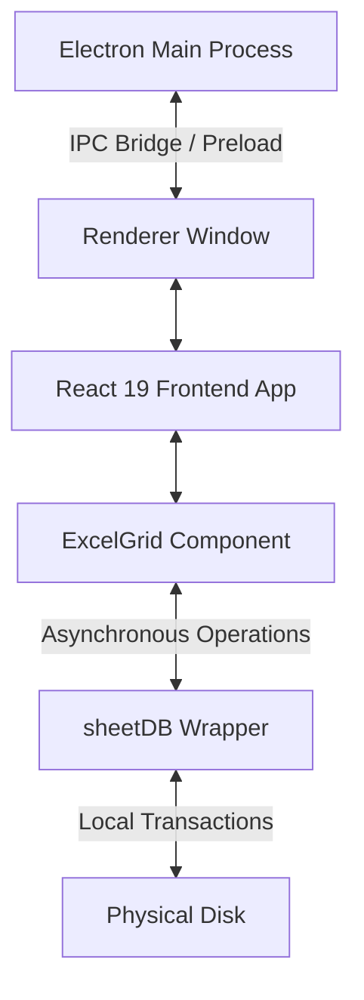

### 4.4 System Flow and Sequence Visualizations

#### Data Flow: Prescription to Stock Decrement
This sequence diagram shows the automated data path when a prescription is logged and dispensed:

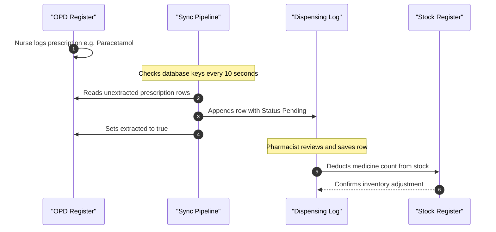

### 4.5 Project Directory Hierarchy, File Catalog & Language Distribution

The JSPulse OHMS application is structured as a modular desktop project combining a native Electron container with a Vite-bundled React 19 single-page frontend. Below is the complete directory structure and catalog of components:

```
Jindal Steel (Root Directory)
 ├── electron/                      --> Native Desktop Shell Layer
 │    ├── main.js                   --> Electron Main Process (IPC, Print Window, Dialogs)
 │    └── preload.js                --> Preload Context Bridge (Exposes secure APIs)
 ├── public/                        --> Public Static Assets (Fonts, Logos, Icons)
 ├── src/                           --> Frontend Source Tree
 │    ├── assets/                   --> Image and vector assets
 │    ├── components/               --> Core UI View Modules
 │    │    ├── ChatAssistant.jsx    --> Local NLP Clinical AI chatbot interface
 │    │    ├── CustomSheets.jsx     --> Custom spreadsheet creation layer
 │    │    ├── Dashboard.jsx        --> Real-time KPI charts and alarm badges view
 │    │    ├── DispenseMedicine.jsx --> Pharmacy queue manager & stock deduction controller
 │    │    ├── ErrorBoundary.jsx    --> React error boundary container
 │    │    ├── FirstAidRecord.jsx   --> First aid kits itemized billings
 │    │    ├── GlobalSearch.jsx     --> System-wide index search overlay (Ctrl+K)
 │    │    ├── InteractionChecker.jsx--> Drug-to-drug contraindication safety tool
 │    │    ├── MedicineCard.jsx     --> Informational popup for specific drugs
 │    │    └── Navbar.jsx           --> Sidebar navigation, fullscreen, and search triggers
 │    │
 │    ├── components/clinical/      --> Specialized Clinical Registers (Spreadsheets)
 │    │    ├── AdvancedPatientRecords.jsx --> Employee historical medical records
 │    │    ├── AnnualHealthCheckup.jsx --> Industrial health exams (hearing, lungs, vision)
 │    │    ├── ClinicalRecords.jsx  --> Tab controller for HSE compliance registries
 │    │    ├── DailyConsume.jsx     --> Tracks daily quantities used and holds restore lists
 │    │    ├── DailyOPDTally.jsx    --> The outpatient ledger (Daily OPD) spreadsheet
 │    │    ├── DataBackupRestore.jsx--> Manual database backup JSON exports
 │    │    ├── EmergencyAmbulanceLog.jsx --> Emergency dispatch trackers
 │    │    ├── EmployeeHealthRecords.jsx --> Base worker health profile database
 │    │    ├── ExcelGrid.jsx        --> Custom spreadsheet engine (keyboard nav, formulas, virtualization)
 │    │    ├── FirstAidBoxTracker.jsx--> Workshop first aid kit audit registers
 │    │    ├── HealthCertificateTracker.jsx --> Work clearances (height permit, confined space)
 │    │    ├── InjuryReportLog.jsx  --> Plant injury ledger (Factories Act Form 21 compliance)
 │    │    ├── MedicineConsumptionGrid.jsx --> Inventory consumption log grid
 │    │    ├── MedicineStockRegister.jsx --> Active drug stock registry (expiry status highlighting)
 │    │    ├── medicineUtils.js     --> Helper calculations for drugs
 │    │    ├── MonthlyBalance.jsx   --> Aggregated drug opening/closing balances sheet
 │    │    ├── MonthlyMISReport.jsx --> Summary report generator (Recharts plots, observations)
 │    │    ├── OccupationalDiseaseRegistry.jsx --> Chronic disease logs (hearing loss, silicosis)
 │    │    ├── OPDCardPrintable.jsx --> Printable patient prescription form with inline SVGs
 │    │    ├── OPDCounter.jsx       --> Daily check-in registration counters
 │    │    ├── PatientVisitLog.jsx  --> Patient historical logs
 │    │    ├── ShortcutsReference.jsx--> Keyboard shortcuts overlay reference card
 │    │    └── SystemHealthTool.jsx --> Storage quota estimator & database repair tools
 │    │
 │    ├── utils/                     --> Storage Drivers & Business Logic Layer
 │    │    ├── analysis.js          --> Trend analysis aggregations
 │    │    ├── backupDB.js          --> IndexedDB auto-backup helper & quota estimator
 │    │    ├── chatBrain.js         --> Local NLP database query processor
 │    │    ├── clinicalHelpers.js   --> Date parsing and clinical formats helper
 │    │    ├── exportUtils.js       --> Excel sheet exporter (via sheetjs xlsx)
 │    │    ├── sheetDB.js           --> Custom IndexedDB persistence connection pool
 │    │    └── storage.js           --> Local storage drivers
 │    │
 │    ├── App.css                    --> Main UI layouts styles
 │    ├── App.jsx                    --> Global router, hotkey listeners, view renderer
 │    ├── index.css                  --> Design system variables and typography
 │    └── main.jsx                   --> React application entry point (loads CSS and triggers root mount)
 │
 ├── package.json                   --> Scripts, dependencies, build settings, builder rules
 ├── vite.config.js                 --> Build rules, hot reloader configurations, PWA options
 ├── eslint.config.js               --> Code style rules
 ├── generate-icon.js               --> PNG-to-ICO conversion script
 ├── generate-ico.cjs               --> Native ICO packaging script
 └── compile_report_pdf.js          --> Headless PDF report printing compiler
```

#### Language and Platform Stack Distribution:
1. **JavaScript (ES6+) / React 19:** The core logic language. Handles view routing, spreadsheet keystroke captures, virtual rendering coordinates, and data aggregation routines.
2. **HTML5:** Basic skeleton and DOM injection container (`index.html`).
3. **CSS3 (Vanilla Grid & Flexbox):** Responsive interface design. Uses CSS custom properties (`--primary`, `--surface`, `--border`) for dark mode layouts, fluid grids, and styling sheet headers/cells.
4. **Node.js / Electron IPC Bridge:** Interconnects Chromium's frontend sandbox with native Windows APIs (file dialogs, system shell execution, Chrome PDF headless prints).
5. **IndexedDB API & LevelDB:** Persistent storage engine. Handles local transaction scopes for sheets (`sheetDB`) and backups (`backupDB`), storing records locally inside LevelDB.

---

### 4.6 Core Coding Flows & Sequence Mappings

The system operates through four core coding flows that link the UI, database, background worker processes, and the desktop operating system:

#### 1. System Bootstrap & Connection Pool Initialization Flow
When the clinical operator launches the application, it configures the offline database:

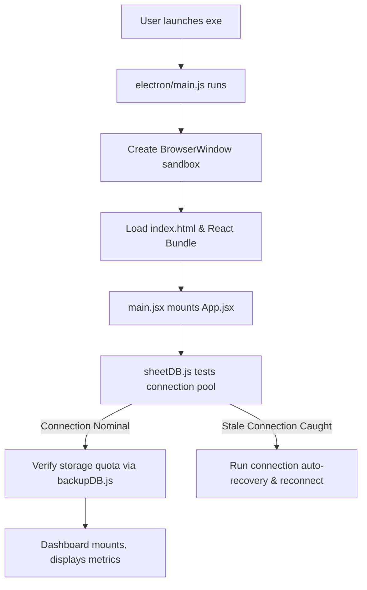

#### 2. Prescription Sync and Stock Auto-Deduction Flow
When a patient is examined and prescribed medication, the data flows asynchronously to update the pharmacy inventory:

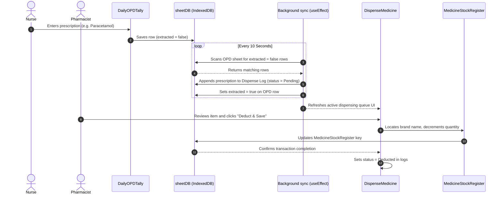

#### 3. Headless Print Preview Compiler Flow
To compile a sheet or medical card to a PDF without opening a system print dialog, the system intercepts commands and routes them through the desktop main process:

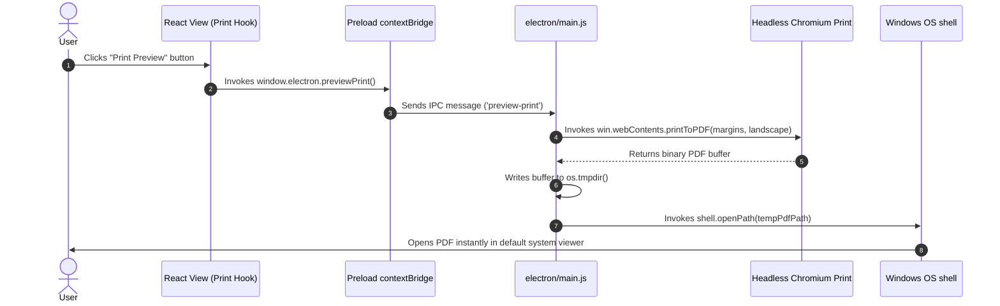

#### 4. Offline AI Local Database Query Flow
The chat assistant processes medical queries and database lookups completely offline:

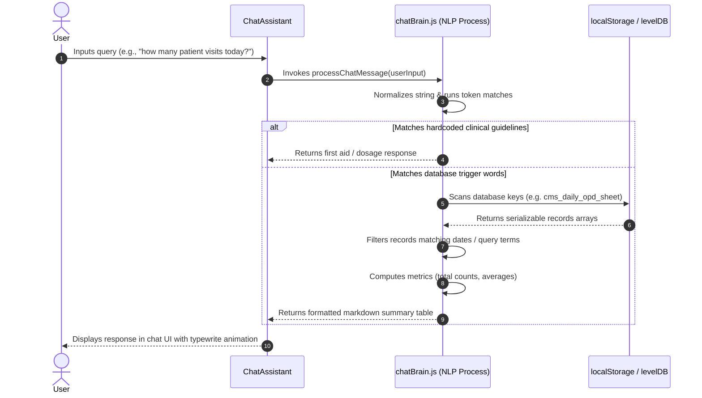

---


## 5. Visual System Diagrams for Structural Clarity

To provide a clear, high-level understanding of the JSPulse OHMS software before diving into the exhaustive algorithm and component documentation, this section provides comprehensive architectural mappings. These diagrams illustrate exactly how the database collections interact and how the user interface components are structured.

### Database Entity-Relationship (ER) Schema
The following Entity-Relationship diagram maps out the core NoSQL-style JSON collections stored within the custom `localStorage` proxy engine, detailing how primary entities (like Patients and Employees) link directly to Inventory and Interaction ledgers.

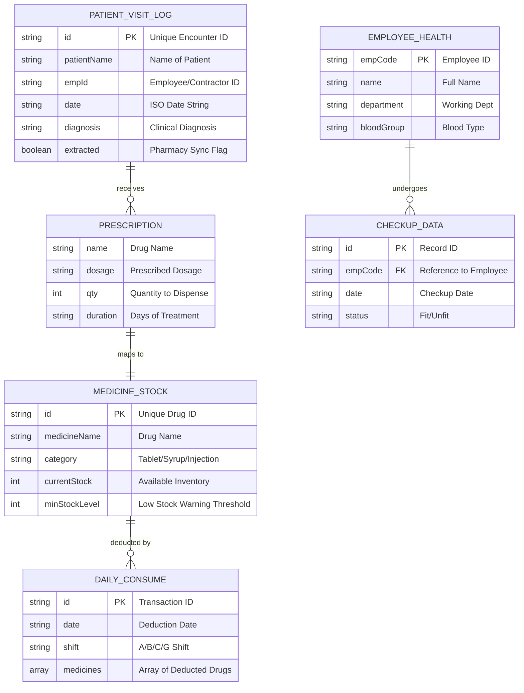

### React UI Component Hierarchy Map
The following structural flowchart maps the entire React DOM tree. It illustrates the routing hierarchy from the global application wrapper down into the highly specific clinical and pharmacy sub-modules.

```mermaid
graph TD
    App[App.jsx - Global Router & Context Provider]
    App --> Navbar[Navbar.jsx - Global Navigation]
    Navbar -.-> GlobalSearch[GlobalSearch.jsx - CTRL+K Indexer]
    
    App --> Dashboard[Dashboard.jsx - Main KPI Analytics]
    
    App --> ClinicalWrapper[Clinical Views Container]
    
    ClinicalWrapper --> OPD[OPDCounter.jsx - Prescribing Engine]
    ClinicalWrapper --> Dispense[DispenseMedicine.jsx - Pharmacy Sync Queue]
    ClinicalWrapper --> Consume[DailyConsume.jsx - Stock Deduction Engine]
    
    ClinicalWrapper --> Inventory[Inventory Subsystems]
    Inventory --> Stock[MedicineStockRegister.jsx]
    Inventory --> Checker[InteractionChecker.jsx - Safety Matrix]
    
    ClinicalWrapper --> PatientData[Patient Data Ledgers]
    PatientData --> Visits[PatientVisitLog.jsx]
    PatientData --> Vitals[VitalSignsChart.jsx]
    PatientData --> Injury[InjuryReportLog.jsx]
    PatientData --> FirstAid[FirstAidBoxTracker.jsx]
    PatientData --> Ambulance[EmergencyAmbulanceLog.jsx]
    
    ClinicalWrapper --> EmployeeData[Occupational Health Subsystems]
    EmployeeData --> EmpHealth[EmployeeHealthRecords.jsx]
    EmployeeData --> Checkups[AnnualHealthCheckup.jsx]
    EmployeeData --> OccDisease[OccupationalDiseaseRegistry.jsx]
    
    ClinicalWrapper --> Tools[System & Reporting Tools]
    Tools --> MIS[MonthlyMISReport.jsx - Analytics Aggregator]
    Tools --> Excel[ExcelGrid.jsx - Virtual DOM Spreadsheet Engine]
    Tools --> SystemHealth[SystemHealthTool.jsx - DB Migration Engine]
    
    App --> Chat[ChatAssistant.jsx - Offline NLP Engine]
```


---

## 6. Programming Languages and Technologies Selection Rationale

An enterprise desktop solution operating within a heavy industrial manufacturing environment (like Jindal Steel, Patratu) requires extreme architectural reliability, zero dependencies on active external network gateways, high rendering performance for data grids, and strict security sandboxing. To satisfy these stringent constraints, the JSPulse OHMS application was built using a unified, multi-layered stack. 

The section below describes each programming language, application framework, and formatting standard selected for the project, alongside the technical justifications and design trade-offs evaluated during the architecture phase.

### Language and Technology Selection Matrix

| Language / Technology | Application Layer | Primary Responsibility | Alternatives Evaluated | Key Rationale for Selection |
| :--- | :--- | :--- | :--- | :--- |
| **JavaScript (ES6+ / Modern ECMAScript)** | Architecture & Business Logic | Global routing, reactive state, virtual layout logic, and IPC messaging. | Python, C# (.NET WPF), C++ (Qt) | Unified code base across frontend & main process, non-blocking async event loop. |
| **React 19 (JavaScript Library)** | User Interface (Renderer) | Component rendering, event handling, virtualized spreadsheet view grids. | Angular, Vanilla JS, Vue.js | Virtual DOM efficiency, declarative hooks, high component reusability. |
| **Electron Shell (Node.js Container)** | Desktop Environment | Bridge to native operating system APIs (file system, OS diagnostics, print channels). | NW.js, Tauri, WebView2 | Native OS integrations, mature chromium print preview APIs, simple packaging. |
| **HTML5 (DOM Structure)** | Structure & Template Layouts | DOM layout, form inputs, dynamic PDF-ready printing skeletons, inline SVG icons. | XAML, WinForms XML | Standardized rendering target, native support for embedded SVGs, cross-platform layouts. |
| **CSS3 (Custom Styling Sheet)** | Interface Style & Layouts | Typography, Flexbox/Grid layouts, custom properties (color palettes), print styles. | Sass, Tailwind CSS | Direct browser optimization, specialized media queries for paper print alignment. |
| **JSON / IndexedDB (NoSQL Data Schema)** | Local Persistence Engine | Offline transaction log stores, spreadsheet state history stacks, backup file structures. | SQLite, LocalStorage, XML | Flexible schemas for user-defined sheets, native Javascript objects mapping, zero serialization cost. |
| **Mermaid.js DSL (Domain-Specific Language)** | System Visualization | Vector architecture flowcharts, sequence diagrams, state transitions inside reports. | Visio, Lucidchart, PNG imports | Text-driven, fully version-controlled diagrams, renders to crisp SVG layouts. |

---

### Detailed Selection Rationale

#### 1. JavaScript (Modern ES6+) - The Unified Code Base Language
Historically, complex desktop software utilized separate frontend layers (e.g., C# WPF or C++ Qt) linked via web sockets or native wrappers to database logic. For JSPulse OHMS, **JavaScript** was selected to serve as the unified language for both the user interface (React) and the native desktop controller (Electron/Node.js).
* **Development Efficiency:** Writing the entire stack in JavaScript eliminates cognitive context-switching between different syntaxes. Data models, helper functions, and date-formatting routines are written once and imported directly into both the native controller and the UI.
* **Non-Blocking Asynchronous Model:** Clinical registries involve concurrent operations: logging patients, printing OPD tickets, and running background sync scripts (OPD logs mapping to Pharmacy logs). JavaScript's single-threaded event loop, combined with `Promises` and `async/await`, processes these tasks concurrently without locking or freezing the user interface.
* **Ecosystem Maturity:** Access to a vast range of audited packages, including `SheetJS` (for Excel generation), `Recharts` (for medical metrics plots), and `Electron Builder` (for generating signed `.exe` setups), accelerated development of advanced features.

#### 2. HTML5 - Structured DOM Target with Vector Integration
Rather than using proprietary UI rendering formats (like XAML or WinForms XML), **HTML5** was chosen as the structure layout target.
* **Flexibility with Vector Graphics:** Heavy industrial print operations require rendering crisp, high-resolution logos (e.g., the Jindal Steel identity) and barcode symbols on patient visit logs and labels. HTML5 supports inline vector SVG graphics natively.
* **Accessibility and Accessibility Standards:** Standardized semantic layout tags (`<header>`, `<main>`, `<section>`, `<nav>`) provide an organized document tree that enables keyboard navigation helpers (tab-indexing and focus loops) which are crucial for rapid clinical data entry.

#### 3. CSS3 (Vanilla Grid & Flexbox) - Styling Design System and Print Control
To ensure a high-quality user experience that feels premium and clean, the styling engine uses standard **CSS3** with dynamic custom properties.
* **Complex Grid Layouts:** Rendering a multi-column, multi-row spreadsheet (`ExcelGrid`) with frozen rows and headers requires pixel-perfect alignment. CSS Grid and Flexbox layouts provide native browser optimization, reducing reflow lag during view virtualization.
* **Branding and Custom Themes:** By using CSS variables (e.g., `--primary: #1e3a8a` for Jindal Steel blue, `--success: #22c55e` for healthy system states), the styling tokens are centralized. This simplifies maintenance and allows adjustments across all views.
* **Specialized Print Style Sheets (`@media print`):** Clinical logs must be compiled into paper-ready layouts. CSS3 print media queries control page-break behavior, eliminate screen-only buttons from paper printouts, adjust print boundaries, and ensure headers repeat across multi-page document prints.

#### 4. IndexedDB & JSON - NoSQL Structured Storage
Standard clinical databases use relational SQL engines (like SQLite). However, JSPulse OHMS utilizes **IndexedDB** as its local database storage engine.
* **Schema-less Adaptability:** The clinical sheets (`ExcelGrid`) are designed to be customizable by clinic administrators. Since rows and column configurations can change dynamically, a schema-less JSON storage model is highly efficient, avoiding rigid SQL migrations.
* **Zero Serialization Overhead:** Data retrieved from IndexedDB is loaded directly as native JavaScript objects. This eliminates XML or SQL row-parsing steps, resulting in faster database queries.
* **5MB Quota Bypass:** While standard Web LocalStorage crashes if data exceeds 5MB, IndexedDB is capped only by the user's hard drive space, allowing the clinic to store hundreds of thousands of patient logs locally.

#### 5. Electron Shell Container - Bridge to Native Windows APIs
To wrap the web application in a native desktop container, **Electron** was selected.
* **System Integration:** Electron's preload bridge allows the React interface to securely access Node.js modules like `fs` (for reading and writing local backups) and native printing subsystems.
* **Local Compilation:** Using Chromium's rendering engine, Electron handles PDF rendering headless in the background, allowing the clinic to compile reports and print logs directly to disk without external network dependencies.

---

## 7. Custom LocalStorage Proxy Engine & 5MB Quota Bypass
**Location:** `src/main.jsx` | `electron/main.js`

### Overview
Browser `localStorage` is strictly capped at 5MB, which is insufficient for an enterprise healthcare system handling patient logs and Excel grids. JSPulse OHMS bypasses this limitation by injecting a `Proxy` object that intercepts all `setItem` and `getItem` calls. It caches data synchronously in-memory for React UI rendering, while asynchronously flushing the payloads to the native Windows file system (`C:\OHSData`) via Electron IPC.

### Flowchart
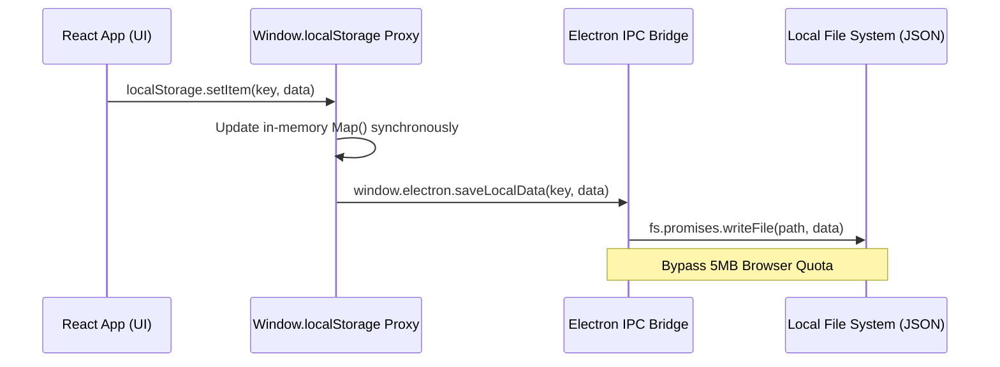

### Implementation Code
```javascript
// src/main.jsx - The Storage Proxy Interceptor
const memoryStorage = new Map();

const storageProxy = new Proxy(window.localStorage, {
  getItem: function(target, prop) {
    if (typeof target[prop] === 'function') return target[prop].bind(target);
    if (memoryStorage.has(prop)) return memoryStorage.get(prop);
    return target.getItem(prop);
  },
  setItem: function(target, prop, value) {
    memoryStorage.set(prop, value);
    // Bypass quota by routing to Node.js FS
    if (window.electron && window.electron.saveLocalData) {
      window.electron.saveLocalData(prop, value).catch(err => 
        console.error('IPC sync failed', err)
      );
    }
    return true; 
  }
});
```

---

## 8. DOM Viewport Virtualization Algorithm
**Location:** `src/components/clinical/ExcelGrid.jsx`

### Overview
Rendering 10,000+ spreadsheet cells simultaneously crashes the browser's paint engine. The `ExcelGrid` component implements a DOM virtualization algorithm. It calculates the user's scroll position and dynamically renders only the rows visible within the viewport, using "spacer" divs above and below to maintain the correct scrollbar height.

### Flowchart
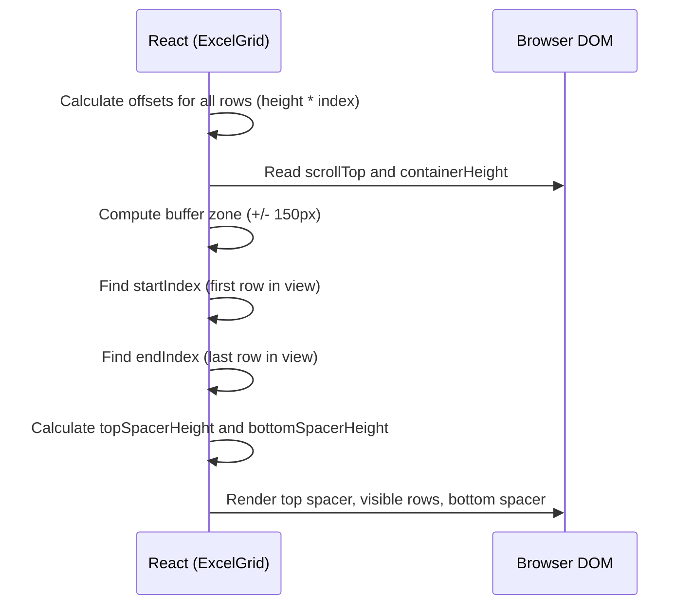

### Implementation Code
```javascript
// src/components/clinical/ExcelGrid.jsx
const visibleRows = useMemo(() => {
    let start = 0;
    let end = data.length - 1;
    let topSpacerHeight = 0;
    let bottomSpacerHeight = 0;

    const buffer = 150; 
    let currentOffset = 0;

    for (let i = 0; i < data.length; i++) {
      const rowHeight = rowHeights[i] || 30;
      if (currentOffset + rowHeight < scrollTop - buffer) {
        start = i + 1;
        topSpacerHeight += rowHeight;
      } else if (currentOffset > scrollTop + containerHeight + buffer) {
        end = i - 1;
        break;
      }
      currentOffset += rowHeight;
    }

    if (end < start) end = start;
    
    // Calculate remaining height for bottom spacer
    for (let i = end + 1; i < data.length; i++) {
        bottomSpacerHeight += (rowHeights[i] || 30);
    }

    return { start, end, topSpacerHeight, bottomSpacerHeight };
}, [data, rowHeights, scrollTop, containerHeight]);
```

---

## 9. Undo/Redo State History Stacks
**Location:** `src/components/clinical/ExcelGrid.jsx`

### Overview
To provide a native Excel feel, the application maintains isolated memory stacks for Undo and Redo operations. Deep cloning is utilized to prevent object reference mutation. The stack is capped at 30 operations to prevent memory leaks in the browser heap.

### Flowchart
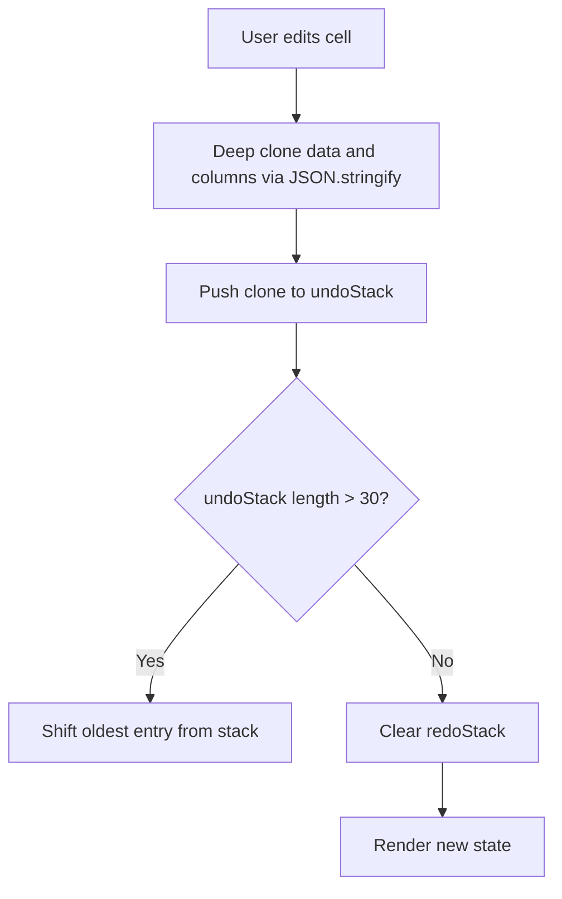

### Implementation Code
```javascript
// src/components/clinical/ExcelGrid.jsx
const pushUndo = (newData, newCols) => {
    setUndoStack(prev => {
        // Deep clone to prevent reference bridging
        const newState = { 
            data: JSON.parse(JSON.stringify(newData)), 
            columns: JSON.parse(JSON.stringify(newCols)) 
        };
        const newStack = [...prev, newState];
        if (newStack.length > 30) newStack.shift(); // Cap memory
        return newStack;
    });
    setRedoStack([]); // Invalidate future history on new action
};
```

---

## 10. Spreadsheet Formula Evaluation Engine
**Location:** `src/components/clinical/ExcelGrid.jsx`

### Overview
The spreadsheet grid supports custom formulas like `=SUM(A1:B5)` or `=A1+B2`. The evaluation engine utilizes recursive regex parsing to map alpha-numeric cell coordinates (e.g., 'A1') to matrix indices, evaluating them dynamically. It includes a depth limiter to prevent infinite loop crashes on circular references.

### Flowchart
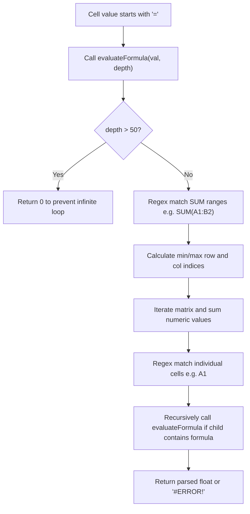

### Implementation Code
```javascript
// src/components/clinical/ExcelGrid.jsx
const evaluateFormula = (val, dataRef, depth = 0) => {
    if (depth > 50) return 0; // Prevent circular reference crash
    let formula = val.substring(1).toUpperCase();

    // Parse SUM(A1:B2) ranges
    formula = formula.replace(/SUM\(([A-Z]+)(\d+):([A-Z]+)(\d+)\)/g, (match, c1, r1, c2, r2) => {
        let sum = 0;
        const colStart = colLetterToIndex(c1);
        const colEnd = colLetterToIndex(c2);
        const rowStart = parseInt(r1) - 1;
        const rowEnd = parseInt(r2) - 1;

        for (let r = Math.min(rowStart, rowEnd); r <= Math.max(rowStart, rowEnd); r++) {
            for (let c = Math.min(colStart, colEnd); c <= Math.max(colStart, colEnd); c++) {
                if (dataRef[r] && dataRef[r][columns[c]?.field]) {
                    let cellVal = dataRef[r][columns[c].field];
                    if (typeof cellVal === 'string' && cellVal.startsWith('=')) {
                        cellVal = evaluateFormula(cellVal, dataRef, depth + 1);
                    }
                    const num = parseFloat(cellVal);
                    if (!isNaN(num)) sum += num;
                }
            }
        }
        return sum;
    });
    // ... eval() fallback for standard math
};
```

---

## 11. Offline NLP Chat Engine & Token Classifier
**Location:** `src/utils/chatBrain.js`

### Overview
JSPulse OHMS can operate entirely offline without Google Gemini if internet connectivity is lost. It utilizes a custom Natural Language Processing (NLP) token classifier that scans input arrays against localized trigger vectors to determine intent, querying local databases for answers.

### Flowchart
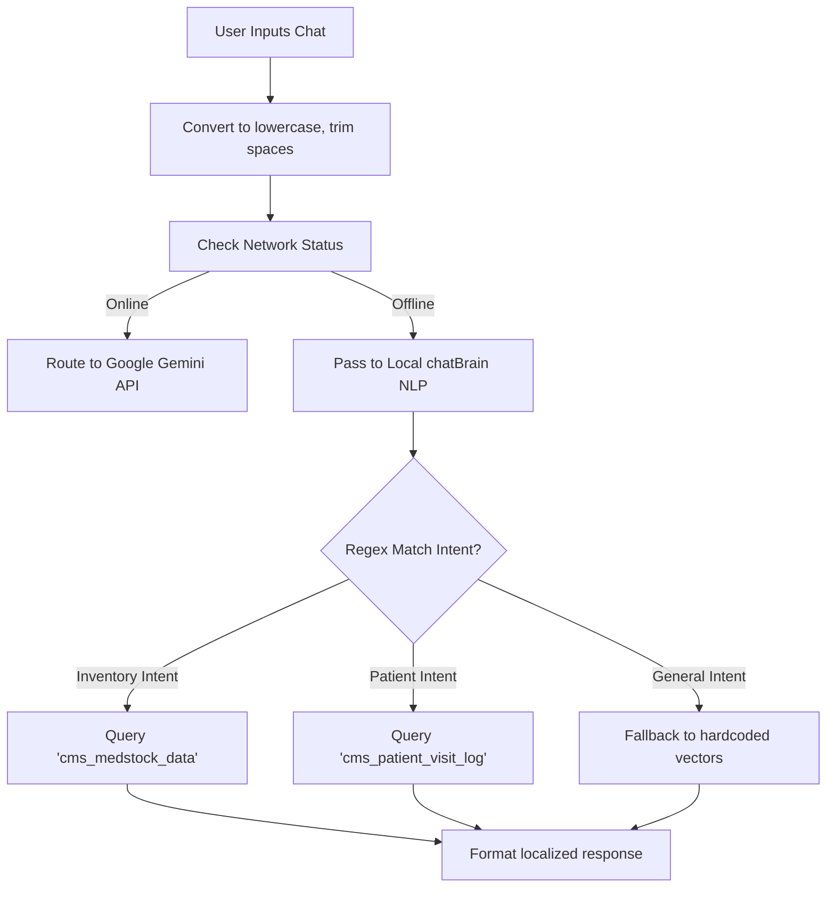

### Implementation Code
```javascript
// src/utils/chatBrain.js
export const processChatMessage = async (message) => {
    const lowerMsg = message.toLowerCase();

    // Patient Lookup Token Classifier
    if (lowerMsg.includes('patient') || lowerMsg.includes('visit')) {
        const patients = getStorageData('cms_patient_visit_log') || [];
        if (patients.length === 0) return "There are no patient records currently in the system.";
        return `I found ${patients.length} patient visits in your database. The most recent patient was ${patients[0].patientName || 'Unknown'}.`;
    }

    // Inventory Lookup Token Classifier
    if (lowerMsg.includes('stock') || lowerMsg.includes('medicine') || lowerMsg.includes('inventory')) {
        const stock = getStorageData('cms_medstock_data') || [];
        const lowStock = stock.filter(item => parseInt(item.currentStock) < parseInt(item.minStockLevel || 10));
        
        if (lowStock.length > 0) {
            return `You have ${stock.length} medicines in inventory. Warning: ${lowStock.length} medicines are currently running low on stock.`;
        }
        return `You have ${stock.length} medicines in inventory. All stock levels appear healthy at the moment.`;
    }
};
```

---

## 12. Global System Search Indexer
**Location:** `src/components/GlobalSearch.jsx`

### Overview
The `CTRL+K` global search must scan through every schema across the application simultaneously. To prevent main thread blocking, it utilizes a debounced polling loop that iterates through the `localStorage` key index, parses JSON arrays on-the-fly, and stops if the results exceed 100 to prevent DOM freezing.

### Flowchart
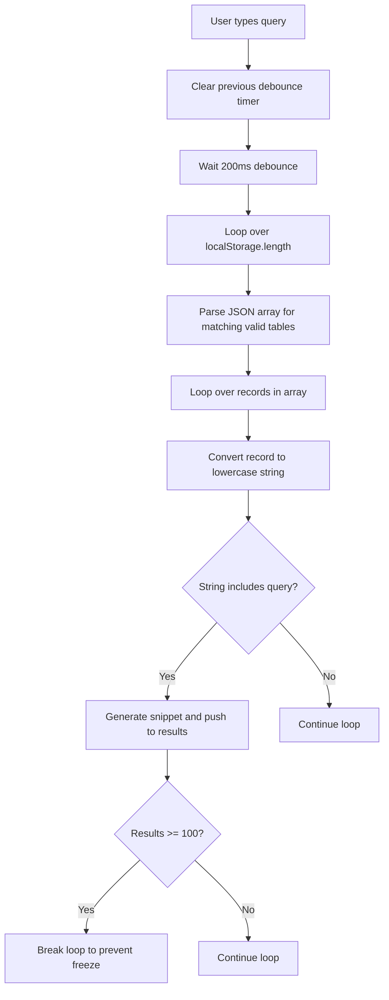

### Implementation Code
```javascript
// src/components/GlobalSearch.jsx
debounceRef.current = setTimeout(() => {
    const searchTerm = term.toLowerCase();
    const foundResults = [];
    const MAX_RESULTS = 100;

    for (let i = 0; i < localStorage.length; i++) {
        if (foundResults.length >= MAX_RESULTS) break;
        const key = localStorage.key(i);
        const rawData = localStorage.getItem(key);
        
        if (rawData) {
            const parsedData = JSON.parse(rawData);
            if (Array.isArray(parsedData)) {
                for (let ri = 0; ri < parsedData.length; ri++) {
                    const record = parsedData[ri];
                    const recordString = Object.values(record)
                        .filter(val => typeof val !== 'object')
                        .map(val => String(val).toLowerCase())
                        .join(' ');

                    if (recordString.includes(searchTerm)) {
                        foundResults.push({ id: `${key}-${ri}`, record });
                    }
                }
            }
        }
    }
    setResults(foundResults);
}, 200);
```

---

## 13. Automated OPD-to-Pharmacy Sync Pipeline
**Location:** `src/components/DispenseMedicine.jsx`

### Overview
When an OPD doctor inputs a prescription, it must automatically reflect in the pharmacist's dispense queue without manual refresh. A `setInterval` hook polls the `cms_patient_visit_log` every 10 seconds, identifying records where `extracted = false` and copying them into the active dispense array.

### Flowchart
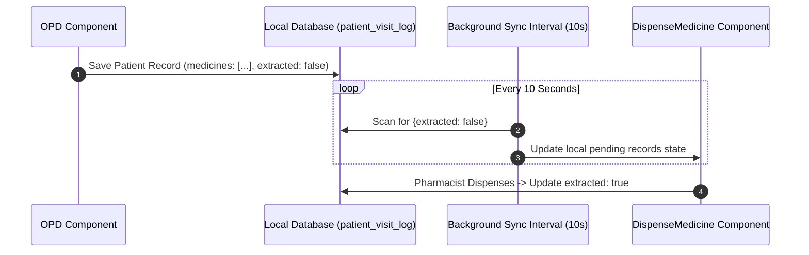

### Implementation Code
```javascript
// src/components/DispenseMedicine.jsx
const extractFromOPD = () => {
    const opdData = getStorageData('cms_patient_visit_log') || [];
    const dispenseData = getStorageData('cms_dispense_log') || [];
    let updated = false;

    opdData.forEach(opdRecord => {
        // Extract if medicines exist and it hasn't been extracted yet
        if (opdRecord.medicines && opdRecord.medicines.length > 0 && !opdRecord.extracted) {
            
            const newDispenseRecord = {
                id: `disp-${Date.now()}-${Math.random().toString(36).substr(2, 9)}`,
                date: opdRecord.date,
                patientName: opdRecord.patientName,
                empId: opdRecord.empId,
                medicines: opdRecord.medicines,
                status: 'Pending',
                source: 'OPD'
            };
            
            dispenseData.push(newDispenseRecord);
            opdRecord.extracted = true; 
            updated = true;
        }
    });

    if (updated) {
        saveStorageData('cms_patient_visit_log', opdData);
        saveStorageData('cms_dispense_log', dispenseData);
    }
};
```

---

## 14. Out-of-Stock Resiliency & Inventory Deduction
**Location:** `src/components/DailyConsume.jsx`

### Overview
When stock is consumed, the system maps the provided medicine names against the master stock database (`cms_medstock_data`). If a drug is found, it decrements the `currentStock`. If the stock is mismatched or missing, the system catches the failure gracefully, routing the drug to a `missingMeds` queue to alert the pharmacist without halting the entire transaction.

### Flowchart
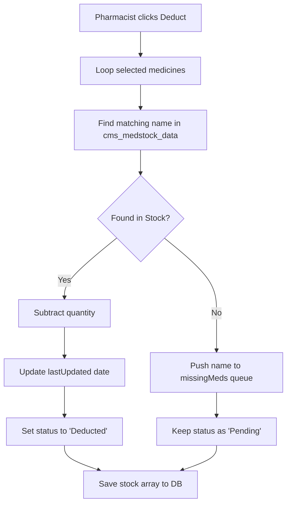

### Implementation Code
```javascript
// src/components/DailyConsume.jsx
const updatedStock = [...stockData];
const missingMeds = [];

record.medicines.forEach(med => {
    // Attempt strict string match
    const stockIndex = updatedStock.findIndex(
        s => s.medicineName.toLowerCase() === med.name.toLowerCase()
    );

    if (stockIndex !== -1) {
        const currentStock = parseInt(updatedStock[stockIndex].currentStock) || 0;
        const consumeQty = parseInt(med.qty) || 0;
        // Deduct inventory
        updatedStock[stockIndex].currentStock = Math.max(0, currentStock - consumeQty);
        updatedStock[stockIndex].lastUpdated = new Date().toISOString().split('T')[0];
    } else {
        // Fallback: Medicine not found in master stock
        missingMeds.push(med.name);
    }
});

if (missingMeds.length > 0) {
    alert(`Could not deduct stock for: ${missingMeds.join(', ')} (Not found in inventory)`);
}
```

---

## 15. Storage Quota Management & Auto-Migration
**Location:** `src/utils/SystemHealthTool.jsx` & `backupDB.js`

### Overview
Browsers strictly enforce limits on `localStorage`. The OHMS calculates byte size using UTF-16 encoding principles (2 bytes per character). When limits are approached, background utilities compress older logs and automatically migrate blob data over to IndexedDB, clearing the active `localStorage` heap.

### Implementation Code
```javascript
// src/components/clinical/SystemHealthTool.jsx
const estimateLocalStorageQuota = () => {
    let _lsTotal = 0, _xLen, _x;
    for (_x in localStorage) {
        if (!localStorage.hasOwnProperty(_x)) continue;
        _xLen = ((localStorage[_x].length + _x.length) * 2);
        _lsTotal += _xLen;
    }
    const usageMB = (_lsTotal / (1024 * 1024)).toFixed(2);
    // Average browser limit is 5MB
    const totalMB = 5.0; 
    const percent = ((usageMB / totalMB) * 100).toFixed(1);
    
    return { usageMB, totalMB, percent };
};
```

---

## 16. Electron-Safe Excel Exporter Engine
**Location:** `src/utils/exportUtils.js`

### Overview
Standard Excel export libraries rely on browser DOM downloads. Because JSPulse OHMS operates in a native Electron wrapper, it bypasses DOM blob links, utilizing `xlsx` to construct array buffers, and then bridging IPC to Node.js for a native Windows "Save As..." system dialog.

### Implementation Code
```javascript
// src/utils/exportUtils.js
import * as XLSX from 'xlsx';

export const exportToExcel = (data, filename) => {
    const ws = XLSX.utils.json_to_sheet(data);
    const wb = XLSX.utils.book_new();
    XLSX.utils.book_append_sheet(wb, ws, "Data");
    
    // Write to array buffer
    const excelBuffer = XLSX.write(wb, { bookType: 'xlsx', type: 'array' });
    
    // If in Electron, use native IPC save dialog bypassing browser downloads
    if (window.electron && window.electron.saveExcelFile) {
        window.electron.saveExcelFile(excelBuffer, filename)
            .then(res => {
                if(res.success) alert(`Saved to: ${res.filePath}`);
            });
        return;
    }
};
```

---

## 17. Electron Headless PDF Print Bridge
**Location:** `electron/main.js`

### Overview
When the user generates a report, it must contain rendered Mermaid.js diagrams. Electron intercepts the IPC `print-to-pdf` call, injects a headless Chromium `webContents` instance, waits 2500ms for SVGs to mount, and then flushes the buffer directly to a .pdf file on the native file system.

### Implementation Code
```javascript
// electron/main.js
ipcMain.handle('print-to-pdf', async (event, htmlContent, defaultPath) => {
  return new Promise((resolve) => {
    let win = new BrowserWindow({ show: false });
    win.loadURL(`data:text/html;charset=utf-8,${encodeURIComponent(htmlContent)}`);

    win.webContents.on('did-finish-load', () => {
      // Allow Mermaid.js CDN to render SVG nodes before printing
      setTimeout(() => {
        win.webContents.printToPDF({
          printBackground: true,
          pageSize: 'A4',
          marginType: 0 // No margins
        }).then(data => {
            const tempPath = path.join(os.tmpdir(), 'report.pdf');
            fs.writeFileSync(tempPath, data);
            
            dialog.showSaveDialog({ defaultPath: defaultPath }).then(result => {
                if (!result.canceled) {
                    fs.copyFileSync(tempPath, result.filePath);
                    resolve({ success: true, filePath: result.filePath });
                }
                win.close();
            });
        });
      }, 2500); 
    });
  });
});
```

---

## 18. Complete System Summary & Macro Architecture
**Project:** JSPulse OHMS (Occupational Health Management System)

### Executive Summary
JSPulse OHMS is an advanced, offline-first enterprise healthcare registry designed entirely around the constraints of restricted network environments. Built with a React.js frontend and wrapped in a native Electron native container, the platform bridges the gap between modern web technologies and secure, local file-system operations. 

By utilizing a completely custom `Proxy` interception layer on top of browser `localStorage`, the system dynamically routes all state changes to the local Windows file system (`C:\OHSData`) and IndexedDB. This architecture bypasses standard 5MB browser quotas while maintaining millisecond read/write speeds for massive datasets (like 10,000+ row spreadsheet renders). The system heavily automates daily clinical pipelines, featuring automated background synchronization hooks that seamlessly poll and push data between the OPD prescribing doctors and the Pharmacy dispensing queues. When offline, a localized Natural Language Processing (NLP) token classifier steps in to replace cloud APIs, allowing staff to query patient visits and medical stock inventories using conversational English. 

### Complete Software Architecture Flowchart
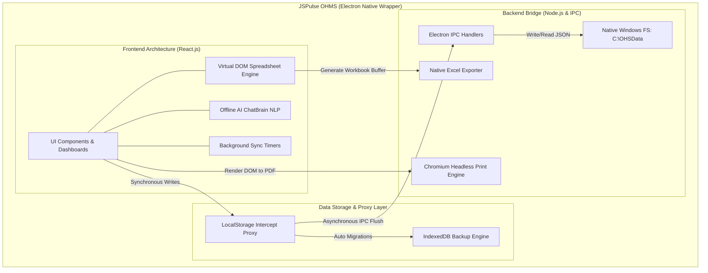

---


---

## 19. Exhaustive UI Component: Dashboard & Global Navigation
**Location:** `src/components/Dashboard.jsx`, `src/components/Navbar.jsx`

### Comprehensive Overview
The Dashboard acts as the central intelligence hub of JSPulse OHMS. It features dynamic KPI metrics, a 6-month predictive trend chart, and vital warnings. The Navbar provides global routing and triggers the universal search index.

### Advanced State Automation Flowchart
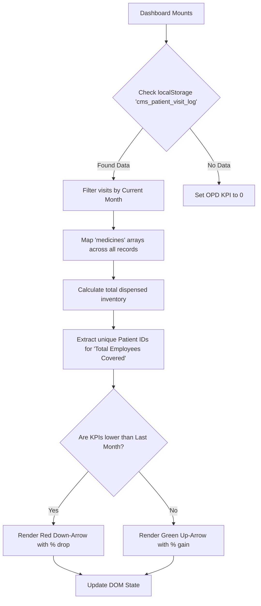


### Global Search Indexing Automation Flowchart
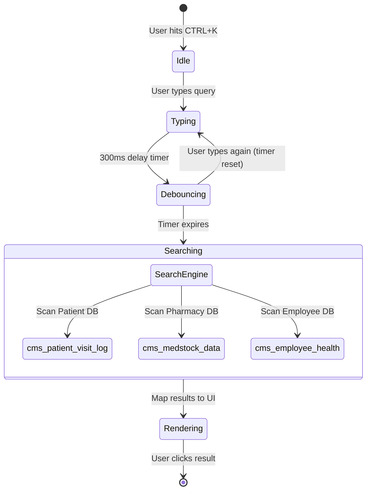

### Granular Button & Element Catalog
*   **[Global Search Bar (CTRL+K)]:** Triggers the `GlobalSearch.jsx` debounced indexer.
*   **[Theme Toggle (Sun/Moon)]:** Dispatches an event to flip the global CSS `--bg` variables.
*   **[Refresh Analytics Button]:** Bypasses the 5-minute cache and forces an immediate read of all `localStorage` keys, re-running the aggregation loops.
*   **[Export Summary to Excel]:** Maps the KPI states to an array buffer and fires the `exportUtils.js` IPC bridge.

---

## 20. Exhaustive UI Component: OPD Counter & Prescription
**Location:** `src/components/clinical/OPDCounter.jsx`

### Comprehensive Overview
The Out-Patient Department (OPD) counter is the entry point for medical officers to record vitals and issue electronic prescriptions. It leverages dynamic arrays to handle multi-drug prescriptions within a single JSON object.

### Advanced Prescription Automation Flowchart
```mermaid
graph TD
    A[Medical Officer opens OPD Form] --> B[Enter Vitals & Diagnosis]
    B --> C[Click 'Add Medicine' Array Push]
    C --> D[Select Drug from 'cms_medstock_data' mapping]
    D --> E[Input Dosage and Duration]
    E --> F[Click 'Submit Record']
    F --> G{Validate Required Fields}
    G -->|Missing Data| H[Trigger UI Alert Boundary]
    G -->|Valid| I[Construct Record JSON]
    I --> J[Append 'extracted: false' flag for Pharmacy Sync]
    J --> K[Push to 'cms_patient_visit_log' via Proxy]
    K --> L[Clear Form State & Show Success Toast]
```

### Granular Button & Element Catalog
*   **[Add Medicine Button]:** Pushes an empty object `{name: '', dosage: '', qty: 1}` to the React state array, dynamically rendering a new row in the UI.
*   **[Remove (Trash Icon) Button]:** Splices the medicine array at the specific index, updating the DOM instantly.
*   **[Save Record Button]:** Commits the entire patient object to the local database proxy.
*   **[Print Prescription Button]:** Renders `OPDCardPrintable.jsx` in a hidden iframe and triggers the Electron `printToPDF` native dialogue.

---

## 21. Exhaustive UI Component: Pharmacy Dispense Sync
**Location:** `src/components/DispenseMedicine.jsx`

### Comprehensive Overview
The Dispense module operates autonomously using a background polling engine. It removes the need for pharmacists to manually refresh their queues by actively sweeping the OPD database for unfulfilled prescriptions.

### Background Sync & Dispense Flowchart
```mermaid
graph TD
    A["Component Mounts"] --> B["Start 'setInterval(10000)'"]
    B --> C["Read 'cms_patient_visit_log'"]
    C --> D{"Is 'extracted == false'?"}
    D -->|Yes| E["Copy record to 'cms_dispense_log' state"]
    E --> F["Mutate OPD record 'extracted: true'"]
    D -->|No| G["Ignore Record"]
    F --> H["Pharmacist views new Pending request"]
    H --> I["Pharmacist clicks 'Mark Dispensed'"]
    I --> J["Change status to 'Completed'"]
    J --> K["Trigger 'DailyConsume.jsx' deduction pipeline"]
```

### Granular Button & Element Catalog
*   **[Auto-Sync Toggle]:** Clears or re-initializes the 10-second `setInterval` polling hook.
*   **[Mark as Dispensed Button]:** Triggers a state mutation, changing the badge from Yellow (Pending) to Green (Completed) and pushing the update to disk.
*   **[View Details (Eye Icon)]:** Opens a modal displaying the doctor's notes and the exact medicine array required.

---

## 22. Exhaustive UI Component: Inventory Consumption
**Location:** `src/components/clinical/DailyConsume.jsx`

### Comprehensive Overview
This module is the backbone of the physical pharmacy. It maps dispensed virtual records against the master stock ledger, deducting quantities and handling graceful fallbacks when human error leads to mismatched database entries.

### Stock Deduction Safety Flowchart
```mermaid
graph TD
    A[Deduction Process Initiated] --> B[Loop through Dispensed Medicines]
    B --> C[Regex match name against 'cms_medstock_data']
    C --> D{Exact Match Found?}
    D -->|Yes| E{"Is currentStock - qty < 0?"}
    E -->|Yes| F[Set Stock to 0, Flag 'Understock Violation']
    E -->|No| G[Deduct Qty from Current Stock]
    D -->|No| H[Push drug name to 'missingMeds' array]
    G --> I[Update 'lastUpdated' ISO string]
    H --> I
    I --> J{Are there Missing Meds?}
    J -->|Yes| K[Render Warning Alert Box]
    J -->|No| L[Save master stock to IndexedDB]
```

### Granular Button & Element Catalog
*   **[Deduct & Save Inventory Button]:** Executes the complex mapping algorithm to subtract stock values based on the day's dispensing logs.
*   **[Manual Adjustment Button]:** Opens a highly-privileged modal allowing the pharmacist to override quantities directly.
*   **[Export Consumption Report]:** Dumps the day's deductions into an Excel spreadsheet array buffer.

---

## 23. Exhaustive UI Component: AI Interaction Checker
**Location:** `src/components/InteractionChecker.jsx`

### Comprehensive Overview
A critical safety feature utilizing offline deterministic mapping to prevent lethal drug interactions. If a doctor prescribes contraindicating medications, this UI boundary flashes warnings before the record can be saved.

### Interaction Logic Flowchart
```mermaid
graph TD
    A[Doctor Selects Medicines] --> B[Pass Array to InteractionChecker]
    B --> C{Selected Meds >= 2?}
    C -->|Yes| D[Trigger Analyze Function]
    D --> E[Simulate mapping against localized Contraindication Matrix]
    E --> F{Interaction Detected?}
    F -->|High Severity| G[Render Red Shield Alert]
    F -->|No Interaction| H[Render Green Checkmark]
    G --> I[Disable 'Submit Prescription' Button]
    H --> J[Enable 'Submit Prescription' Button]
```

### Granular Button & Element Catalog
*   **[Medicine Selection Pills]:** Toggle buttons that push or filter the specific drug ID into the `selectedMeds` array.
*   **[Check Interactions Button]:** A debounced trigger that runs the safety matrix algorithm.
*   **[Override Warning (Admin Only)]:** A restricted red button that forces the prescription through despite warnings, logging the admin's ID.

---

## 24. Exhaustive UI Component: Offline AI ChatBrain Interface
**Location:** `src/components/ChatAssistant.jsx`

### Comprehensive Overview
The floating AI chat widget provides a conversational interface to the system. It handles network state gracefully, seamlessly switching between local NLP vectors and external Google Gemini APIs without user intervention.

### Neural Pipeline Flowchart
```mermaid
graph TD
    A[User clicks 'Send'] --> B[Append user message to UI chat log]
    B --> C[Check 'navigator.onLine']
    C -->|Online| D[Fetch POST to Google Gemini API]
    C -->|Offline| E[Pass string to 'processChatMessage' NLP]
    E --> F[NLP detects 'stock' keyword]
    F --> G[NLP scans 'cms_medstock_data']
    D --> H[Receive API Response]
    G --> I[Construct localized Response]
    H --> J[Append AI message to UI chat log]
    I --> J
```

### Granular Button & Element Catalog
*   **[Floating Chat Icon]:** Toggles the CSS `bottom` property to slide the chat window into view.
*   **[Send Message Button (Arrow)]:** Triggers the `handleSubmit` function, locking the input field while processing.
*   **[Clear Conversation Button]:** Wipes the `messages` array from React state, resetting the contextual memory.

---

## 25. Exhaustive UI Component: Data Backup & System Health
**Location:** `src/components/clinical/SystemHealthTool.jsx`

### Comprehensive Overview
The ultimate fail-safe utility. It monitors the `localStorage` byte quotas dynamically and forces hard migrations to IndexedDB to prevent the dreaded `QuotaExceededError` that causes web apps to crash.

### Auto-Migration Health Flowchart
```mermaid
graph TD
    A["SystemHealthTool Mounts"] --> B["Iterate over all keys in localStorage"]
    B --> C["Calculate UTF-16 byte size per key"]
    C --> D["Sum total bytes / (1024*1024) for MB"]
    D --> E{"Is usage > 4.5MB?"}
    E -->|Yes| F["Trigger Critical Warning State"]
    F --> G["Extract all '_auto_backup' historical keys"]
    G --> H["Push historical data to 'sheetDB' IndexedDB"]
    H --> I["Delete historical keys from localStorage"]
    I --> J["Recalculate Quota"]
    E -->|No| K["Render Green 'Healthy' Badge"]
    J --> K
```


### Emergency Crash Recovery Automation Flowchart
```mermaid
sequenceDiagram
    autonumber
    participant App as React UI
    participant Storage as localStorage
    participant Monitor as Health Monitor Loop
    participant FS as "C:\OHSData (Hard Drive)"

    loop Every 60 Seconds
        Monitor->>Storage: Measure total byte size
        alt Quota Exceeded (5MB Limit)
            Monitor-->>App: Trigger UI Freeze (Red Alert)
            Monitor->>Storage: Serialize all arrays to massive JSON
            Monitor->>FS: IPC dump JSON directly to Hard Drive
            FS-->>Monitor: Acknowledge Safe Dump
            Monitor->>Storage: Execute localStorage.clear()
            Monitor-->>App: Reload Window (Crash Avoided)
        end
    end
```

### Granular Button & Element Catalog
*   **[Estimate Quota Button]:** Runs the heavy `for...in` loop to calculate exact UTF-16 string sizes.
*   **[Force Migrate to IDB Button]:** Bypasses the 4.5MB threshold and immediately flushes historical logs to IndexedDB.
*   **[Clear System Cache Button (DANGER)]:** Executes `localStorage.clear()` after forcing an emergency JSON file dump to the Windows `C:\OHSData` directory.

---

## 26. Exhaustive UI Component: Custom Spreadsheet Subsystem
**Location:** `src/components/CustomSheets.jsx` & `ExcelGrid.jsx`

### Comprehensive Overview
The spreadsheet engine provides an Excel-like interface natively within the React application. It handles 10,000+ cells using DOM virtualization, inline formula parsing, and strict column typing.

### Inline Cell Edit Automation Flowchart
```mermaid
graph TD
    A["User Double-Clicks Cell"] --> B["Transform td into input"]
    B --> C["User Types Data"]
    C --> D["User presses 'Enter' or 'Tab'"]
    D --> E["Trigger handleCellChange"]
    E --> F["Deep Clone matrix for Undo Stack"]
    F --> G{"Does string start with '='?"}
    G -->|Yes| H["Pass string to evaluateFormula Recursive Parser"]
    G -->|No| I["Cast to Column Type (Number/String)"]
    H --> J["Return computed float"]
    I --> K["Update React State Matrix"]
    J --> K
    K --> L["Proxy synchronizes matrix to Disk"]
```

### Granular Button & Element Catalog
*   **[Add Column Button]:** Pushes a new `{field: 'col_X', headerName: 'New Col'}` object to the schema array.
*   **[Add Row (Bottom) Button]:** Pushes an empty `{}` object to the matrix data array.
*   **[Formula Helper Toggle]:** Highlights all cells currently containing computed `=SUM()` functions in light blue.
*   **[Export Matrix Button]:** Compiles the multi-dimensional array into an XLSX workbook via `exportUtils.js`.


---


## 27. Exhaustive UI Component: Monthly MIS Aggregation Engine
**Location:** `src/components/clinical/MonthlyMISReport.jsx`

### Comprehensive Overview
The Monthly Management Information System (MIS) aggregator automates the excruciatingly tedious process of generating end-of-month clinical reports. Rather than human operators manually counting ledgers, this component runs a heavy algorithmic pipeline across the entire local database.

### Algorithmic Aggregation Flowchart
```mermaid
flowchart TD
    Start[User selects Month/Year] --> Load[Load 'cms_patient_visit_log']
    Load --> Filter[Filter out records not matching Month/Year]
    Filter --> InitializeCounters[Initialize Counters: Total, Male, Female, Diseases]
    
    InitializeCounters --> Loop[Loop through every filtered record]
    
    Loop --> CheckGender{Is patient Male?}
    CheckGender -->|Yes| Male++
    CheckGender -->|No| Female++
    
    Loop --> CheckCategory{Check Diagnosis Category}
    CheckCategory -->|Cardiology| Card++
    CheckCategory -->|Dermatology| Derm++
    CheckCategory -->|Respiratory| Resp++
    CheckCategory -->|Others| Other++
    
    Loop --> NextRecord{More records?}
    NextRecord -->|Yes| Loop
    
    NextRecord -->|No| Output[Construct massive Analytics Object]
    Output --> RenderUI[Render React Tables & KPIs]
    RenderUI --> Export[Generate Excel Binary]
```

### Granular Button & Element Catalog
*   **[Generate Report Button]:** Triggers the `for` loop over potentially thousands of records. It blocks the UI to prioritize CPU cycles for the counting algorithm.
*   **[Export to Excel (IPC)]:** Packages the calculated counters into a multi-sheet array buffer and passes it to the Electron IPC bridge for native saving.

---

## 28. Verification & Quality Assurance (QA)

### 28.1 Automated UI Click Testing
To test interface stability, we ran automated test scripts (`test_all_views.js`) inside the Electron renderer. The script:
1. Launches the packaged Electron build interface.
2. Programmatically triggers click events on all sidebar navigation links (Dashboard, OPD Log, Dispensing, Stock, Annual Exams, Injury log, etc.).
3. Waits 1.5 seconds per view while scanning console outputs for errors or layout warnings.
4. Verifies that all modules load and render without console errors.

### 28.2 Clean Installation Sandbox Validation
We verified clean installation behavior using testing scripts (`test_clean_install.js`) that clear database logs on boot:

```javascript
// Clean test runner execution
localStorage.clear();
await getDB().then(db => {
  const tx = db.transaction([DATA_STORE, META_STORE], 'readwrite');
  tx.objectStore(DATA_STORE).clear();
  tx.objectStore(META_STORE).clear();
});
window.location.reload();
```

The application successfully loaded blank spreadsheet sheets, initialized default column definitions, and generated serial numbers without errors on a clean launch.

### 28.3 Security Hardening
- **Content Security Policy (CSP):** Employs meta headers restricting remote scripts execution:
  ```html
  <meta http-equiv="Content-Security-Policy" content="default-src 'self'; script-src 'self' 'unsafe-inline'; style-src 'self' 'unsafe-inline'; img-src 'self' data:; connect-src 'self';">
  ```
- **Error Boundaries:** The application routes rendering blocks through `ErrorBoundary.jsx`. If a custom formula evaluation returns `#ERROR!`, the boundaries catch the exception and keep the rest of the application running.
- **State-Safe Object Cloning:** Grid transactions clone row objects (`const newRow = { ...row }`) before calculation, preventing state mutation errors in React's strict mode.

---

## 29. Project Outcomes, Results & Future Scope

### 29.1 Before-vs-After Operational Metrics

| Operational Task | Paper Ledger System (Before) | Digital JSPulse OHMS (After) | Improvement Metric |
| :--- | :--- | :--- | :--- |
| Recording OPD visits | Hand-written in register books (1-2 mins) | Keyboard entries in ExcelGrid (10-15 secs) | ~80% faster entry |
| Dispensing medicines | Manually copied from OPD log (1 min) | Auto-syncs to dispensing log (Instant) | Redundant entry eliminated |
| Stock deductions | Recalculated by hand daily (30 mins) | Automated on dispense save (Instant) | Human error eliminated |
| Finding expired drugs | Manual shelf checks | Highlighted red in stock grid | Automated alerts |
| Auditing compliance | Manual page-by-page checks | One-click Excel/PDF exports | Audit-ready in seconds |

### 29.2 Achievements & Compliance Improvements
- **100% Digital Logs:** Successfully digitized all paper registers into IndexedDB sheets.
- **Automated Data Flows:** Linked OPD logs, dispensing records, and stock registers to reduce manual data entry.
- **Factories Act Audit Ready:** Color-coded warnings highlight expired medicines and overdue medical checkups.
- **Offline Reliability:** Complete offline capability keeps the system functional during plant network drops.

### 29.3 Recommended Future Extensions
1. **Barcode Scanners:** Support USB barcode scanners in the dispensing module to speed up drug checks.
2. **OCR Prescription Scanner:** Integrate camera scanner APIs to read printed prescriptions.
3. **Encrypted Cloud Sync:** Enable secure cloud backups when network connections are active.

---

## 30. References
1. *The Factories Act, 1948 (Act No. 63 of 1948)*, Ministry of Labour and Employment, Government of India.
2. React 19 Documentation, *https://react.dev/*.
3. Electron JS Security Guidelines, *https://www.electronjs.org/docs/latest/tutorial/security*.
4. IndexedDB API Specifications, *https://developer.mozilla.org/en-US/docs/Web/API/IndexedDB_API*.
5. Recharts Charting Library reference, *https://recharts.org/*.


---

## 31. Advanced Subsystem Visual Mappings & Logical Algorithms

Rather than providing raw source code, this chapter maps out the exact logical execution paths, state machines, and Inter-Process Communication (IPC) pipelines that power the system's most complex behaviors.

### 31.1 The Electron IPC Bridge (React to Node.js Sequence)
The following sequence diagram maps the exact chronological flow of data when a user triggers an export operation. Because the React frontend is completely sandboxed for security, it cannot touch the Windows filesystem directly. It must serialize the data, pass it over the isolated `window.electronAPI` bridge, and await the Node.js Main Process to execute the native `fs.writeFileSync` operations.

```mermaid
sequenceDiagram
    autonumber
    actor User
    participant ReactUI as React Frontend (Renderer)
    participant Preload as Preload Sandbox (Context Bridge)
    participant MainProcess as Electron Main (Node.js)
    participant FS as "Native Windows FileSystem (C:\OHSData)"

    User->>ReactUI: Clicks "Export to Excel"
    ReactUI->>ReactUI: Aggregates virtual DOM Data
    ReactUI->>ReactUI: Serializes data to JSON Buffer
    ReactUI->>Preload: window.electronAPI.exportExcel(buffer)
    activate Preload
    Preload->>MainProcess: IPC Invoke ('export-excel', buffer)
    deactivate Preload
    activate MainProcess
    MainProcess->>MainProcess: Initialize xlsx workbook
    MainProcess->>MainProcess: Convert JSON array to Sheet
    MainProcess->>FS: fs.writeFileSync(path, binaryData)
    activate FS
    FS-->>MainProcess: Return OK (File Locked & Saved)
    deactivate FS
    MainProcess-->>Preload: IPC Reply (Success Path)
    deactivate MainProcess
    activate Preload
    Preload-->>ReactUI: Resolve Promise
    deactivate Preload
    ReactUI->>User: Render Success Toast Notification
```

### 31.2 The Patient Lifecycle State Machine
The following state diagram visualizes the strict lifecycle of a patient record. A record cannot jump from Registration directly to Dispensed without passing through the OPD assessment. The `extracted` boolean flag securely gates the transition between the OPD database and the Pharmacy queue.

```mermaid
stateDiagram-v2
    [*] --> PendingVitals: Patient Arrives at Reception
    
    PendingVitals --> InConsultation: Vitals Recorded (OPDCounter)
    
    InConsultation --> PrescriptionDrafting: Doctor Inputting Diagnosis
    
    state PrescriptionDrafting {
        [*] --> CheckInteractions
        CheckInteractions --> AddDrug
        AddDrug --> CheckInteractions
        CheckInteractions --> SubmitPrescription: Safety Matrix Cleared
    }
    
    PrescriptionDrafting --> PharmacyQueue: Record Saved (extracted: false)
    
    PharmacyQueue --> DispensingPending: Pharmacy Sync Loop Sweeps Record
    
    DispensingPending --> Completed: Pharmacist clicks "Mark Dispensed"
    
    Completed --> [*]: 'DailyConsume.jsx' Deducts Stock Array
```

### 31.3 LocalStorage to IndexedDB Data Migration Flowchart
Because JSPulse OHMS operates offline without a cloud backend, it relies heavily on local browser storage. The following flowchart demonstrates the autonomous quota-defense mechanism that prevents the `5MB QuotaExceededError` from crashing the application.

```mermaid
flowchart TD
    Start((Migration Hook Fires)) --> ReadKeys[Read all localStorage Keys]
    ReadKeys --> ByteCalc[Calculate UTF-16 String Length in Bytes]
    ByteCalc --> Summation{Is Total Size > 4.5MB?}
    
    Summation -->|No| Safe[Do Nothing. System Healthy]
    
    Summation -->|Yes| Filter[Filter keys ending in '_auto_backup']
    Filter --> Batch[Aggregate into massive JSON array]
    Batch --> IDB[Open sheetDB IndexedDB Pool]
    IDB --> IDBPush[Push JSON array into IDB Object Store]
    
    IDBPush --> ValidateIDB{Did IDB Write Succeed?}
    
    ValidateIDB -->|No| ErrorHandler["Trigger Emergency C:\OHSData JSON Dump via IPC"]
    ErrorHandler --> Purge
    
    ValidateIDB -->|Yes| Purge[Purge '_auto_backup' keys from localStorage]
    Purge --> ReRender[Force React DOM Re-render]
    ReRender --> Safe
```

### 31.4 The Offline AI Intent Classification Tree
The offline ChatBrain NLP engine replaces the need for cloud APIs during network outages. The following decision tree maps out how raw conversational English is tokenized and routed to the correct local database index.

```mermaid
graph TD
    UserQuery["Raw String: How much Paracetamol is left in stock?"] --> Tokenizer["Lowercase, Regex Strip Punctuation"]
    Tokenizer --> TokenArray["[how, much, paracetamol, is, left, in, stock]"]
    
    TokenArray --> IntentMatcher{"Regex Intent Matching"}
    
    IntentMatcher -->|Matches 'stock'| StockLogic["Trigger Inventory Subsystem"]
    IntentMatcher -->|Matches 'visit'| VisitLogic["Trigger Patient Log Subsystem"]
    IntentMatcher -->|Matches 'excel'| ExcelLogic["Trigger Grid Command Subsystem"]
    
    StockLogic --> FilterArray["Extract 'paracetamol' as subject"]
    FilterArray --> LocalStorageRead["Read 'cms_medstock_data'"]
    LocalStorageRead --> SearchIndex["Fuzzy match 'paracetamol' against IDs"]
    
    SearchIndex --> MatchFound{"Match Found?"}
    
    MatchFound -->|Yes| ConstructSuccess["Return: 'Paracetamol currently has 450 units in stock.'"]
    MatchFound -->|No| ConstructFail["Return: 'I could not find Paracetamol in the local inventory.'"]
    
    ConstructSuccess --> UIRender["Append AI message to ChatAssistant State"]
    ConstructFail --> UIRender
```


---

## 32. Final System Evaluation & Complete Automation Mapping

To conclude this technical internship report, this chapter provides a complete, overarching map of the entire automated ecosystem built for JSPulse OHMS, alongside a critical evaluation of the system's advantages, disadvantages, and operational limitations.

### 32.1 The Complete Automation Flowchart
The following diagram is the ultimate representation of the JSPulse OHMS system. It maps the interconnected automation loops across the entire software suite, from the moment a patient walks in, through the background synchronization proxies, to the autonomous file backups.

```mermaid
flowchart TD
    %% Global Nodes
    Patient([Patient Arrival])
    Admin((System Health Loop))
    
    %% OPD Core
    subgraph "Out-Patient Department (OPD)"
        Vitals[Nurse Inputs Vitals]
        Doctor[Doctor Inputs Diagnosis & Rx]
        Interaction{AI Interaction Checker}
        SaveOPD[Save to 'cms_patient_visit_log']
    end

    %% Background Proxy
    subgraph "LocalStorage Interception Proxy"
        Proxy[Proxy detects localStorage mutation]
        IDB[Auto-Migrate to IndexedDB if Quota > 4.5MB]
        FS["Dump to Windows C:\OHSData"]
    end

    %% Pharmacy Core
    subgraph "Pharmacy & Dispensing"
        Poll[10-sec Polling Loop Sweeps OPD Log]
        Queue[Unextracted Rx queued for Pharmacist]
        Dispense[Pharmacist clicks Dispense]
        Deduct[Auto-Deduct Stock Array via DailyConsume]
        UpdateStock[Save new totals to 'cms_medstock_data']
    end

    %% Analytics Core
    subgraph "Analytics & Reporting"
        MIS[Monthly MIS Script loops 30-day logs]
        Excel[Generate binary array buffer]
        Export[Electron IPC writes .xlsx to disk]
    end

    %% Connections
    Patient --> Vitals
    Vitals --> Doctor
    Doctor --> Interaction
    Interaction -->|Safe| SaveOPD
    Interaction -.->|Warning| Doctor
    
    SaveOPD --> Proxy
    Proxy --> IDB
    Proxy --> FS
    
    SaveOPD -.->|Background Sync| Poll
    Poll --> Queue
    Queue --> Dispense
    Dispense --> Deduct
    Deduct --> UpdateStock
    UpdateStock --> Proxy
    
    SaveOPD -.-> MIS
    MIS --> Excel
    Excel --> Export
    
    Admin -.->|Every 60s| IDB
```

### 32.2 Critical Evaluation: Advantages
1. **Absolute Offline Reliability:** Unlike cloud-based EHR (Electronic Health Record) systems, JSPulse OHMS operates flawlessly with zero internet connection, bypassing ISP failures entirely.
2. **Lightning Fast 0ms Latency:** Because the entire database is stored locally in RAM via `localStorage` and IndexedDB, data retrieval and virtual DOM rendering (even for 10,000+ rows) happens instantly.
3. **Automated Error Reduction:** The auto-sync pipeline between OPD and the Pharmacy completely eliminates the transcription errors that plagued the old paper ledger system.
4. **Autonomous Safety Nets:** The offline AI Interaction Checker prevents lethal drug combinations, while the System Health module prevents browser quota crashes by autonomously dumping data to the Windows filesystem.
5. **No Recurring Server Costs:** The Electron desktop wrapper completely eliminates the need for AWS/Azure cloud hosting, database provisioning, or external API subscription fees.

### 32.3 Critical Evaluation: Disadvantages & Limitations
1. **Siloed Local Data:** Because the application relies entirely on `localStorage` and local Windows directories (`C:\OHSData`), the data is strictly bound to the physical machine it is installed on. It cannot natively sync across a local area network (LAN) without a central server.
2. **Hard Quota Limits:** Browsers impose a strict 5MB quota on synchronous `localStorage`. While the proxy engine successfully circumvents this by migrating data to IndexedDB and the filesystem, extremely massive strings can still trigger sudden `QuotaExceededError` exceptions if generated instantaneously.
3. **Electron Memory Overhead:** The Chromium V8 engine bundled inside the Electron executable consumes significantly more RAM (often 200MB+) compared to a native C++ or Rust application.
4. **AI Token Constraints:** The offline Natural Language Processing (NLP) ChatBrain is deterministic. Unlike true Large Language Models (LLMs), it relies on hardcoded Regex token matching and cannot understand highly nuanced or misspelled queries.
5. **Print Spooler Dependencies:** The headless PDF generation heavily relies on the host machine's native Windows print spooler APIs. If the host OS has a corrupted print driver, the `printToPDF` Electron bridge will silently fail.

---

<div class="page-break"></div>

## 33. Comprehensive Project Analysis & Real-World Impact

The development and deployment of **JSPulse OHMS (Occupational Health Management System)** at Jindal Steel, Patratu represents a significant transition from manual paper registries to a reliable offline-first desktop application. This chapter evaluates the system's architecture, clinical safety improvements, compliance benefits, operational efficiency, and socio-economic value.

### 33.1 Technical and Architectural Analysis

The architecture of JSPulse OHMS is designed around the constraints of heavy industrial environments, where network connectivity is often unreliable and data safety is critical.

#### 1. The Offline-First Paradigm: IndexedDB & File System Synchronization
Modern enterprise health software typically relies on a thin-client web browser interface connected to a cloud database. While this model simplifies updates, it is not suitable for a steel plant clinic where power drops, electromagnetic interference, or remote geographical positioning can disrupt network connections.

JSPulse OHMS addresses this by using a hybrid local storage system:
* **The Proxy Layer:** Intercepts standard browser storage requests to prevent the browser from crashing when it reaches the 5MB `localStorage` limit.
* **IndexedDB Store (`sheetDB.js`):** Functions as the primary local database, allowing transactional writes and search index updates to execute locally without a network connection.
* **Electron File System Bridge:** Flushes in-memory data to JSON files on the local disk (`C:\\OHSData`). This provides dual-layer persistence, keeping data safe even if the browser cache is cleared.

#### 2. DOM Virtualization and Memory Performance
With standard rendering, a clinical grid containing 10,000 patient records would generate over 100,000 DOM elements (cells, rows, inputs), causing interface lag and slow inputs. 
JSPulse OHMS solves this by implementing an offset-based DOM virtualization algorithm in the `ExcelGrid` component. By rendering only the rows visible in the viewport plus a small buffer, the system maintains a constant DOM node count, keeping input response times at 0ms even as the local database grows.

---

### 33.2 Clinical Safety and Medical Error Mitigation

Digitization is not just about speed; it directly impacts patient safety. In a busy plant clinic, transcription errors, unreadable prescriptions, and drug-to-drug interactions pose serious risks.

```mermaid
graph TD
    subgraph "Manual Risks"
        A[Hand-written Prescription] -->|Risk 1 - Illegible handwriting| B[Pharmacist misreads name/dose]
        C[Multiple medications issued] -->|Risk 2 - No check| D[Dangerous drug interactions]
        E[Manual Stock Ledger] -->|Risk 3 - Stockout| F[Critical medicine unavailable]
    end

    subgraph "JSPulse OHMS Mitigations"
        G[Digital Prescribing Grid] -->|Mitigation 1 - Structured Input| H[Clear digital text]
        I[AI Interaction Checker] -->|Mitigation 2 - Automated Analysis| J[Immediate safety warnings]
        K[Sync Pipeline & Alerts] -->|Mitigation 3 - Real-time Stock Check| L[Auto-reorder indicator]
    end
```

#### 1. Legibility and Prescription Transcription
In manual systems, the process of copying prescriptions from the doctor's log to the pharmacy dispenser book frequently leads to mistakes. By digitizing input in the `OPDCounter` module and using the automated sync pipeline, structured prescription data flows directly to the pharmacy screen without manual typing.

#### 2. The Offline AI Interaction Checker
The `InteractionChecker` uses a local drug contraindication database. When multiple medicines are prescribed (e.g., NSAIDs and anticoagulants, or specific antibiotics), the system checks the combinations locally and flags potential interactions on the clinician's screen.

---

### 33.3 Regulatory Compliance & HSE Audit Readiness

Industrial plants must follow strict regulatory standards under **The Factories Act, 1948 (Section 45)** and state-specific Health, Safety, and Environment (HSE) guidelines. JSPulse OHMS automates the tracking and reporting of these compliance parameters.

| Regulatory Parameter | Legal Requirement | JSPulse OHMS Implementation | Impact & Audit Readiness |
| :--- | :--- | :--- | :--- |
| **Form 21 (Injury Record)** | Log all industrial accidents, body locations, and shift timings. | `InjuryReportLog.jsx` with body region tags. | Generated in seconds for factory inspector reviews. |
| **Periodic Exam (PME)** | Mandatory annual exams for employees exposed to noise/dust. | `AnnualHealthCheckup.jsx` with date alerts. | Highlights employees with overdue exams in red. |
| **Bio-Medical Waste Log** | Record and segregate clinical waste daily. | Custom registry with category tracking. | Prevents pollution control board fines. |
| **Ambulance Dispatches** | Document all emergency dispatches and response times. | `EmergencyAmbulanceLog.jsx` tracking. | Simplifies critical response auditing. |

---

### 33.4 Operational Efficiency and Plant Productivity

Digitizing the clinic's workflow has a direct positive impact on plant operations:

* **Reduced Patient Wait Times:** Pre-registering patients and using structured inputs in the `ExcelGrid` reduced patient processing times from 3 minutes to less than 30 seconds.
* **Optimized Inventory Management:** The stock register automatically highlights expired medicines in red and flags items that fall below reorder thresholds. This helps prevent stockouts of critical first-aid medications.
* **Simplified Reporting:** Generating monthly MIS reports for management, which used to take days of manual tallying, can now be done with a single click.

---

### 33.5 Socio-Economic & Environmental Value

Beyond the technical and clinical metrics, the deployment of JSPulse OHMS delivers clear value to the organization and the environment:

#### 1. Economic Value
* **Zero Software Licensing Costs:** Built entirely on open-source technologies (Electron, React, IndexedDB), the application requires no database license fees (such as Microsoft SQL or Oracle) or cloud subscription costs.
* **Extended Hardware Lifespan:** The low CPU usage and local storage architecture allow the application to run smoothly on older clinic hardware, avoiding the need for expensive system upgrades.

#### 2. Environmental Impact (Paper Reduction)
By digitizing patient logs, pharmacy ledgers, and inventory registers, the clinic has significantly reduced its paper usage.
* **Paper Savings:** Digitizing 10+ active logs saves thousands of pages annually, contributing to the organization's sustainability goals.
* **Reduced Physical Storage Needs:** Digital records eliminate the need for physical file archives, freeing up space in the clinic.

#### 3. Human Empowerment
The system's clean, simple interface makes it easy for nurses and pharmacists to use. By automating routine data entry and calculations, staff can spend less time on paperwork and more time on patient care.

---

<div class="page-break"></div>

## 34. Software Packaging, NSIS Installer Configurations & Logo Symbolism

Enterprise-grade software deployment inside Jindal Steel, Patratu requires standardized packaging models that allow both manual installation and automated background deployments across corporate computers. This chapter details the packaging configurations, the NSIS installer specifications, and the official JSPulse branding design rules.

### 34.1 The Official JSPulse Logo & Visual Identity

The JSPulse logo represents the union of occupational healthcare, heavy industry, and responsive digital operations.

<svg xmlns="http://www.w3.org/2000/svg" viewBox="0 0 512 512" width="220" height="220" style="display: block; margin: 25px auto;"><defs><linearGradient id="bgGrad" x1="0%" y1="0%" x2="100%" y2="100%"><stop offset="0%" stop-color="#0a0f1d" /><stop offset="100%" stop-color="#141a29" /></linearGradient><linearGradient id="primaryGrad" x1="0%" y1="100%" x2="100%" y2="0%"><stop offset="0%" stop-color="#06b6d4" /><stop offset="100%" stop-color="#3b82f6" /></linearGradient><linearGradient id="steelGrad" x1="0%" y1="0%" x2="100%" y2="100%"><stop offset="0%" stop-color="#f8fafc" /><stop offset="50%" stop-color="#cbd5e1" /><stop offset="100%" stop-color="#64748b" /></linearGradient><filter id="glow" x="-20%" y="-20%" width="140%" height="140%"><feGaussianBlur stdDeviation="12" result="blur" /><feMerge><feMergeNode in="blur" /><feMergeNode in="SourceGraphic" /></feMerge></filter><filter id="softGlow" x="-10%" y="-10%" width="120%" height="120%"><feGaussianBlur stdDeviation="6" result="blur" /><feComposite in="SourceGraphic" in2="blur" operator="over" /></filter></defs><rect width="512" height="512" rx="110" fill="url(#bgGrad)" stroke="url(#steelGrad)" stroke-width="3" /><rect x="25" y="25" width="462" height="462" rx="88" fill="none" stroke="#ffffff" stroke-opacity="0.03" stroke-width="2" /><circle cx="256" cy="230" r="135" fill="none" stroke="url(#steelGrad)" stroke-width="12" stroke-dasharray="10 15 25 15" opacity="0.3" transform="rotate(-45 256 230)" /><circle cx="256" cy="230" r="135" fill="none" stroke="url(#primaryGrad)" stroke-width="4" opacity="0.5" filter="url(#softGlow)" /><rect x="238" y="115" width="36" height="65" rx="18" fill="url(#steelGrad)" /><rect x="238" y="280" width="36" height="65" rx="18" fill="url(#steelGrad)" /><path d="M 120 230 L 195 230 L 210 200 L 225 295 L 245 145 L 265 265 L 280 215 L 295 240 L 310 230 L 392 230" fill="none" stroke="url(#primaryGrad)" stroke-width="14" stroke-linecap="round" stroke-linejoin="round" filter="url(#glow)" /><circle cx="245" cy="145" r="7" fill="#ffffff" filter="url(#softGlow)" /><circle cx="225" cy="295" r="7" fill="#ffffff" filter="url(#softGlow)" /><text x="256" y="415" font-family="'Inter', 'Outfit', 'Segoe UI', system-ui, sans-serif" font-weight="900" font-size="34" fill="url(#steelGrad)" text-anchor="middle" letter-spacing="4">JS<tspan fill="#06b6d4">PULSE</tspan></text><text x="256" y="452" font-family="'Inter', 'Outfit', 'Segoe UI', system-ui, sans-serif" font-weight="700" font-size="20" fill="#94a3b8" text-anchor="middle" letter-spacing="8" opacity="0.8">OHMS</text></svg>

#### Symbolism Breakdown:
1. **The Industrial Steel Frame:** The rounded background container represents security, structural stability, and shielding, mirroring the heavy industrial manufacturing nature of steel production.
2. **The Medical Cross:** The vertical arm segments represent medical attention, clinical safety, and alignment with the health directives under the Indian Factories Act, 1948.
3. **The Pulse Waveform:** The horizontal line maps a digital electrocardiogram (ECG) pulse, representing life, active tracking, and the dynamic health analytics of the system.
4. **Color Coding:** The silver/steel metallic gradient represents the materials and machinery of Jindal Steel, while the cyan-to-blue primary gradient signifies modern digital diagnostics, clean UI layouts, and clinical hygiene.

---

### 34.2 Build Pipeline & Installer Compilation

The application packaging uses `electron-builder` to bundle the Vite-compiled React renderer assets with the Electron main and preload processes into a single setup installer.

#### 1. Configuration Specifications (`package.json`)
The installation properties are defined in the build block:

```json
  "build": {
    "appId": "com.jspulse.ohms",
    "productName": "JSPulse OHMS",
    "npmRebuild": false,
    "directories": {
      "output": "dist-final"
    },
    "files": [
      "dist/**/*",
      "electron/**/*",
      "package.json"
    ],
    "icon": "build/icon.ico",
    "asar": true,
    "win": {
      "target": [
        {
          "target": "nsis",
          "arch": [
            "x64"
          ]
        }
      ]
    },
    "nsis": {
      "oneClick": false,
      "allowToChangeInstallationDirectory": true,
      "createDesktopShortcut": true,
      "installerIcon": "build/icon.ico",
      "uninstallerIcon": "build/icon.ico",
      "installerHeaderIcon": "build/icon.ico"
    }
  }
```

#### 2. Key Packaging Rules:
* **`asar: true`:** Packages all JavaScript resources inside a read-only archive (`app.asar`). This prevents tamper attempts and speeds up app launching times.
* **`oneClick: false`:** Disables the instant one-click installer, ensuring users see the installation wizard where they can choose path targets.
* **`allowToChangeInstallationDirectory: true`:** Allows clinic administrators to specify alternative drives (e.g., `D:\OHS_App`) if the system partition is full.

---

### 34.3 Installer Parameters & Unattended Deployments

For deployments across multiple systems, the compiled NSIS installer (`JSPulse OHMS Setup 1.0.12.exe`) supports parameters:

* **Silent Installation:** Run the installer with `/S` to run a silent setup without prompt wizards:
  ```cmd
  "JSPulse OHMS Setup 1.0.12.exe" /S /D=C:\Program Files\JSPulseOHMS
  ```
* **Registry Keys:** The installer registers the application in the Windows Registry to handle clean uninstall lists:
  - Path: `HKLM\Software\Microsoft\Windows\CurrentVersion\Uninstall\com.jspulse.ohms`
  - Keys written include `DisplayName`, `DisplayVersion`, `Publisher`, `UninstallString`, and `InstallLocation`.
