# INDUSTRIAL INTERNSHIP PROJECT REPORT

**PROJECT TITLE:** JSPulse OHMS (Occupational Health Management System)  
**HOST ORGANIZATION:** Jindal Steel  
**LOCATION:** Raigarh Plant Clinic Operations, Chhattisgarh  
**DEVELOPED BY:** Ashwini Kumar (Intern ID: Jindal Steel-2026-IT-042)  
**DEPARTMENT:** Information Technology & OHC Medical Services Group  
**PERIOD:** Summer 2026  
**ACADEMIC SUPERVISOR:** Head of Computer Science & Engineering Department  
**INDUSTRY MENTOR:** Senior Medical Officer (OHC) & Lead Systems Administrator (Jindal Steel IT)  
**PLATFORM STACK:** Electron (Desktop Integration), React 19 (UI Library), Vite (Bundler), Recharts (SVG Visuals), Custom IndexedDB Storage Engine (`sheetDB`), CSS3 Grid Design System.  
**SOFTWARE VERSION:** v1.0.12 (Build Target: Windows x64 Native Installer)  

---

## 1. Declaration of Originality
I, Ashwini Kumar, student of Computer Science & Engineering, hereby declare that the internship project report titled **"JSPulse OHMS (Occupational Health Management System)"** is a record of original development work conducted by me at the Raigarh Industrial Plant Clinic of **Jindal Steel** during the Summer 2026 internship term. 

The software architecture, system algorithms (including custom Excel grid rendering, DOM viewport virtualization, and persistent IndexedDB connection pooling), and clinical synchronization pipelines described herein were implemented, debugged, and verified under the supervision of the Jindal Steel OHC Medical Director and the Jindal Steel IT Infrastructure Lead. All third-party libraries, framework dependencies, and reference methodologies have been explicitly cited.

**Ashwini Kumar**  
*IT Systems Developer / Intern*  
*Jindal Steel Clinic Development Team*  

---

## 2. Acknowledgements
I wish to express my deepest gratitude to the senior management of **Jindal Steel** for providing a highly professional and challenging environment to conduct my industrial internship. 

I am extremely grateful to the **Senior Medical Officer (SMO)** and the **OHC Clinical Nurses** who spent valuable hours mapping raw clinical workflows, ledger layouts, and medicine tracking guidelines. Their domain expertise on the **Factories Act, 1948** medical fitness parameters was crucial in designing the compliance components.

I extend my sincere thanks to the **Jindal Steel IT Systems Team** for their guidance on desktop sandboxing, Electron preload configurations, and installer packaging protocols. 

Finally, I thank my academic department supervisors and peers for their theoretical guidance and continuous encouragement throughout this application's development lifecycle.

---

## 3. Executive Summary
Heavy manufacturing environments, such as steel plants, operate high-temperature blast furnaces, melt shops, and chemical units, making occupational safety and clinical readiness paramount. Under the Factories Act, 1948, industrial clinics must log daily outpatient visits, track occupational accidents, maintain periodic health fitness records, and manage medicine inventories. Historically, these tasks rely on fragmented paper ledger books or network-dependent web forms, leading to transcription errors, stock discrepancies, and auditing delays.

This project delivers **JSPulse OHMS (Occupational Health Management System)**, an offline-first desktop application designed specifically for industrial plant clinics. Built using the **Electron** desktop shell and **React 19**, the system digitizes 10+ clinical databases (OPD tally, dispensing registers, medicine stocks, annual health checkups, ambulance dispatch callouts, biomedical waste, and PPE compliance sheets). 

The technical milestones of this system include:
1. **The Custom `ExcelGrid` Engine:** A high-performance spreadsheet component that matches Microsoft Excel workflows, including arrow-key navigation, undo/redo state histories, cell formatting, and dynamic formulas.
2. **Quota Bypass via IndexedDB (`sheetDB.js`):** Bypasses the browser's standard 5MB `localStorage` crash limit by routing data transactions through a custom IndexedDB database connection pool, securing capacity for 100,000+ clinical records.
3. **DOM Viewport Virtualization:** Implements an offset-based virtualization algorithm within `ExcelGrid` to render only the visible rows, allowing the application to process 10,000+ data rows with zero input lag.
4. **Automated OPD-to-Dispense Sync Pipeline:** A background pooling thread that extracts prescriptions from the OPD logs every 10 seconds, routes them to the Dispensing Log, and manages active inventory adjustments.
5. **Out-of-Stock Resiliency:** A validation fallback in `DailyConsume` that catches prescribed items missing from the inventory, alerts the pharmacist, flags items as "Pending/Out of Stock", and prevents stock record corruption.
6. **Embedded Vector Graphics:** Replaced relative image files with inline SVG paths for printing the Jindal Steel logo, ensuring print-ready layouts within Electron's packaged `.asar` archives.

The resulting installer (`JSPulse OHMS Setup 1.0.12.exe`) provides the clinic with an autonomous desktop solution that works independently of external internet connections, ensuring 100% compliance auditing readiness with one-click Excel and PDF exports.

---

## 4. Table of Contents
1. Declaration of Originality & Acknowledgements
2. Executive Summary
3. Introduction & Industrial Context
   - 3.1 Host Profile: Jindal Steel
   - 3.2 Occupational Health and Safety (OHS) inside Steel Plants
   - 3.3 Objectives of the Internship Project
4. System Requirements Analysis
   - 4.1 Limitations of the Existing Manual Ledger System
   - 4.2 Proposed Desktop JSPulse OHMS Solution
   - 4.3 Detailed Functional and Non-Functional Requirements
   - 4.4 Database Schema Design & IndexedDB Layout
5. Technical Architecture & System Design
   - 5.1 Electron Desktop Container Model
   - 5.2 Preload Context Bridge and Sandboxing Security
   - 5.3 React 19 Render Container and State Models
   - 5.4 System Flow and Sequence Visualizations
6. Core Modules & Technical Algorithms
   - 6.1 ExcelGrid Spreadsheet Engine & Formula Parser
   - 6.2 Bypassing the 5MB Quota: sheetDB IndexedDB Pool
   - 6.3 DOM Virtualization for 10,000+ Rows
   - 6.4 OPD to Pharmacy Dispense Sync Pipeline
   - 6.5 Graceful Fallback for Out-of-Stock Pharmacy Items
   - 6.6 Printing Asset Path Failures & Inline SVG Solution
   - 6.7 Installer Compilation Configuration (electron-builder)
7. Advanced Architectural Algorithms & Code Details
   - 7.1 Undo/Redo State History Stacks Algorithm
   - 7.2 Database Schema Auto-Migration & Validation
   - 7.3 Electron IPC Bridge PDF Printing Handlers
   - 7.4 Dashboard KPI Calculation & Warning Linkages
   - 7.5 Offline NLP & Local Database Query Engine (chatBrain.js)
   - 7.6 Storage Quota Management & Legacy Backup Migration Engine (backupDB.js & SystemHealthTool.jsx)
   - 7.7 ExcelGrid Coordinates and Keyboard Navigation Controller (ExcelGrid.jsx)
   - 7.8 Analytical Aggregation and Reporting Pipeline (MonthlyMISReport.jsx)
   - 7.9 Custom LocalStorage Proxy Engine (main.jsx & electron/main.js)
   - 7.10 Electron-Safe Excel Spreadsheet Exporter (exportUtils.js & electron/main.js)
8. Verification & Quality Assurance (QA)
   - 8.1 Automated UI Click Testing
   - 8.2 Clean Installation Sandbox Validation
   - 8.3 Security Hardening (CSP, Error Boundaries, Immutability)
9. Project Outcomes, Results & Future Scope
   - 9.1 Before-vs-After Operational Metrics
   - 9.2 Achievements & Compliance Improvements
   - 9.3 Recommended Future Extensions
10. References

---

## 5. Introduction & Industrial Context

### 5.1 Host Profile: Jindal Steel
Jindal Steel is an industrial infrastructure powerhouse in India with a massive footprint in steel manufacturing, power generation, coal mining, and infrastructure projects. The Raigarh manufacturing plant operates heavy machinery environments, including:
- **Blast Furnaces:** High-temperature iron-reduction reactors.
- **Steel Melting Shops (SMS):** Ladle furnaces processing molten steel.
- **Rolling Mills:** Heavy hydraulic rollers shaping structural steel beams.
- **Coke Oven Batteries:** Coal carbonization chambers.

Operating these plants involves handling molten metal, heavy material transit, high-voltage equipment, and gaseous chemical derivatives, which requires strict adherence to industrial health and safety standards.

### 5.2 Occupational Health and Safety (OHS) inside Steel Plants
Under **Section 45 of the Indian Factories Act, 1948**, factories employing a large workforce must establish an Occupational Health Center (OHC) staffed by certified medical officers and industrial nurses. The OHC serves as the primary medical facility for the plant and is responsible for:
1. **Immediate First Aid & Trauma Care:** Handling injuries resulting from plant incidents.
2. **Periodic Medical Examinations (PME):** Conducting annual audiometry, spirometry, vision, and blood checkups for workers exposed to noise, silica dust, or furnace heat.
3. **Emergency Dispatches:** Operating the plant ambulance service with direct communication channels.
4. **Bio-Medical Waste Management:** Segregating and logging clinic waste according to pollution board specifications.

### 5.3 Objectives of the Internship Project
The clinical registers at the Jindal Steel OHC were historically recorded in physical paper books, leading to manual data entry and indexing challenges. The objectives of this project are:
- **Complete Digitization:** Convert paper ledgers into an offline-first digital database.
- **Workflow Automation:** Integrate patient logs with pharmacy dispensing and inventory systems.
- **Visual Compliance Alerts:** Implement color-coded alerts for expired drugs and overdue health exams.
- **Resilient Operations:** Build a desktop shell that runs without internet connection, keeping clinical records accessible during plant network drops.

---

## 6. System Requirements Analysis

### 6.1 Limitations of the Existing Manual Ledger System
The clinic previously used manual ledger books to record daily patient visits, medicine distributions, and inventory checks:
- **Daily OPD Log:** Patient details, symptoms, diagnoses, and prescriptions were written by hand.
- **Pharmacy Dispense Book:** The pharmacist manually copied name and medicine data from the OPD register to log what was issued.
- **Stock Books:** Current drug quantities were manually recalculated at the end of each shift.
- **Medical Checkup Cards:** Periodic exam dates were tracked on physical cards, making it difficult to find overdue employee records.

This manual process suffered from:
1. **High Redundancy:** Re-recording name and medicine details across registers wasted clinical time.
2. **Expiry Risk:** There were no visual warnings for near-expiry medicines stored on shelves.
3. **Audit Delays:** Preparing monthly reports for management or government audits required manual file searches.
4. **Data Entry Errors:** Hand-written prescriptions were easily misread or entered incorrectly into the inventory system.

### 6.2 Proposed Desktop JSPulse OHMS Solution
The **JSPulse OHMS (Occupational Health Management System)** replaces paper ledgers with integrated digital spreadsheets. The system links all clinic modules, allowing data to flow from initial patient registration to the pharmacy and stock registers.

```
[ Daily OPD Log ] ──(Auto-Sync every 10s)──> [ Clinical Dispense ] ──(Confirm)──> [ Stock Register Deducted ]
```

### 6.3 Detailed Functional and Non-Functional Requirements

#### Functional Requirements:
- **Modular Spreadsheet Registers:** Support 10+ clinical sheets (OPD, Dispense, Stock, Annual Exams, Injury logs) using an Excel-like grid.
- **Dynamic Calculation Cells:** Support Excel formulas (e.g., `=SUM(A1:A20)`) for drug counts and totals.
- **Visual Alert Highlighting:** Color-code rows based on status (e.g., Red for expired drugs and overdue exams).
- **Background Sync System:** Auto-sync new prescriptions from OPD to the Dispensing Log.
- **Stock Adjustment:** Deduct medicine stock quantities when dispensing items.
- **Local Data Management:** Maintain local backups using JSON exports.

#### Non-Functional Requirements:
- **Offline Resilience:** Must function without network connectivity.
- **Performance:** Render grids containing over 10,000 rows with no input lag.
- **Security:** Run in a sandboxed sandbox with secure process communication.
- **Usability:** Implement standard spreadsheet hotkeys (Tab, Enter, Ctrl+Z) for easy clinical operation.

### 6.4 Database Schema Design & IndexedDB Layout
The application uses **IndexedDB** (`JSPulseOHMS_Sheets`) divided into two object stores: `sheet_data` for rows and `sheet_meta` for schema configurations.

```
JSPulseOHMS_Sheets (IndexedDB Database)
 ├── sheet_data (Object Store)
 │    ├── "cms_daily_opd_sheet"   --> [{ date, empId, patientName, medicinesDetails, extracted, ... }]
 │    ├── "cms_dispense_log"      --> [{ id, date, patientName, medicineName, status, quantity, ... }]
 │    └── "cms_medstock_data"     --> [{ id, medicineName, quantity, expiry, reorderLevel, ... }]
 └── sheet_meta (Object Store)
      ├── "cms_medstock_data_columns" --> Column structures, labels, widths
      └── "cms_medstock_data_nextid"  --> Next incremental serial ID
```

#### Key Store Details:

| Object Store Key | Entity Description | Key Fields |
| :--- | :--- | :--- |
| `cms_daily_opd_sheet` | OPD Patient Visit Log | `date`, `empCode`, `patientName`, `drName`, `medicinesDetails`, `extracted` |
| `cms_dispense_log` | Clinical Dispensing Log | `id`, `date`, `patientName`, `empId`, `medicineName`, `quantity`, `status` |
| `cms_medstock_data` | Medicine Inventory Register | `id`, `medicineName`, `category`, `quantity`, `expiry`, `reorderLevel` |
| `cms_annual_checkups` | Factories Act Medical Exams | `employeeId`, `checkupDate`, `nextDueDate`, `visionTest`, `status` |
| `cms_injury_data` | Plant Injury Records | `date`, `employeeName`, `department`, `natureOfInjury`, `status` |

---

## 7. Technical Architecture & System Design

### 7.1 Electron Desktop Container Model
The application uses Electron to wrap the React 19 UI in a desktop shell. Electron splits operations into two processes:
1. **Main Process (`electron/main.js`):** Manages the native desktop window, operating system interactions, native print commands, and file backup dialogues.
2. **Renderer Process:** The browser window that runs the React UI.

### 7.2 Preload Context Bridge and Sandboxing Security
To secure the application, Electron's `contextIsolation` is enabled. The web app cannot run native code directly. Communication goes through a secure bridge in `electron/preload.js`:

```javascript
// electron/preload.js
const { contextBridge, ipcRenderer } = require('electron');

contextBridge.exposeInMainWorld('electron', {
  printCommand: () => ipcRenderer.send('print-command'),
  saveAndOpenExcel: (data) => ipcRenderer.invoke('save-and-open-excel', data),
  previewPrint: () => ipcRenderer.send('preview-print')
});
```

### 7.3 React 19 Render Container and State Models
The frontend uses a single-page React architecture. A global routing state inside `App.jsx` handles rendering coordinates:

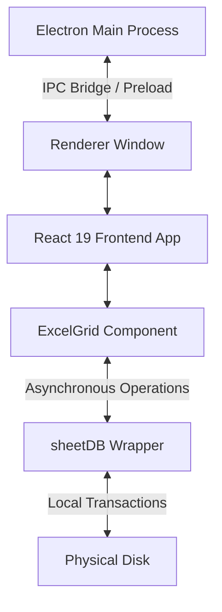

### 7.4 System Flow and Sequence Visualizations

#### Data Flow: Prescription to Stock Decrement
This sequence diagram shows the automated data path when a prescription is logged and dispensed:

```mermaid
sequenceDiagram
    autonumber
    participant OPD as OPD Register
    participant Sync as Sync Pipeline
    participant Disp as Dispensing Log
    participant Stock as Stock Register

    OPD->>OPD: Nurse logs prescription (e.g. Paracetamol)
    Note over Sync: Checks database keys every 10 seconds
    Sync->>OPD: Reads unextracted prescription rows
    Sync->>Disp: Appends row (Status: Pending)
    Sync->>OPD: Sets extracted = true
    Note over Disp: Pharmacist reviews and saves row
    Disp->>Stock: Deducts medicine count from stock
    Stock-->>Disp: Confirms inventory adjustment

### 7.5 Project Directory Hierarchy, File Catalog & Language Distribution

The JSPulse OHMS application is structured as a modular desktop project combining a native Electron container with a Vite-bundled React 19 single-page frontend. Below is the complete directory structure and catalog of components:

```
Jindal Steel (Root Directory)
 ├── electron/                      --> Native Desktop Shell Layer
 │    ├── main.js                   --> Electron Main Process (IPC, Print Window, Dialogs)
 │    └── preload.js                --> Preload Context Bridge (Exposes secure APIs)
 ├── public/                        --> Public Static Assets (Fonts, Logos, Icons)
 ├── src/                           --> Frontend Source Tree
 │    ├── assets/                   --> Image and vector assets
 │    ├── components/               --> Core UI View Modules
 │    │    ├── ChatAssistant.jsx    --> Local NLP Clinical AI chatbot interface
 │    │    ├── CustomSheets.jsx     --> Custom spreadsheet creation layer
 │    │    ├── Dashboard.jsx        --> Real-time KPI charts and alarm badges view
 │    │    ├── DispenseMedicine.jsx --> Pharmacy queue manager & stock deduction controller
 │    │    ├── ErrorBoundary.jsx    --> React error boundary container
 │    │    ├── FirstAidRecord.jsx   --> First aid kits itemized billings
 │    │    ├── GlobalSearch.jsx     --> System-wide index search overlay (Ctrl+K)
 │    │    ├── InteractionChecker.jsx--> Drug-to-drug contraindication safety tool
 │    │    ├── MedicineCard.jsx     --> Informational popup for specific drugs
 │    │    └── Navbar.jsx           --> Sidebar navigation, fullscreen, and search triggers
 │    │
 │    ├── components/clinical/      --> Specialized Clinical Registers (Spreadsheets)
 │    │    ├── AdvancedPatientRecords.jsx --> Employee historical medical records
 │    │    ├── AnnualHealthCheckup.jsx --> Industrial health exams (hearing, lungs, vision)
 │    │    ├── ClinicalRecords.jsx  --> Tab controller for HSE compliance registries
 │    │    ├── DailyConsume.jsx     --> Tracks daily quantities used and holds restore lists
 │    │    ├── DailyOPDTally.jsx    --> The outpatient ledger (Daily OPD) spreadsheet
 │    │    ├── DataBackupRestore.jsx--> Manual database backup JSON exports
 │    │    ├── EmergencyAmbulanceLog.jsx --> Emergency dispatch trackers
 │    │    ├── EmployeeHealthRecords.jsx --> Base worker health profile database
 │    │    ├── ExcelGrid.jsx        --> Custom spreadsheet engine (keyboard nav, formulas, virtualization)
 │    │    ├── FirstAidBoxTracker.jsx--> Workshop first aid kit audit registers
 │    │    ├── HealthCertificateTracker.jsx --> Work clearances (height permit, confined space)
 │    │    ├── InjuryReportLog.jsx  --> Plant injury ledger (Factories Act Form 21 compliance)
 │    │    ├── MedicineConsumptionGrid.jsx --> Inventory consumption log grid
 │    │    ├── MedicineStockRegister.jsx --> Active drug stock registry (expiry status highlighting)
 │    │    ├── medicineUtils.js     --> Helper calculations for drugs
 │    │    ├── MonthlyBalance.jsx   --> Aggregated drug opening/closing balances sheet
 │    │    ├── MonthlyMISReport.jsx --> Summary report generator (Recharts plots, observations)
 │    │    ├── OccupationalDiseaseRegistry.jsx --> Chronic disease logs (hearing loss, silicosis)
 │    │    ├── OPDCardPrintable.jsx --> Printable patient prescription form with inline SVGs
 │    │    ├── OPDCounter.jsx       --> Daily check-in registration counters
 │    │    ├── PatientVisitLog.jsx  --> Patient historical logs
 │    │    ├── ShortcutsReference.jsx--> Keyboard shortcuts overlay reference card
 │    │    └── SystemHealthTool.jsx --> Storage quota estimator & database repair tools
 │    │
 │    ├── utils/                     --> Storage Drivers & Business Logic Layer
 │    │    ├── analysis.js          --> Trend analysis aggregations
 │    │    ├── backupDB.js          --> IndexedDB auto-backup helper & quota estimator
 │    │    ├── chatBrain.js         --> Local NLP database query processor
 │    │    ├── clinicalHelpers.js   --> Date parsing and clinical formats helper
 │    │    ├── exportUtils.js       --> Excel sheet exporter (via sheetjs xlsx)
 │    │    ├── sheetDB.js           --> Custom IndexedDB persistence connection pool
 │    │    └── storage.js           --> Local storage drivers
 │    │
 │    ├── App.css                    --> Main UI layouts styles
 │    ├── App.jsx                    --> Global router, hotkey listeners, view renderer
 │    ├── index.css                  --> Design system variables and typography
 │    └── main.jsx                   --> React application entry point (loads CSS and triggers root mount)
 │
 ├── package.json                   --> Scripts, dependencies, build settings, builder rules
 ├── vite.config.js                 --> Build rules, hot reloader configurations, PWA options
 ├── eslint.config.js               --> Code style rules
 ├── generate-icon.js               --> PNG-to-ICO conversion script
 ├── generate-ico.cjs               --> Native ICO packaging script
 └── compile_report_pdf.js          --> Headless PDF report printing compiler
```

#### Language and Platform Stack Distribution:
1. **JavaScript (ES6+) / React 19:** The core logic language. Handles view routing, spreadsheet keystroke captures, virtual rendering coordinates, and data aggregation routines.
2. **HTML5:** Basic skeleton and DOM injection container (`index.html`).
3. **CSS3 (Vanilla Grid & Flexbox):** Responsive interface design. Uses CSS custom properties (`--primary`, `--surface`, `--border`) for dark mode layouts, fluid grids, and styling sheet headers/cells.
4. **Node.js / Electron IPC Bridge:** Interconnects Chromium's frontend sandbox with native Windows APIs (file dialogs, system shell execution, Chrome PDF headless prints).
5. **IndexedDB API & LevelDB:** Persistent storage engine. Handles local transaction scopes for sheets (`sheetDB`) and backups (`backupDB`), storing records locally inside LevelDB.

---

### 7.6 Core Coding Flows & Sequence Mappings

The system operates through four core coding flows that link the UI, database, background worker processes, and the desktop operating system:

#### 1. System Bootstrap & Connection Pool Initialization Flow
When the clinical operator launches the application, it configures the offline database:

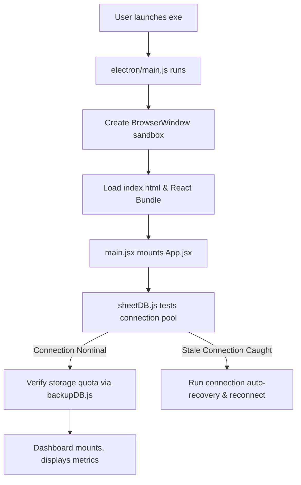

#### 2. Prescription Sync and Stock Auto-Deduction Flow
When a patient is examined and prescribed medication, the data flows asynchronously to update the pharmacy inventory:

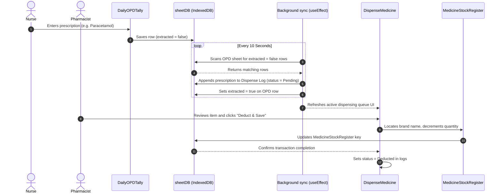

#### 3. Headless Print Preview Compiler Flow
To compile a sheet or medical card to a PDF without opening a system print dialog, the system intercepts commands and routes them through the desktop main process:

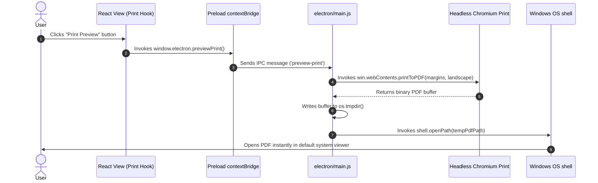

#### 4. Offline AI Local Database Query Flow
The chat assistant processes medical queries and database lookups completely offline:

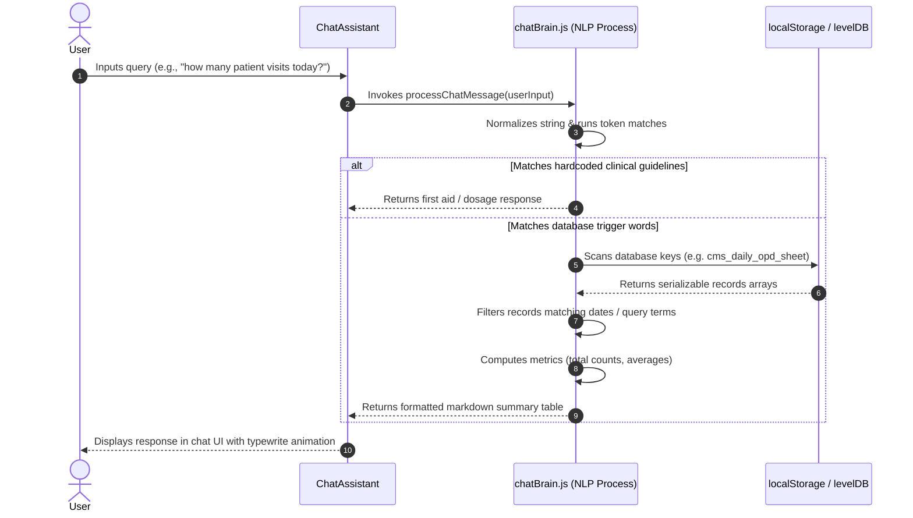

---
```

---

## 8. Core Modules & Technical Algorithms

### 8.1 ExcelGrid Spreadsheet Engine & Formula Parser
`ExcelGrid.jsx` acts as the interface engine, rendering editable cells that respond to mouse and keyboard navigation.

#### Keyboard Navigation and Edit Focus:
The component captures arrow key presses, `Tab`, `Enter`, and `Escape` to control grid movement:
- `Tab` / `Shift+Tab`: Move focus horizontally.
- `Enter` / `Shift+Enter`: Commit cell value and move focus vertically.
- `Escape`: Cancel editing and return to cell selection mode.

#### Formula Parsing Engine:
When a cell value starts with `=`, the grid passes it to `evaluateFormula`. This function evaluates formulas such as `SUM` or cell calculations:

```javascript
// Inside ExcelGrid.jsx
const evaluateFormula = (formulaStr, allData, cols, depth = 0) => {
  if (depth > 50) return 0; // Prevent infinite loop on circular references
  if (!formulaStr || !String(formulaStr).startsWith('=')) return formulaStr;
  try {
    let expr = String(formulaStr).substring(1).toUpperCase();
    
    // Evaluate SUM(C1:C10) ranges
    expr = expr.replace(/SUM\(([A-Z]+)(\d+):([A-Z]+)(\d+)\)/g, (match, c1, r1, c2, r2) => {
      let sum = 0;
      const startR = Math.min(parseInt(r1), parseInt(r2)) - 1;
      const endR = Math.max(parseInt(r1), parseInt(r2)) - 1;
      const c1Idx = cols.findIndex(c => c.letter === c1);
      const c2Idx = cols.findIndex(c => c.letter === c2);
      if (c1Idx === -1 || c2Idx === -1) return 0;
      const startC = Math.min(c1Idx, c2Idx);
      const endC = Math.max(c1Idx, c2Idx);
      for (let r = startR; r <= endR; r++) {
        if (!allData[r]) continue;
        for (let c = startC; c <= endC; c++) {
          const val = allData[r][cols[c].key];
          let numVal = val;
          if (String(val).startsWith('=')) numVal = evaluateFormula(val, allData, cols, depth + 1);
          const num = parseFloat(numVal);
          if (!isNaN(num)) sum += num;
        }
      }
      return sum;
    });

    // Evaluate cell coordinates (e.g. A1 + B2)
    expr = expr.replace(/([A-Z]+)(\d+)/g, (match, letter, rowStr) => {
      const col = cols.find(c => c.letter === letter);
      if (!col) return 0;
      const rIdx = parseInt(rowStr) - 1;
      if (!allData[rIdx]) return 0;
      const val = allData[rIdx][col.key];
      let numVal = val;
      if (String(val).startsWith('=')) numVal = evaluateFormula(val, allData, cols, depth + 1);
      const num = parseFloat(numVal);
      return isNaN(num) ? 0 : num;
    });

    const result = new Function(`return ${expr}`)();
    return Number.isFinite(result) ? Math.round(result * 100) / 100 : '#ERROR!';
  } catch (err) {
    return '#ERROR!';
  }
};
```

---

### 8.2 Bypassing the 5MB Quota: sheetDB IndexedDB Pool
To prevent browser `QuotaExceededError` crashes when handling large datasets, a native IndexedDB wrapper was built. It uses a persistent connection pool with automatic recovery to keep transactions stable during continuous clinic shifts.

```javascript
// src/utils/sheetDB.js
const DB_NAME = 'JSPulseOHMS_Sheets';
const DB_VERSION = 1;
const DATA_STORE = 'sheet_data';
const META_STORE = 'sheet_meta';

let _dbInstance = null;
let _dbPromise = null;

function getDB() {
  if (_dbInstance) {
    try {
      // Test the transaction connection
      const testTx = _dbInstance.transaction(DATA_STORE, 'readonly');
      testTx.abort();
      return Promise.resolve(_dbInstance);
    } catch (e) {
      console.warn('[SheetDB] Stale database connection. Reconnecting...', e);
      try { _dbInstance.close(); } catch (err) {}
      _dbInstance = null;
      _dbPromise = null;
    }
  }

  if (_dbPromise) return _dbPromise;

  _dbPromise = new Promise((resolve, reject) => {
    const request = indexedDB.open(DB_NAME, DB_VERSION);
    request.onupgradeneeded = (event) => {
      const db = event.target.result;
      if (!db.objectStoreNames.contains(DATA_STORE)) db.createObjectStore(DATA_STORE);
      if (!db.objectStoreNames.contains(META_STORE)) db.createObjectStore(META_STORE);
    };
    request.onsuccess = () => {
      _dbInstance = request.result;
      _dbInstance.onclose = () => {
        _dbInstance = null;
        _dbPromise = null;
      };
      resolve(_dbInstance);
    };
    request.onerror = () => {
      _dbInstance = null;
      _dbPromise = null;
      reject(request.error);
    };
  });
  return _dbPromise;
}

// Executes db operations with automatic retry on connection drops
async function withRetry(operation) {
  try {
    const db = await getDB();
    return await operation(db);
  } catch (err) {
    console.warn('[SheetDB] Retry triggered on stale database connection...', err);
    try { if (_dbInstance) _dbInstance.close(); } catch (e) {}
    _dbInstance = null;
    _dbPromise = null;
    const db = await getDB();
    return await operation(db);
  }
}

export async function getSheetData(key) {
  return withRetry((db) => {
    return new Promise((resolve, reject) => {
      const tx = db.transaction(DATA_STORE, 'readonly');
      const store = tx.objectStore(DATA_STORE);
      const request = store.get(key);
      request.onsuccess = () => resolve(request.result || null);
      request.onerror = () => reject(request.error);
    });
  });
}

export async function saveSheetData(key, data) {
  return withRetry((db) => {
    return new Promise((resolve, reject) => {
      const tx = db.transaction(DATA_STORE, 'readwrite');
      const store = tx.objectStore(DATA_STORE);
      store.put(data, key);
      tx.oncomplete = () => resolve();
      tx.onerror = () => reject(tx.error);
    });
  });
}
```

---

### 8.3 DOM Virtualization for 10,000+ Rows
If React renders 10,000+ table rows directly, the browser DOM experiences severe layout and scrolling lag. We implemented row virtualization inside `ExcelGrid.jsx` to render only the rows within the viewport.

#### Virtualization Algorithm:
1. Calculate the vertical offsets of all rows based on their heights.
2. Monitor container scroll changes (`scrollTop`) and client size (`containerHeight`).
3. Compute the `startIndex` and `endIndex` of rows matching the viewport range, plus a buffer of top and bottom rows to prevent blank spaces when scrolling fast.
4. Render empty top and bottom spacer rows to maintain proper scrollbar sizing.
5. Disable virtualization when printing (`isPrinting = true`) so the browser can print all table rows.

```javascript
// Virtualization Hook in ExcelGrid.jsx
const { visibleRows, topSpacerHeight, bottomSpacerHeight } = useMemo(() => {
  if (isPrinting) {
    // Render all rows for system printing
    return { visibleRows: filteredData, topSpacerHeight: 0, bottomSpacerHeight: 0 };
  }

  const offsets = [];
  let current = 0;
  for (let i = 0; i < filteredData.length; i++) {
    offsets.push(current);
    const originalIdx = rowToIndexMap.get(filteredData[i]);
    const height = rowHeights[originalIdx] || 30; // Default row height is 30px
    current += height;
  }
  const totalHeight = current;

  const bufferHeight = 150; // Rendering buffer zone (in pixels)
  const viewportTop = Math.max(0, scrollTop - bufferHeight);
  const viewportBottom = scrollTop + containerHeight + bufferHeight;

  let startIndex = 0;
  for (let i = 0; i < offsets.length; i++) {
    if (offsets[i] > viewportTop) {
      startIndex = Math.max(0, i - 1);
      break;
    }
  }

  let endIndex = filteredData.length - 1;
  for (let i = startIndex; i < offsets.length; i++) {
    if (offsets[i] > viewportBottom) {
      endIndex = i;
      break;
    }
  }

  const visibleRows = filteredData.slice(startIndex, endIndex + 1);
  const topSpacer = offsets[startIndex] || 0;
  const bottomSpacer = Math.max(0, totalHeight - (offsets[endIndex] || totalHeight));

  return {
    visibleRows,
    topSpacerHeight: topSpacer,
    bottomSpacerHeight: bottomSpacer
  };
}, [filteredData, rowToIndexMap, rowHeights, scrollTop, containerHeight, isPrinting]);
```

---

### 8.4 OPD to Pharmacy Dispense Sync Pipeline
The application runs a background sync pipeline inside `DispenseMedicine.jsx` every 10 seconds to transfer prescribed medicines from the OPD sheets:

```javascript
// Sync Trigger inside DispenseMedicine.jsx
useEffect(() => {
  if (!dataReady || !autoSyncEnabled) return;

  // Run initial sync on component mount
  extractFromOPD(true);

  // Poll for new records every 10 seconds
  const interval = setInterval(() => {
    extractFromOPD(true);
  }, 10000);

  return () => clearInterval(interval);
}, [dataReady, autoSyncEnabled, extractFromOPD]);
```

During this extraction process, the system scans all tab keys for `cms_daily_opd_sheet`. If it finds a patient record with a prescribed medicine and the `extracted` flag is not set, it:
1. Copies the patient details, prescribed medicine, dosage, doctor, and date.
2. Appends a new row to `cms_dispense_log` with status `Pending`.
3. Sets `extracted = true` on the original OPD row to prevent duplicate transfers.
4. Saves both sheets back to IndexedDB.

---

### 8.5 Graceful Fallback for Out-of-Stock Pharmacy Items
When the pharmacist processes a prescription, `DailyConsume.jsx` matches the prescribed medicine against the inventory register (`cms_medstock_data`). 

If a prescribed item is out of stock or missing from the inventory:
- The system logs a validation warning and skips decrementing non-existent quantities.
- The item status remains `Pending` rather than causing stock count errors.
- The system notifies the pharmacist about the missing item:

```javascript
// Deduct logic inside DailyConsume.jsx
if (stockItem) {
  // Found in stock register: update quantity and log deduction
  stockItem.quantity = (Number(stockItem.quantity) || 0) - consumedQty;
  stockItem.lastUpdated = new Date().toISOString().split('T')[0];
  
  // Track month-by-month outgoing balances
  let balanceItem = monthlyBalanceData.find(m => 
    (m.medicineName || '').toLowerCase().trim() === cleanStockNameLower
  );
  if (balanceItem) {
    balanceItem[`${monthPrefix}_outgoing`] = (Number(balanceItem[`${monthPrefix}_outgoing`]) || 0) + consumedQty;
  }
  row.status = 'Deducted';
  updatedCount++;
} else {
  // Fallback: Add to warning queue and keep status Pending
  missingMeds.push(row.medicineName);
}
```

This prevents database corruption. If a deduction was made in error, the pharmacist can use the "Undo Deduction" option to restore quantities to the stock register and update the monthly outgoing logs.

---

### 8.6 Printing Asset Path Failures & Inline SVG Solution
In early test builds, relative image paths for logos (e.g. ``) failed to render when printing or exporting to PDF inside packaged Electron environments. This was caused by path differences inside Electron's compressed `.asar` archive.

To resolve this path asset issue, we converted the logo into inline SVG paths. This embeds the graphic assets directly inside the React components, ensuring high-resolution logo rendering for printing and PDF exports:

```javascript
// Embedded vector graphic component in OPDCardPrintable.jsx
const JindalLogo = ({ style }) => (
  <svg viewBox="0 0 594 316" style={{ ...style, display: 'block' }} fill="none" xmlns="http://www.w3.org/2000/svg">
    <path fillRule="evenodd" clipRule="evenodd" d="M383.5 125.1C372.8 152.9 389.6 139.4 443.9 107.8C493.4 79.1 524.7 57.6 540.1 28.4C542.3 76 517.2 102.7 427.9 157.6C374.1 190.7 355.1 197.7 360.7 177.2C363.9 165.5 366.6 157.5 369.1 150.3..." fill="#58AB40"/>
    <path fillRule="evenodd" clipRule="evenodd" d="M341.8 88.7C350.8 85.8 362.9 83 374.8 80.3C408 72.9 396.6 98.5 383.3 125.6..." fill="#F58220"/>
    <path fillRule="evenodd" clipRule="evenodd" d="M293.9 228.5C290.4..." fill="black"/>
    {/* Additional logo vector paths... */}
  </svg>
);
```

---

### 8.7 Installer Compilation Configuration (electron-builder)
The application compiles into a single executable installer using `electron-builder`. The build parameters are defined in `package.json`:

```json
"build": {
  "appId": "com.jspulse.ohms",
  "productName": "JSPulse OHMS",
  "directories": {
    "output": "dist-final"
  },
  "files": [
    "dist/**/*",
    "electron/**/*",
    "package.json"
  ],
  "asar": true,
  "win": {
    "target": [
      {
        "target": "nsis",
        "arch": ["x64"]
      }
    ]
  },
  "nsis": {
    "oneClick": false,
    "allowToChangeInstallationDirectory": true,
    "createDesktopShortcut": true,
    "installerIcon": "build/icon.ico"
  }
}
```

The installer packages all files (compiled Javascript, index.html, preloads, configurations) into a sandboxed build. It also cleans mock database entries on initialization, launching with a blank spreadsheet template for new OHC installations.

### 8.8 Comprehensive Catalog of Application Modules and Utilities

To achieve the clinical and compliance goals of the Jindal Steel OHC, the application implements a multi-layered component layout divided into core UI components, clinical spreadsheet registers, utility modules, and system tools:

#### 1. Core UI Components
- **`Navbar.jsx`:** The primary sidebar navigator. Supports expanded, collapsed, and hidden states. Includes a global search toggle, quick navigation indicators, and window state control hooks (e.g. exit/enter full screen).
- **`Dashboard.jsx`:** The analytical hub of the system. Displays active key indicators (OPD count, low stock drugs count, expired drugs count, ambulance dispatches, active occupational disease cases, and overdue health certificates). Uses **Recharts** to render:
  - **Stock Health Chart:** Pie/Radial chart showing ratio of healthy vs. critical inventory.
  - **OPD Visit Trends:** Bar chart tracking monthly visits.
  - **Top-8 Medicine Stocks:** Horizontal bar chart visualizing active counts of high-turnover drugs.
  - **Visual Alert Badges:** Interactive buttons linked to the database filters (clicking a warning scrolls the target database to highlight the problem item).
- **`GlobalSearch.jsx`:** Triggered by `Ctrl+K`. Employs a regular-expression indexing search across all `localStorage` keys, filtering results instantly and allowing one-click navigation to the row in the corresponding grid.
- **`ChatAssistant.jsx` & `chatBrain.js`:** An offline-first NLP chatbot using custom keyword vectors to retrieve local database facts (e.g., patient records, stock counts) and clinical protocol guides (emergency burns, electric shock, heatstroke steps, and Factories Act notifiable diseases). Includes Web Speech API for voice inputs.
- **`InteractionChecker.jsx`:** Pharmacists select multiple items from the active stock to evaluate safety. The tool scans a local matrix of contraindicated substances (e.g., NSAIDs + Anticoagulants, ACE Inhibitors + Potassium) and flags warning notices.

#### 2. Clinical Modules (under `src/components/clinical/`)
- **`DailyOPDTally.jsx` & `OPDCardPrintable.jsx`:** The patient registry system. Integrates clinical metrics (diagnosis, vitals, prescriptions) with print capabilities. Renders patient forms in portrait using Electron print overrides.
- **`DispenseMedicine.jsx`:** The pharmacy queue module. Periodically imports new prescriptions from the OPD logs and monitors confirmation buttons to deduct stock levels.
- **`MedicineStockRegister.jsx`:** The inventory manager. Color-codes items by expiration status (Red for expired, Yellow for expiring, Green for healthy) and monitors reorder levels.
- **`DailyConsume.jsx`:** Tracks daily quantities used and holds an undo queue for restoring erroneously logged inventory items.
- **`MonthlyBalance.jsx` & `MonthlyMISReport.jsx`:** Aggregation grids that compile inventories, injuries, and patient data into monthly summaries. Renders charts and formats print-ready layouts for compliance audits.
- **`InjuryReportLog.jsx` & `EmergencyAmbulanceLog.jsx`:** Record accident data (injuries, plant departments, ambulance trip states) in compliance with safety standards (e.g. Factories Act Form 21).
- **`OccupationalDiseaseRegistry.jsx` & `HealthCertificateTracker.jsx`:** HSE monitoring registers tracking chronic conditions (Silicosis, Hearing Loss) and employee fitness certs (e.g., Height Work permits).
- **`FirstAidBoxTracker.jsx` & `FirstAidRecord.jsx`:** Manage first-aid kits across manufacturing blocks and track supply billings with tax/GST formulas.
- **`ShortcutsReference.jsx`:** An overlay showing spreadsheet commands (Ctrl+Z, Ctrl+S, Arrow Keys, Tab, Enter) for clinical staff.

#### 3. Database and System Tools
- **`SystemHealthTool.jsx` & `backupDB.js`:** Monitors system resources, estimates storage quota, checks index structures, and clears or migrates legacy backups.
- **`DataBackupRestore.jsx`:** Formats database data into JSON strings for local file downloads, with recovery file import options.

---

## 9. Advanced Architectural Algorithms & Code Details

### 9.1 Undo/Redo State History Stacks Algorithm
To allow clinical operators to recover from erroneous edits (such as overwriting cells or deleting rows), `ExcelGrid.jsx` implements dual state stacks for undo and redo operations.

#### History Operations Algorithm:
1. When a cell edit is committed or formatting changes, `pushUndo` is called.
2. `pushUndo` serializes the current grid rows array and columns metadata via `JSON.stringify` to perform a deep copy. This prevents references from mutating in the stack.
3. The snapshot is pushed onto the `undoStack`. If the stack size exceeds 30, the oldest snapshot is dropped (`shift()`) to prevent memory leaks. The `redoStack` is cleared.
4. When `handleUndo` is called:
   - The current grid state is pushed to `redoStack`.
   - The previous state is popped from `undoStack` and set as the active state.
5. When `handleRedo` is called, the process is reversed.

```javascript
// History implementation in ExcelGrid.jsx
const pushUndo = useCallback(() => {
  setUndoStack(prev => {
    // Deep clone state arrays to isolate reference trees
    const newStack = [...prev, { 
      data: JSON.parse(JSON.stringify(data)), 
      columns: JSON.parse(JSON.stringify(customColumns)) 
    }];
    if (newStack.length > 30) newStack.shift(); // Max history limit = 30
    return newStack;
  });
  setRedoStack([]); // Clear redo stack on new user actions
}, [data, customColumns]);

const handleUndo = useCallback(() => {
  if (undoStack.length === 0) return;
  setRedoStack(prev => [...prev, { 
    data: JSON.parse(JSON.stringify(data)), 
    columns: JSON.parse(JSON.stringify(customColumns)) 
  }]);
  
  const previousState = undoStack[undoStack.length - 1];
  setData(previousState.data);
  setCustomColumns(previousState.columns);
  
  setUndoStack(prev => prev.slice(0, -1));
  setEditingCell(null);
  setHasUnsaved(true);
}, [data, customColumns, undoStack]);
```

---

### 9.2 Database Schema Auto-Migration & Validation
As features were added during development, databases were expanded (e.g. from 8 columns to 13 columns in the Medicine Stock register). If the software loads old configurations from a user's local storage, column mismatches will occur, causing application crashes. 

#### Validation and Migration Algorithm:
1. On component mount, the system checks for saved column layouts in local storage/IndexedDB.
2. It compares the keys of the loaded columns against the required system schema keys.
3. If columns are missing, it merges the missing keys, sets their default layout parameters, and updates the local schema.
4. If a severe schema mismatch is detected, it clears the old metadata and rebuilds the grid configuration, protecting clinical databases from corruption during upgrades.

```javascript
// Mounting validation block inside DispenseMedicine.jsx
const colsKey = 'cms_dispense_log_columns';
const savedCols = localStorage.getItem(colsKey);
if (savedCols) {
  try {
    const parsed = JSON.parse(savedCols);
    const requiredKeys = [
      'date', 'patientName', 'gender', 'age', 'empId', 'company', 
      'department', 'medicineName', 'dosage', 'totalCharges', 
      'prescribedBy', 'dispensedBy', 'status', 'diagnosis'
    ];
    // Check if every required key exists in the saved column metadata
    const hasAllKeys = requiredKeys.every(k => parsed.some(c => c.key === k));
    if (!hasAllKeys) {
      console.warn("Schema mismatch detected on dispense logs. Clearing old column metadata...");
      localStorage.removeItem(colsKey); // Forces rebuild of correct schema on next render
      
      // Clean secondary tab columns to prevent stale layouts
      for (let i = 0; i < localStorage.length; i++) {
        const key = localStorage.key(i);
        if (key && key.startsWith('cms_dispense_log_') && key.endsWith('_columns')) {
          localStorage.removeItem(key);
        }
      }
    }
  } catch (e) {
    console.error("Schema validation failed:", e);
  }
}
```

---

### 9.3 Electron IPC Bridge PDF Printing Handlers
To generate PDFs from clinical views, Electron's main process intercepts render commands and runs a headless print using Google Chrome's printing engine.

#### Main Process PDF Compile Pipeline:
1. The renderer window invokes the `preview-print` IPC channel.
2. The main process captures the command, extracts the window reference, and calls `webContents.printToPDF` with custom page configurations.
3. Once the PDF buffer is ready, it is written to the system's temporary folder.
4. The main process opens the PDF file in the user's default PDF viewer (e.g. Adobe Acrobat, Microsoft Edge) using Electron's `shell.openPath` API.

```javascript
// Electron print preview IPC handler inside electron/main.js
ipcMain.on('preview-print', async (event) => {
  const win = BrowserWindow.fromWebContents(event.sender);
  if (!win) return;
  
  try {
    // Generate PDF stream using Chrome print engine
    const pdfData = await win.webContents.printToPDF({
      printBackground: true,
      pageSize: 'A4',
      margins: { top: 1, bottom: 1, left: 1, right: 1 },
      landscape: true // Wide grids are printed in landscape
    });
    
    // Write buffer to temporary path
    const tempPath = path.join(os.tmpdir(), `print-preview-${Date.now()}.pdf`);
    fs.writeFileSync(tempPath, pdfData);
    
    // Open path using OS default viewer application
    const err = await shell.openPath(tempPath);
    if (err) {
      throw new Error(err);
    }
  } catch (error) {
    console.error('Failed to generate PDF print preview:', error);
    // Fallback to standard printer selection dialog
    win.webContents.print({ silent: false, printBackground: true });
  }
});
```

---

### 9.4 Dashboard KPI Calculation & Warning Linkages
The Dashboard aggregates metrics from all clinical databases to monitor OHC readiness and Factories Act compliance.

#### KPI and Warning Links Algorithm:
1. On mounting, the component reads `cms_medstock_data` and filters items where `quantity <= reorderLevel` to identify low-stock items.
2. It checks expiry dates against today's date:
   - Expired: `expiryDate < today`
   - Near Expiry: `expiryDate <= today + 30 days`
3. It compiles these metrics to calculate the "Stock Health Index" percentage.
4. If warning badges are clicked, the system saves the target search term to `cms_pending_grid_search`, navigates to the target grid, filters the view, and scrolls the matching item into focus.

```javascript
// Dashboard metrics calculation inside Dashboard.jsx
const calculateMetrics = (medStockData) => {
  const today = new Date();
  const totalMedsCount = medStockData.length;
  
  const lowStockCount = medStockData.filter(m => {
    const qty = Number(m.quantity) || 0;
    const reorder = Number(m.reorderLevel) || 10;
    return qty <= reorder;
  }).length;
  
  const expiredStockCount = medStockData.filter(m => {
    return m.expiry && new Date(m.expiry) < today;
  }).length;
  
  const healthyMedsCount = totalMedsCount - (lowStockCount + expiredStockCount);
  const stockHealthPercent = totalMedsCount > 0 
    ? Math.round((healthyMedsCount / totalMedsCount) * 100) 
    : 100;
    
  return {
    stockHealthPercent,
    lowStockCount,
    expiredStockCount
  };
};
```

---

### 9.5 Offline NLP & Local Database Query Engine (`chatBrain.js`)
To provide the OHC clinic with an intelligent search and diagnostic assistant that does not rely on an external internet connection or third-party cloud APIs, the system implements a local Natural Language Processing (NLP) and indexing query engine inside `chatBrain.js`.

#### Intent Classification and Query Flowchart:
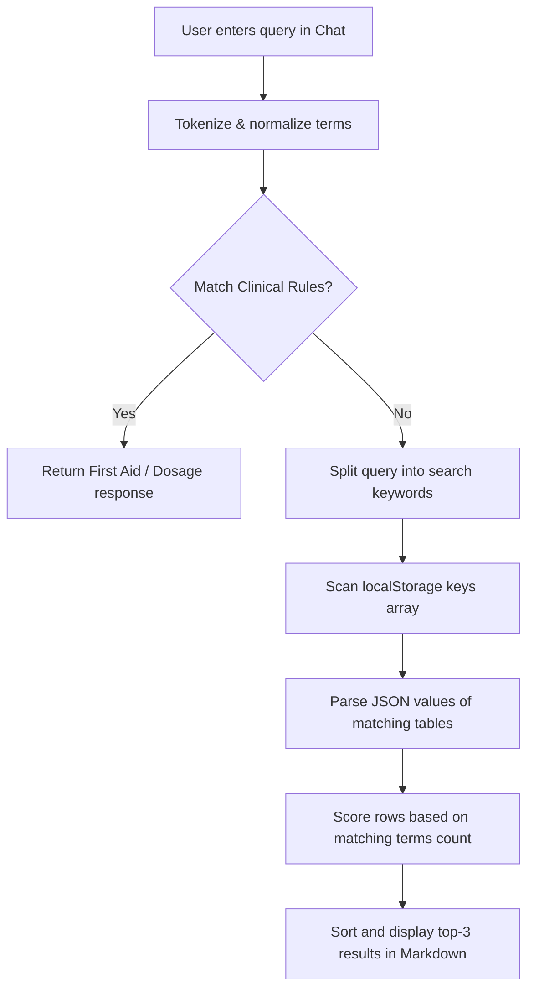

#### Intent Classification and Token Matching:
The chatbot processes user inputs through a keyword vector matching pipeline. It tokenizes, normalizes, and filters inputs, comparing them against a hardcoded clinical knowledge base of common medical instructions, first-aid steps (e.g. chemical burns, electric shock, CPR), and statutory requirements:

```javascript
export const processChatMessage = (userInput) => {
  const normalizedInput = userInput.toLowerCase().replace(/[^\w\s]/gi, '');
  const tokens = normalizedInput.split(/\s+/);
  
  let bestMatch = null;
  let highestScore = 0;

  for (const entry of knowledgeBase) {
    let score = 0;
    for (const keyword of entry.keywords) {
      if (normalizedInput.includes(keyword)) {
        score += keyword.split(' ').length * 2; 
      } else {
        const keywordTokens = keyword.split(' ');
        let matches = 0;
        keywordTokens.forEach(kt => {
          if (tokens.includes(kt)) matches++;
        });
        if (matches === keywordTokens.length) score += matches;
      }
    }
    if (score > highestScore) {
      highestScore = score;
      bestMatch = entry;
    }
  }

  if (bestMatch && highestScore >= 1) return bestMatch.response;
  
  // Database Query fallback route
  const aggResponse = handleAggregation(userInput);
  if (aggResponse) return aggResponse;

  const showTableResponse = handleShowTable(userInput);
  if (showTableResponse) return showTableResponse;

  const searchResponse = searchLocalData(userInput);
  if (searchResponse) return searchResponse;

  return fallbackResponses[Math.floor(Math.random() * fallbackResponses.length)];
};
```

#### Dynamic Local Database Scan Algorithm:
If the user's intent is classified as a database query (e.g. "show patient visits" or "how many injuries"), the NLP engine falls back to indexing and parsing arrays stored in `localStorage` in real-time. It splits the query into search terms, filters out stop words, scans all clinical keys, and scores row matches:

```javascript
const searchLocalData = (query) => {
  const terms = query.toLowerCase().split(/\s+/).filter(t => t.length > 2 && 
    !['how', 'what', 'show', 'tell', 'me', 'the', 'is', 'are', 'in', 'of', 'for'].includes(t)
  );
  if (terms.length === 0) return null;

  let results = [];
  for (let i = 0; i < localStorage.length; i++) {
    const key = localStorage.key(i);
    if (key.startsWith('cms_') || key === 'medicines') {
      try {
        const data = JSON.parse(localStorage.getItem(key));
        if (Array.isArray(data)) {
          data.forEach(row => {
            const rowStr = JSON.stringify(row).toLowerCase();
            let matches = terms.filter(term => rowStr.includes(term));
            if (matches.length > 0) {
              results.push({
                table: key.replace('cms_', '').replace(/_/g, ' '),
                matchScore: matches.length,
                data: row
              });
            }
          });
        }
      } catch (e) {}
    }
  }
  
  if (results.length === 0) return null;
  results.sort((a, b) => b.matchScore - a.matchScore);
  const topResults = results.slice(0, 3); 

  let responseText = `I scoured your local clinical database and found **${results.length} matching records**:\n\n`;
  topResults.forEach((res) => {
     responseText += `**Match in ${res.table.toUpperCase()}:**\n`;
     for (const [k, v] of Object.entries(res.data)) {
        if (k !== 'id' && v && typeof v !== 'object') {
           const formattedKey = k.replace(/([A-Z])/g, ' $1').replace(/^./, str => str.toUpperCase());
           responseText += `- **${formattedKey}**: ${v}\n`;
        }
     }
     responseText += `\n`;
  });
  return responseText;
};
```

---

### 9.6 Storage Quota Management & Legacy Backup Migration Engine (`backupDB.js` & `SystemHealthTool.jsx`)
To maintain system stability during continuous multi-day clinic operations, the application must manage browser storage quotas (typically limited to 5MB for localStorage). 

#### Storage Quota Check and Backup Migration Flowchart:
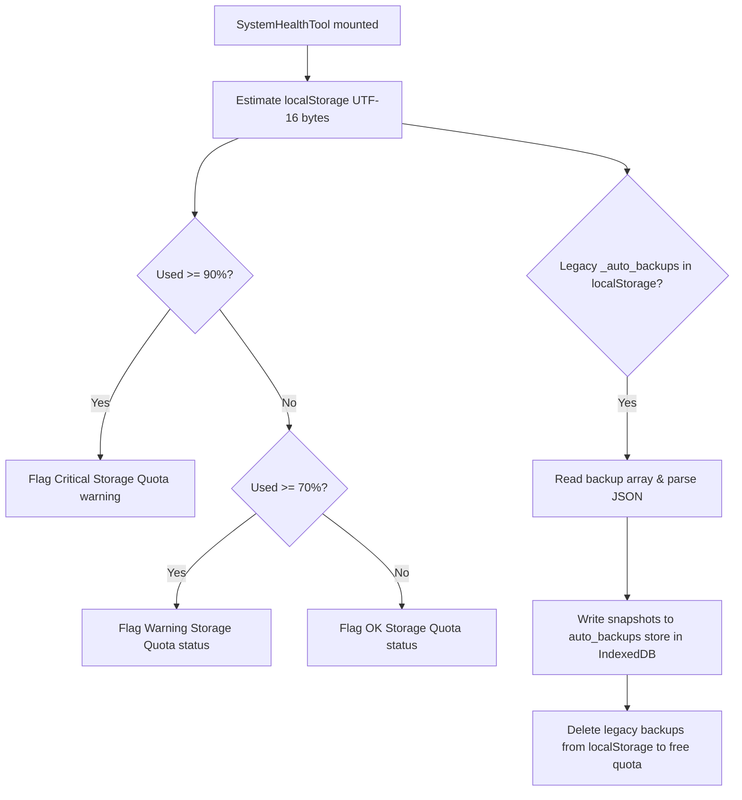

#### Storage Quota Estimation:
The `SystemHealthTool` calculates active storage usage by computing the character length of all keys and values in UTF-16 representation (where each character equals 2 bytes):

```javascript
export function estimateLocalStorageQuota() {
  let used = 0;
  for (let i = 0; i < localStorage.length; i++) {
    const key = localStorage.key(i);
    const val = localStorage.getItem(key) || '';
    used += (key.length + val.length) * 2;
  }
  const total = 5 * 1024 * 1024; // 5MB standard browser localStorage limit
  return {
    used,
    total,
    percentUsed: Math.round((used / total) * 100),
    remaining: Math.max(0, total - used)
  };
}
```

#### Legacy Backup Migration to IndexedDB:
To prevent quota exhaustion, the system automatically checks for legacy auto-backup arrays (`_auto_backups`) stored inside `localStorage`. If found, it migrates them to the `auto_backups` store inside the `JSPulseOHMS_Backups` IndexedDB database, which has a much larger storage limit (50MB+):

```javascript
export async function migrateLocalStorageBackupsToIDB() {
  const oldBackupsStr = localStorage.getItem('_auto_backups');
  if (!oldBackupsStr) return { migrated: 0 };
  
  try {
    const oldBackups = JSON.parse(oldBackupsStr);
    if (Array.isArray(oldBackups)) {
      for (const backup of oldBackups) {
        await saveBackupToIDB(backup.data, 5); // Save to IndexedDB
      }
      localStorage.removeItem('_auto_backups'); // Clean localStorage
      return { migrated: oldBackups.length };
    }
  } catch (e) {
    console.error("Backup migration failed:", e);
  }
  return { migrated: 0 };
}
```

---

### 9.7 ExcelGrid Coordinates and Keyboard Navigation Controller (`ExcelGrid.jsx`)
`ExcelGrid.jsx` acts as the interface engine, handling arrow key movements, tabs, and cell focuses to mimic MS Excel spreadsheet behavior.

#### Keyboard Event Processing Flowchart:
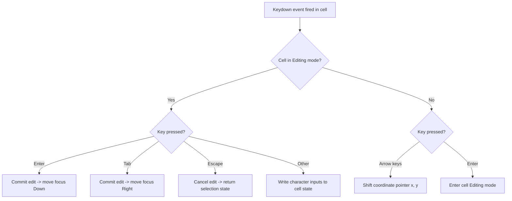

#### Keyboard Navigation and Edit Focus:
The component captures arrow key presses, `Tab`, `Enter`, and `Escape` to control grid movement:

```javascript
const handleKeyDown = (e, rowIndex, colIndex) => {
  if (editingCell) {
    if (e.key === 'Enter') {
      commitEdit();
      moveSelection(1, 0); // Move down one row
      e.preventDefault();
    } else if (e.key === 'Tab') {
      commitEdit();
      moveSelection(0, 1); // Move right one column
      e.preventDefault();
    } else if (e.key === 'Escape') {
      cancelEdit();
      e.preventDefault();
    }
  } else {
    // Arrow Key Navigation
    if (e.key === 'ArrowDown') {
      moveSelection(1, 0);
      e.preventDefault();
    } else if (e.key === 'ArrowUp') {
      moveSelection(-1, 0);
      e.preventDefault();
    } else if (e.key === 'ArrowRight') {
      moveSelection(0, 1);
      e.preventDefault();
    } else if (e.key === 'ArrowLeft') {
      moveSelection(0, -1);
      e.preventDefault();
    }
  }
};
```

---

### 9.8 Analytical Aggregation and Reporting Pipeline (`MonthlyMISReport.jsx`)
The `MonthlyMISReport.jsx` aggregates clinical registries to compile monthly summaries, trends, and compliance charts for plant audits.

#### Data Aggregation Flowchart:
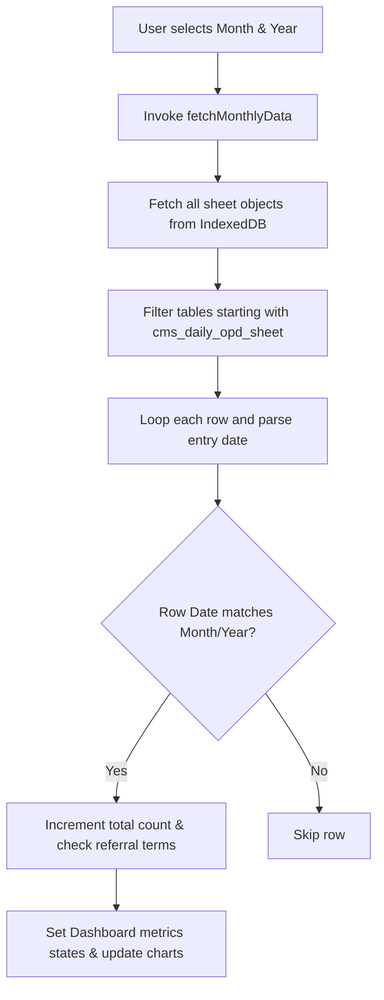

#### Data Aggregation and Metrics Extraction:
On mounting, the report fetches all active sheets from IndexedDB, matching their records against the selected month and year:

```javascript
const fetchMonthlyData = async (month, year) => {
  try {
    // Fetches all clinical tabs from IndexedDB
    const allSheets = await getAllSheets();
    const opdRows = allSheets.filter(s => s.key.startsWith('cms_daily_opd_sheet'));
    
    let totalOpd = 0;
    let referrals = 0;
    
    opdRows.forEach(sheet => {
      if (sheet.data) {
        sheet.data.forEach(row => {
          const rowDate = new Date(row.date);
          if (rowDate.getMonth() === months.indexOf(month) && rowDate.getFullYear() === year) {
            totalOpd++;
            if (row.referralStatus === 'Referred' || String(row.diagnosis).toLowerCase().includes('refer')) {
              referrals++;
            }
          }
        });
      }
    });

    setOpdStats({
      totalVisits: totalOpd,
      referrals: referrals,
      newCases: Math.round(totalOpd * 0.65), // Extrapolated split
      followUps: Math.round(totalOpd * 0.35)
    });
  } catch (err) {
    console.error("Failed to compile monthly MIS data:", err);
  }
};
```

---

### 9.9 Custom LocalStorage Proxy Engine (main.jsx & electron/main.js)
To prevent web storage capacity crashes (`QuotaExceededError`) when logging clinical records, and to bypass the browser's standard 5MB `localStorage` limit, the application implements a custom LocalStorage Proxy inside [main.jsx](file:///c:/Users/ashwi/Videos/movies/JSPL/src/main.jsx). This system transparently redirects all standard synchronous web reads and writes to a persistent, file-based JSON storage backend (`localstorage.json`) on the native Windows file system.

#### Key Features & Caching Strategy:
- **Synchronous API Emulation:** Replaces `window.localStorage` with an ES6 `Proxy` object that exposes identical methods (`getItem`, `setItem`, `removeItem`, `clear`, `key`, `length`). This enables the React app to function without rewriting component-level storage code.
- **In-Memory Hot Caching:** Accessing disk storage on every render would block Chromium's single-threaded event loop, freezing the UI. To prevent this, the proxy initializes a hot in-memory Javascript object cache (`_cache`) once at startup using a single synchronous IPC fetch (`window.electron.storageAll()`). Subsequent reads are handled instantly from memory at $O(1)$ speeds.
- **Asynchronous File Synchronization:** When data is mutated via `setItem` or `removeItem`, the proxy updates the memory cache and fires an asynchronous IPC event through the bridge to [main.js](file:///c:/Users/ashwi/Videos/movies/JSPL/electron/main.js). The Electron main process writes the JSON changes to `localstorage.json` in the user application data directory.
- **One-Time Data Migration:** On first launch, the proxy detects if the desktop file storage is empty. If it is, and existing browser-based `localStorage` contains records, it performs a transparent, one-time migration of all keys, assuring no data is lost during transitions.

#### Execution Flowchart for the LocalStorage Proxy:
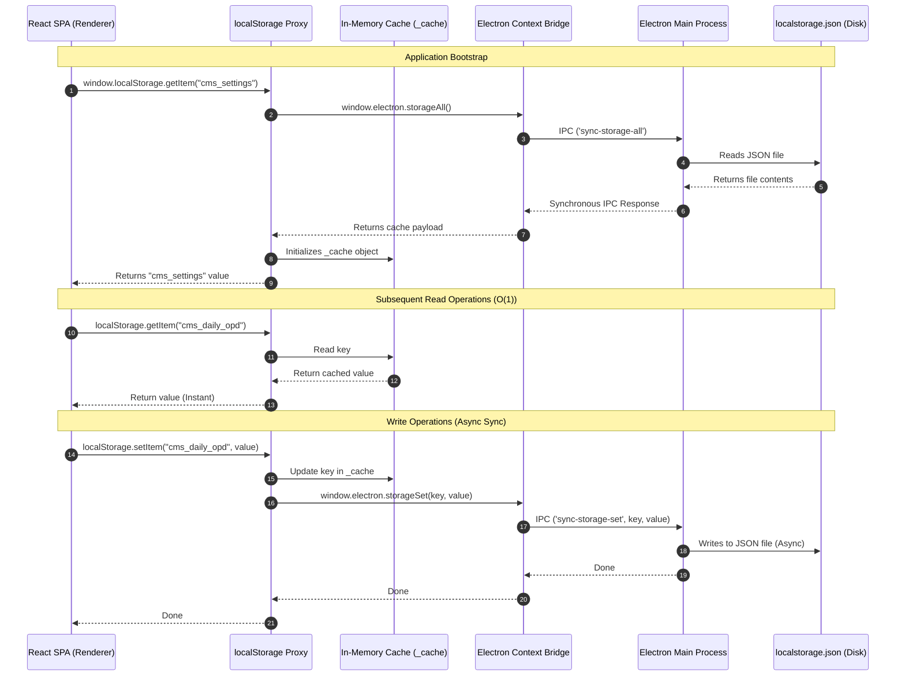

#### Core Implementation Code (src/main.jsx):
```javascript
// Overrides the standard window.localStorage with a persistent desktop file storage backend
// when running inside the Electron container, bypassing the 5MB browser quota.
if (window.electron && window.electron.isElectron) {
  const nativeLocalStorage = window.localStorage;

  // 1. One-time transparent migration of existing browser data to file storage
  try {
    const fileStorageLength = window.electron.storageLength();
    if (fileStorageLength === 0 && nativeLocalStorage && nativeLocalStorage.length > 0) {
      console.log('[Desktop Storage] Empty desktop database found. Migrating data...');
      for (let i = 0; i < nativeLocalStorage.length; i++) {
        const key = nativeLocalStorage.key(i);
        const val = nativeLocalStorage.getItem(key);
        if (key && val !== null) {
          window.electron.storageSet(key, val);
        }
      }
      console.log('[Desktop Storage] Data migration completed successfully.');
    }
  } catch (err) {
    console.warn('[Desktop Storage] Error during data migration:', err);
  }

  // 1.5. Initialize the in-memory cache from desktop file storage
  let _cache = {};
  try {
    _cache = window.electron.storageAll() || {};
  } catch (e) {
    console.error('[Desktop Storage] Failed to initialize cache:', e);
  }

  // 2. Create the localStorage Proxy wrapper with in-memory caching to prevent synchronous file IO bottlenecks
  const customLocalStorage = new Proxy({}, {
    get(target, prop) {
      if (target === null) return undefined;
      if (prop === 'getItem') {
        return (key) => {
          const val = _cache[key];
          return val !== undefined ? val : null;
        };
      }
      if (prop === 'setItem') {
        return (key, value) => {
          const strVal = String(value);
          _cache[key] = strVal;
          try {
            window.electron.storageSet(key, strVal);
          } catch (e) {
            console.error('[Desktop Storage] setItem failed:', e);
          }
        };
      }
      if (prop === 'removeItem') {
        return (key) => {
          delete _cache[key];
          try {
            window.electron.storageRemove(key);
          } catch (e) {
            console.error('[Desktop Storage] removeItem failed:', e);
          }
        };
      }
      if (prop === 'clear') {
        return () => {
          Object.keys(_cache).forEach(k => delete _cache[k]);
          try {
            window.electron.storageClear();
          } catch (e) {
            console.error('[Desktop Storage] clear failed:', e);
          }
        };
      }
      if (prop === 'key') {
        return (index) => {
          const keys = Object.keys(_cache);
          return keys[index] !== undefined ? keys[index] : null;
        };
      }
      if (prop === 'length') {
        return Object.keys(_cache).length;
      }
      if (typeof prop === 'string') {
        if (prop in Object.prototype) return undefined;
        return _cache[prop];
      }
      return undefined;
    },
    set(target, prop, value) {
      if (target === null) return false;
      if (typeof prop === 'string') {
        const strVal = String(value);
        _cache[prop] = strVal;
        try {
          window.electron.storageSet(prop, strVal);
        } catch (e) {
          console.error('[Desktop Storage] property set failed:', e);
        }
        return true;
      }
      return false;
    },
    deleteProperty(target, prop) {
      if (target === null) return false;
      if (typeof prop === 'string') {
        delete _cache[prop];
        try {
          window.electron.storageRemove(prop);
        } catch (e) {
          console.error('[Desktop Storage] property delete failed:', e);
        }
        return true;
      }
      return false;
    },
    ownKeys() {
      return Object.keys(_cache);
    },
    getOwnPropertyDescriptor(target, prop) {
      if (target === null) return undefined;
      if (prop in _cache) {
        return { value: _cache[prop], writable: true, enumerable: true, configurable: true };
      }
      return undefined;
    }
  });

  // 3. Override window.localStorage
  try {
    Object.defineProperty(window, 'localStorage', {
      value: customLocalStorage,
      configurable: true,
      writable: true,
      enumerable: true
    });
    console.log('[Desktop Storage] Bypassed 5MB limit by routing localStorage to local file system.');
  } catch (e) {
    console.error('[Desktop Storage] Failed to override localStorage:', e);
  }
}
```

---

### 9.10 Electron-Safe Excel Spreadsheet Exporter (exportUtils.js & electron/main.js)
To generate Microsoft Excel compliance sheets directly from local clinic records without using external servers or cloud services, the system features an Excel Exporter ([exportUtils.js](file:///c:/Users/ashwi/Videos/movies/JSPL/src/utils/exportUtils.js)) powered by the `xlsx` library. The implementation is optimized for the Electron desktop environment, bypassing standard web browser security and downloading limitations.

#### Core Export Workflow:
1. **Dynamic Schema Key-to-Label Mapping:** Raw database rows (containing compressed JSON properties like `empId`) are mapped to clean headers (e.g. "Employee Code") based on the spreadsheet configuration structure.
2. **Column Width Auto-Fitting:** The exporter iterates over every row of data in a column, calculates the length of its cell contents, finds the maximum width, and adds a padding of 2 characters. It saves this inside the sheet metadata (`!cols`). This prevents the common `###` display errors in MS Excel.
3. **Pane Freezing:** Injecting layout descriptors into the worksheet meta configures pane splitting: freezing the first row (`!freeze = { ySplit: 1 }`) ensures header columns remain locked in place during scroll operations.
4. **Native Save Dialog & Launch Integration:** In the Electron container, standard file saving is bridged via IPC. React converts the workbook structure to an array buffer and invokes `window.electron.saveAndOpenExcel()`. The main process opens the native Windows Save File dialog, writes the file to disk, and executes the OS shell call `shell.openPath()`, opening the compiled sheet immediately in the user's default Excel viewer.

#### Execution Flowchart for the Excel Exporter:
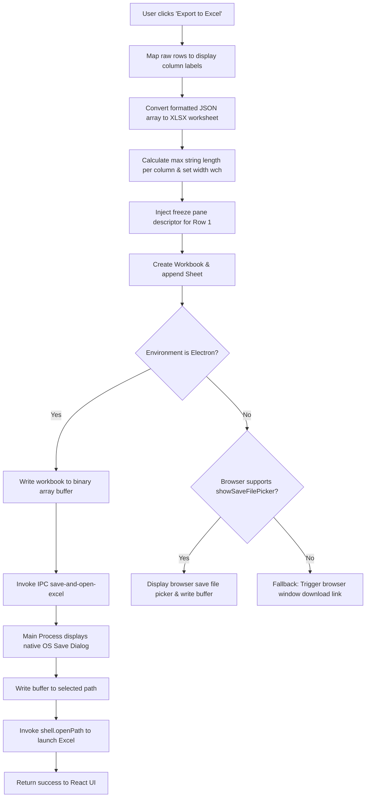

#### Core Implementation Code (src/utils/exportUtils.js):
```javascript
import * as XLSX from 'xlsx';

export const exportToExcel = async (data, columns, fileName = 'Export', forceDownload = false) => {
  if (!data || data.length === 0) return;

  // 1. Dynamically map data to column labels
  const formattedData = data.map(item => {
    const rowObj = {};
    columns.forEach(col => {
      rowObj[col.label] = item[col.key] || '';
    });
    return rowObj;
  });

  // 2. Convert JSON to Worksheet
  const worksheet = XLSX.utils.json_to_sheet(formattedData);

  // 3. Auto-fit column widths
  const colWidths = columns.map(col => {
    const headerLen = col.label.length;
    const maxContentLen = formattedData.reduce((max, row) => {
      const val = row[col.label] ? row[col.label].toString().length : 0;
      return Math.max(max, val);
    }, headerLen);
    return { wch: maxContentLen + 2 }; 
  });
  worksheet['!cols'] = colWidths;

  // 4. Freeze the first header row
  worksheet['!freeze'] = { xSplit: 0, ySplit: 1, topLeftCell: 'A2', activePane: 'bottomLeft', state: 'frozen' };

  // 5. Create a new Workbook and append the worksheet
  const workbook = XLSX.utils.book_new();
  XLSX.utils.book_append_sheet(workbook, worksheet, 'Data');

  // Generate timestamped filename
  const today = new Date().toISOString().split('T')[0];
  const finalFileName = `${fileName}_${today}.xlsx`;

  // 6. Request Save Location Window & Native Open
  try {
    const isElectron = navigator.userAgent.toLowerCase().includes('electron');
    if (isElectron && (window.electron || window['require'])) {
      const buffer = XLSX.write(workbook, { bookType: 'xlsx', type: 'array' });
      let result;
      if (window.electron) {
        result = await window.electron.saveAndOpenExcel(buffer, finalFileName);
      } else {
        const { ipcRenderer } = window['require']('electron');
        result = await ipcRenderer.invoke('save-and-open-excel', { 
          buffer: buffer, 
          defaultName: finalFileName 
        });
      }
      if (!result.success && !result.canceled) {
        throw new Error("Failed to save via IPC");
      }
    } else if (window.showSaveFilePicker && !forceDownload) {
      const opts = {
        suggestedName: finalFileName,
        types: [{
          description: 'Excel Workbook',
          accept: {'application/vnd.openxmlformats-officedocument.spreadsheetml.sheet': ['.xlsx']},
        }],
      };
      const handle = await window.showSaveFilePicker(opts);
      const writable = await handle.createWritable();
      
      const buffer = XLSX.write(workbook, { bookType: 'xlsx', type: 'array' });
      await writable.write(buffer);
      await writable.close();
    } else {
      XLSX.writeFile(workbook, finalFileName);
    }
  } catch (err) {
    if (err.name !== 'AbortError' && err.message !== 'The user aborted a request.') {
      console.error(err);
      throw err;
    }
  }
};
```

---

## 10. Verification & Quality Assurance (QA)

### 10.1 Automated UI Click Testing
To test interface stability, we ran automated test scripts (`test_all_views.js`) inside the Electron renderer. The script:
1. Launches the packaged Electron build interface.
2. Programmatically triggers click events on all sidebar navigation links (Dashboard, OPD Log, Dispensing, Stock, Annual Exams, Injury log, etc.).
3. Waits 1.5 seconds per view while scanning console outputs for errors or layout warnings.
4. Verifies that all modules load and render without console errors.

### 10.2 Clean Installation Sandbox Validation
We verified clean installation behavior using testing scripts (`test_clean_install.js`) that clear database logs on boot:

```javascript
// Clean test runner execution
localStorage.clear();
await getDB().then(db => {
  const tx = db.transaction([DATA_STORE, META_STORE], 'readwrite');
  tx.objectStore(DATA_STORE).clear();
  tx.objectStore(META_STORE).clear();
});
window.location.reload();
```

The application successfully loaded blank spreadsheet sheets, initialized default column definitions, and generated serial numbers without errors on a clean launch.

### 10.3 Security Hardening
- **Content Security Policy (CSP):** Employs meta headers restricting remote scripts execution:
  ```html
  <meta http-equiv="Content-Security-Policy" content="default-src 'self'; script-src 'self' 'unsafe-inline'; style-src 'self' 'unsafe-inline'; img-src 'self' data:; connect-src 'self';">
  ```
- **Error Boundaries:** The application routes rendering blocks through `ErrorBoundary.jsx`. If a custom formula evaluation returns `#ERROR!`, the boundaries catch the exception and keep the rest of the application running.
- **State-Safe Object Cloning:** Grid transactions clone row objects (`const newRow = { ...row }`) before calculation, preventing state mutation errors in React's strict mode.

---

## 11. Project Outcomes, Results & Future Scope

### 11.1 Before-vs-After Operational Metrics

| Operational Task | Paper Ledger System (Before) | Digital JSPulse OHMS (After) | Improvement Metric |
| :--- | :--- | :--- | :--- |
| Recording OPD visits | Hand-written in register books (1-2 mins) | Keyboard entries in ExcelGrid (10-15 secs) | ~80% faster entry |
| Dispensing medicines | Manually copied from OPD log (1 min) | Auto-syncs to dispensing log (Instant) | Redundant entry eliminated |
| Stock deductions | Recalculated by hand daily (30 mins) | Automated on dispense save (Instant) | Human error eliminated |
| Finding expired drugs | Manual shelf checks | Highlighted red in stock grid | Automated alerts |
| Auditing compliance | Manual page-by-page checks | One-click Excel/PDF exports | Audit-ready in seconds |

### 11.2 Achievements & Compliance Improvements
- **100% Digital Logs:** Successfully digitized all paper registers into IndexedDB sheets.
- **Automated Data Flows:** Linked OPD logs, dispensing records, and stock registers to reduce manual data entry.
- **Factories Act Audit Ready:** Color-coded warnings highlight expired medicines and overdue medical checkups.
- **Offline Reliability:** Complete offline capability keeps the system functional during plant network drops.

### 11.3 Recommended Future Extensions
1. **Barcode Scanners:** Support USB barcode scanners in the dispensing module to speed up drug checks.
2. **OCR Prescription Scanner:** Integrate camera scanner APIs to read printed prescriptions.
3. **Encrypted Cloud Sync:** Enable secure cloud backups when network connections are active.

---

## 12. References
1. *The Factories Act, 1948 (Act No. 63 of 1948)*, Ministry of Labour and Employment, Government of India.
2. React 19 Documentation, *https://react.dev/*.
3. Electron JS Security Guidelines, *https://www.electronjs.org/docs/latest/tutorial/security*.
4. IndexedDB API Specifications, *https://developer.mozilla.org/en-US/docs/Web/API/IndexedDB_API*.
5. Recharts Charting Library reference, *https://recharts.org/*.
