# JSPulse OHMS — Occupational Health Management System Software

[](https://www.electronjs.org/)
[](https://react.dev/)
[](https://vitejs.dev/)
[](https://tailwindcss.com/)
[](https://github.com/ashwini2619a/JSPulse-Occupational-Health-Management-System-Software)
[](https://github.com/ashwini2619a/JSPulse-Occupational-Health-Management-System-Software/releases)
[](#license)

> **Enterprise-grade, offline-first clinical and occupational health desktop system engineered for the Occupational Health Centre (OHC) at Jindal Steel Patratu.**

---

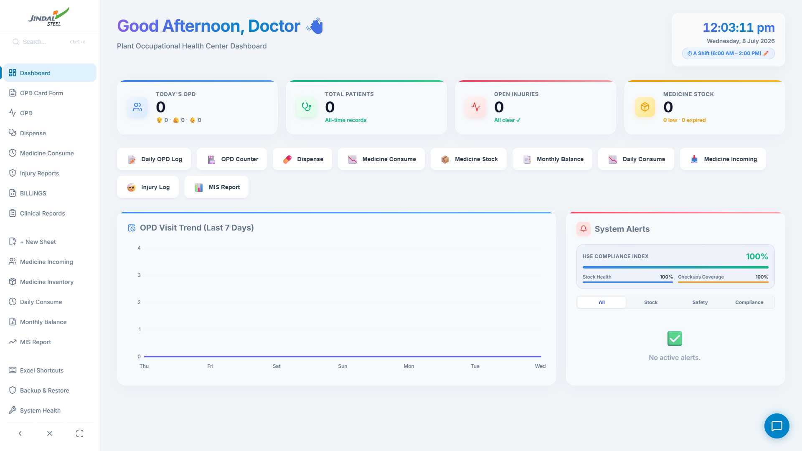

---

## 📑 Table of Contents

- [Executive Overview](#-executive-overview)
- [Industrial Context & Historical Challenges](#-industrial-context--historical-challenges)
- [System Architecture & Core Algorithms](#-system-architecture--core-algorithms)
  - [1. Quota-Bypassing Storage Proxy](#1-quota-bypassing-storage-proxy-5mb-quota-bypass)
  - [2. DOM Viewport Virtualization Engine](#2-dom-viewport-virtualization-engine)
  - [3. Spreadsheet Formula Evaluation Engine](#3-spreadsheet-formula-evaluation-engine)
  - [4. Automated OPD-to-Pharmacy Pipeline](#4-automated-opd-to-pharmacy-pipeline)
  - [5. Hybrid Offline AI Clinical Assistant (ChatBrain)](#5-hybrid-offline-ai-clinical-assistant-chatbrain)
- [Key Modules & Feature Showcase](#-key-modules--feature-showcase)
- [Project Directory Structure](#-project-directory-structure)
- [Statutory Compliance & Standards](#-statutory-compliance--standards)
- [Getting Started & Installation](#-getting-started--installation)
- [Production Build & Enterprise Deployment](#-production-build--enterprise-deployment)
- [Author & Acknowledgements](#-author--acknowledgements)

---

## 🏥 Executive Overview

**JSPulse OHMS** is a mission-critical desktop workstation application designed to modernize clinical healthcare operations, drug inventory control, and statutory health audits at the **Occupational Health Centre (OHC)** of **Jindal Steel Patratu**. 

Operating in high-hazard industrial manufacturing environments requires infallible uptime, zero network dependency, real-time safety checks against drug contraindications, and instant access to years of employee health histories. JSPulse OHMS replaces legacy physical registers with an automated, synchronized, offline-first platform capable of processing hundreds of daily patient consultations and managing 100,000+ medical records with sub-millisecond responsiveness.

---

## 🏭 Industrial Context & Historical Challenges

Prior to JSPulse OHMS, the OHC at Jindal Steel Patratu relied entirely on manual paper ledgers, which created operational and regulatory risks:

```
┌─────────────────────────────────────────────────────────────────────────────────┐
│                    MANUAL OHC BOTTLENECKS (PRIOR TO JSPULSE)                    │
├──────────────────────────┬──────────────────────────┬───────────────────────────┤
│    Data Redundancy       │     Inventory Risks      │    Regulatory Audit Lag   │
│  Double ledger entries   │    Zero expiry alerts    │  Form 21 injury records   │
│ between OPD doctor desk  │   leading to near-expiry │ hand-compiled from logs;  │
│ and physical dispensary. │   risks & stockouts of   │ days of manual searching  │
│ Shift-end tallies took   │  emergency life-saving   │  to compile monthly plant │
│ hours of manual tallying.│     medications.         │       MIS reports.        │
└──────────────────────────┴──────────────────────────┴───────────────────────────┘
```

1. **High Redundancy & Administrative Drag:** Medical officers hand-wrote prescriptions, which pharmacists then manually re-transcribed into dispensing ledgers.
2. **Critical Stockouts & Expiry Vulnerability:** No automated minimum-level warnings or early-expiry notifications existed, creating severe risks for plant emergency responses.
3. **Clinical Transcription & Interaction Errors:** Illegible prescription handwriting risked dispensing mistakes, and there was no proactive mechanism to detect drug-to-drug interactions (e.g., NSAIDs combined with anticoagulants).
4. **Factories Act (1948) Compliance Bottlenecks:** Compiling **Form 21 (Accident & Injury Register)**, Periodic Medical Examination (PME) records, and Directorate of Industrial Health & Safety audit reports took days of manual record recovery.

---

## ⚡ System Architecture & Core Algorithms

```
┌─────────────────────────────────────────────────────────────────────────────────┐
│                             ELECTRON MAIN PROCESS                               │
│       • Single Instance Lock (requestSingleInstanceLock)                        │
│       • Desktop Storage IPC Bridge (Window File System: userData/storage.json)  │
│       • Native Chromium Headless PDF Print-to-PDF Bridge                        │
│       • Native SheetJS Excel Binary Exporter (save-and-open-excel)              │
└────────────────────────────────────────┬────────────────────────────────────────┘
                                         │ Context-Isolated Preload Bridge
┌────────────────────────────────────────▼────────────────────────────────────────┐
│                        REACT 19 + VITE UI ENGINE                                │
│                                                                                 │
│   ┌───────────────────────┐  ┌───────────────────────┐  ┌───────────────────┐   │
│   │  Executive Dashboard  │  │   OPD Consultation    │  │ Pharmacy Dispense │   │
│   │  & Predictive Charts  │  │   & Prescription Form │  │ Queue & Auto-Pull │   │
│   └───────────┬───────────┘  └───────────┬───────────┘  └─────────┬─────────┘   │
│               │                          │                        │             │
│   ┌───────────▼──────────────────────────▼────────────────────────▼─────────┐   │
│   │              Background Sync Engine (src/utils/backgroundSync.js)        │   │
│   │              • Sweeps unextracted patient visits every 10–20s           │   │
│   │              • Auto-deducts shift inventory across 7 clinical sections  │   │
│   └──────────────────────────────────────┬──────────────────────────────────┘   │
│                                          │                                      │
│   ┌──────────────────────────────────────▼──────────────────────────────────┐   │
│   │          Custom Storage Proxy Engine (src/main.jsx)                     │   │
│   │          • In-Memory Map Cache (0ms latency React rendering)            │   │
│   │          • Transparent sync to native Windows filesystem (No 5MB Cap)   │   │
│   └─────────────────────────────────────────────────────────────────────────┘   │
└─────────────────────────────────────────────────────────────────────────────────┘
```

### 1. Quota-Bypassing Storage Proxy (5MB Quota Bypass)
* **Location:** [`src/main.jsx`](src/main.jsx) & [`electron/main.js`](electron/main.js)
* Standard browser `localStorage` is hard-capped at 5MB. JSPulse OHMS injects a synchronous JavaScript `Proxy` over `window.localStorage`. 
* Reads and writes are cached synchronously in an in-memory dictionary for instant React render cycles, while changes are asynchronously flushed via Electron IPC to `userData/localstorage.json` on the native Windows drive. This architecture allows storage of 100,000+ clinical consultations without storage overflow errors.

### 2. DOM Viewport Virtualization Engine
* **Location:** [`src/components/clinical/ExcelGrid.jsx`](src/components/clinical/ExcelGrid.jsx)
* Rendering tens of thousands of spreadsheet cells simultaneously overloads Chromium paint threads.
* The virtualization algorithm dynamically computes vertical scroll offsets (`scrollTop`), rendering only the rows within the active viewport window (plus a 150px prefetch buffer). Invisible rows are replaced with dynamic top and bottom spacer DOM elements, preserving precise scroll heights while keeping frame rates at a constant 60 FPS.

### 3. Spreadsheet Formula Evaluation Engine
* **Location:** [`src/components/clinical/ExcelGrid.jsx`](src/components/clinical/ExcelGrid.jsx)
* Powers native Excel-style calculations (such as `=SUM(A1:B20)`, `=AVERAGE()`, and mathematical expressions) directly inside clinical sheets.
* Implements a recursive cell-coordinate parser with depth limiters and circular-reference traps to prevent UI lockups during complex aggregations.

### 4. Automated OPD-to-Pharmacy Pipeline
* **Location:** [`src/utils/backgroundSync.js`](src/utils/backgroundSync.js) & [`src/components/DispenseMedicine.jsx`](src/components/DispenseMedicine.jsx)
* An autonomous background sync worker sweeps `cms_patient_visit_log` every 10 to 20 seconds.
* Prescriptions marked `extracted: false` are parsed (normalizing medicine names, dosages, and quantities) and copied into the active dispensing log (`cms_dispense_log`).
* As pharmacists fulfill orders, stock deductions automatically cascade to the master stock register (`cms_medstock_data`) and the annual monthly balance sheet (`cms_yearly_monthly_balance`) partitioned across shifts (1st, 2nd, 3rd, General) and clinical sections.

### 5. Hybrid Offline AI Clinical Assistant (ChatBrain)
* **Location:** [`src/components/ChatAssistant.jsx`](src/components/ChatAssistant.jsx) & [`src/utils/chatBrain.js`](src/utils/chatBrain.js)
* Provides a floating natural language assistant for doctors and administrative staff.
* Checks network status via `navigator.onLine`. If online, queries the Google Gemini API for medical queries; if offline, executes deterministic NLP vector matching against local IndexedDB datasets for medicine inventory lookups, patient histories, and guideline lookups.

---

## 🖥️ Key Modules & Feature Showcase

### 1. Executive Intelligence Dashboard
Real-time operational dashboard with live OPD volume tracking, gender demographics (Male/Female/Child), department visit trends, injury counters, and critical near-expiry / low-stock alert notifications.


---

### 2. Out-Patient Department (OPD) Consultation Counter
Allows medical officers to record employee vitals (BP, Pulse, SpO2, Temperature), search past clinical history by Employee ID, prescribe multiple medicines dynamically, and tag diagnoses.

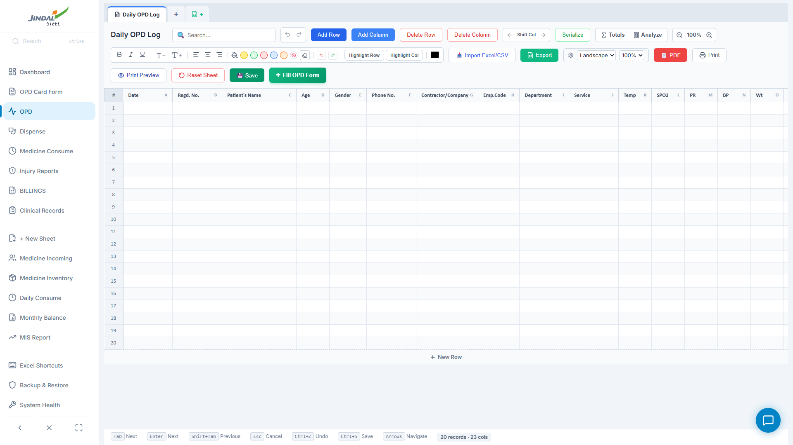

---

### 3. Standardized Printable A4 OPD Card
Generates standardized, print-ready prescription cards with barcodes, hospital branding, patient vitals, diagnosis, and prescription schedules. Integrated with Electron's headless PDF print engine.

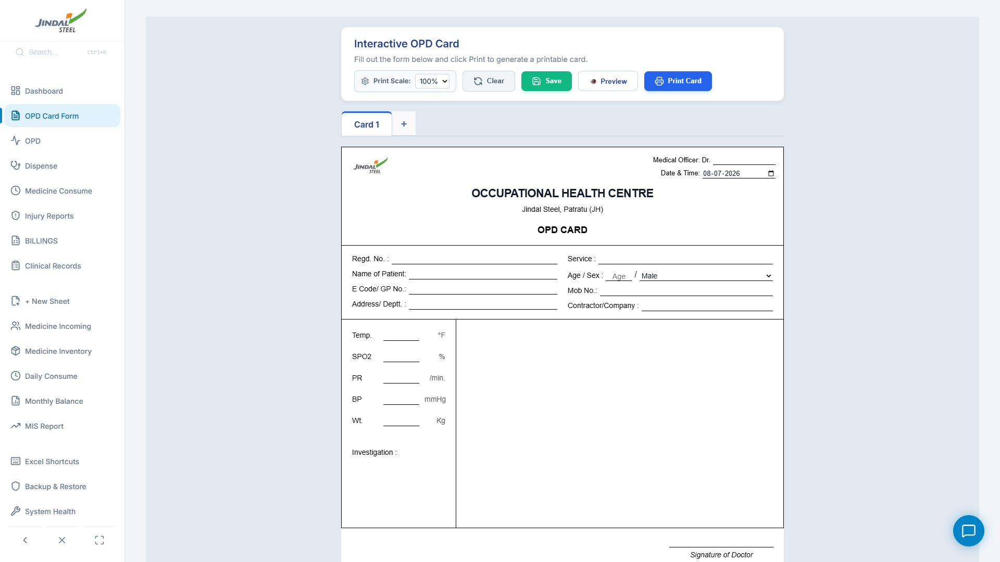

---

### 4. Real-Time Pharmacy Dispensing Queue
Automatically pulls pending doctor prescriptions into an organized queue. Pharmacists can review drug details, verify dosages, and mark prescriptions as dispensed with one click.

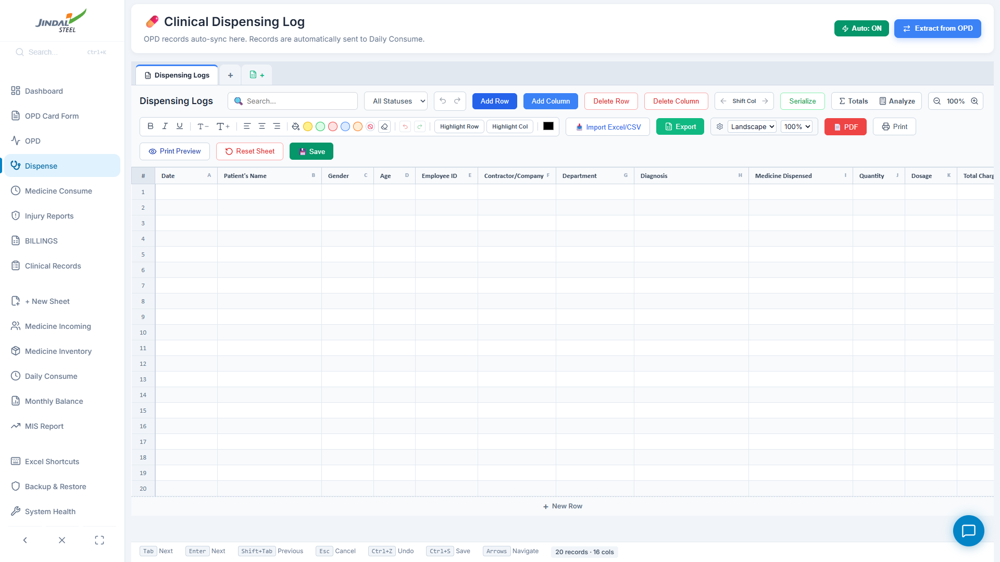

---

### 5. Master Medicine Stock Register
Comprehensive drug registry tracking trade names, generic compositions, batch numbers, manufacturer info, units of measurement, expiry dates, minimum buffer thresholds, and current stock.

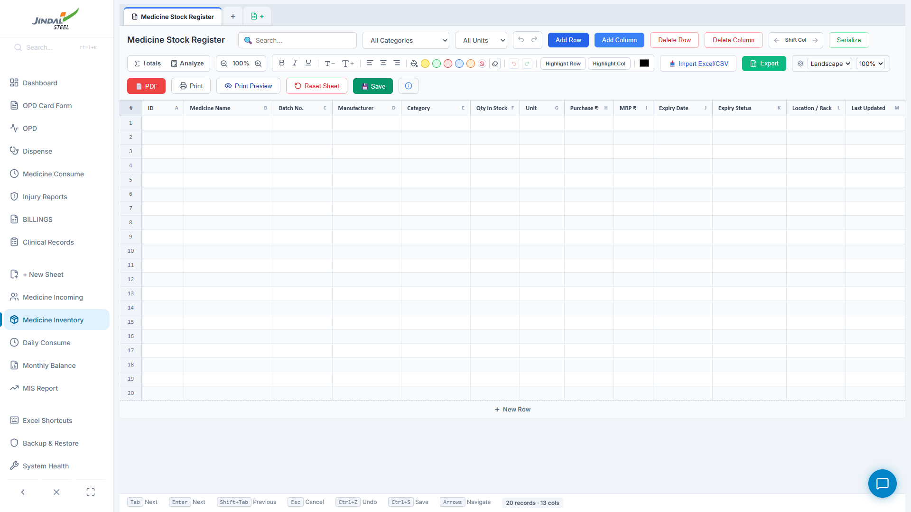

---

### 6. Daily Shift & Section Consumption Matrix
Detailed multi-column daily consumption sheet tracking medicine utilization across 4 plant shifts (A, B, C, General) and 7 clinical sections (OHC Counter, Dressing, Life Saving, First Aid, Physio, PME, Expired).

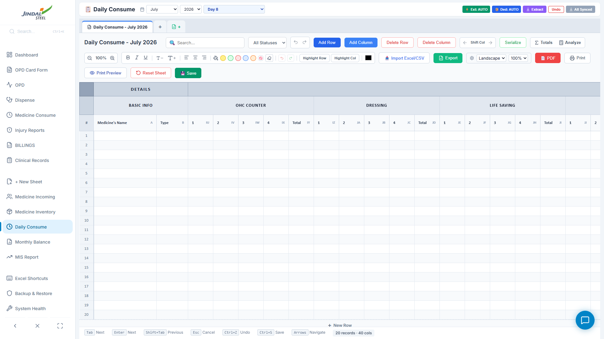

---

### 7. Annual Month-by-Month Stock Balance Ledger
Yearly balance sheet calculating opening balance, monthly incoming receipts, monthly consumption, and closing balances for all 12 calendar months with automated annual rollover.

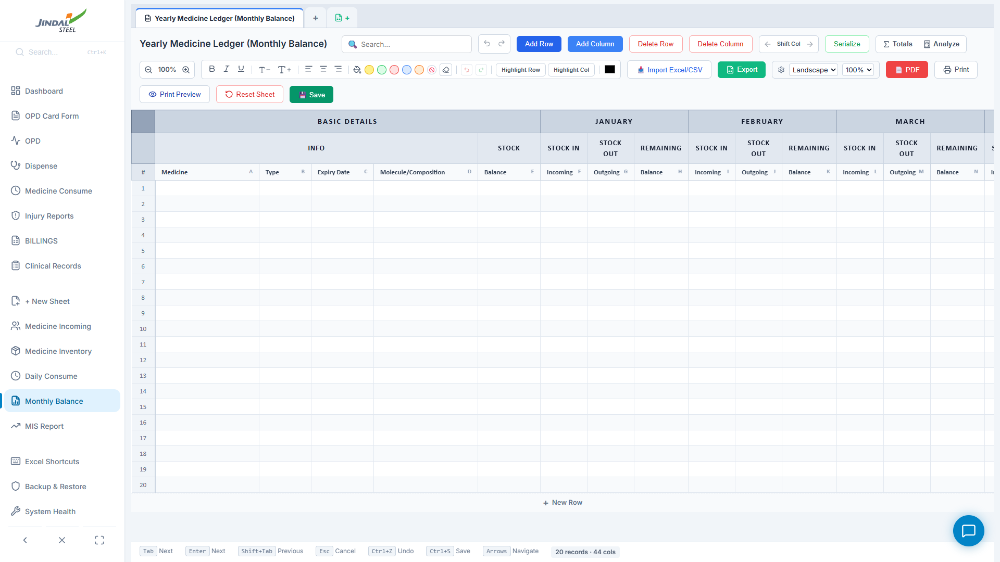

---

### 8. Monthly MIS Plant Health Report
Automated Management Information System (MIS) compiling monthly plant-wide employee health data, morbidity categories, department injury rates, and chronic disease registries for senior leadership and audit teams.

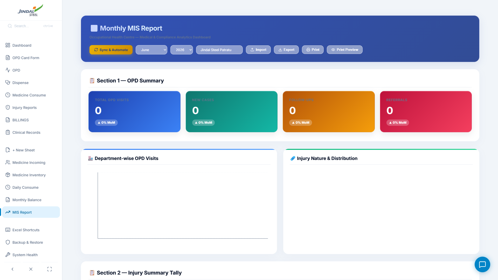

---

### 9. Database Backup, Snapshot & Disaster Recovery
Integrated backup and recovery utility supporting complete database exports, automated snapshot creation, and one-click JSON restore to protect against hardware failure.

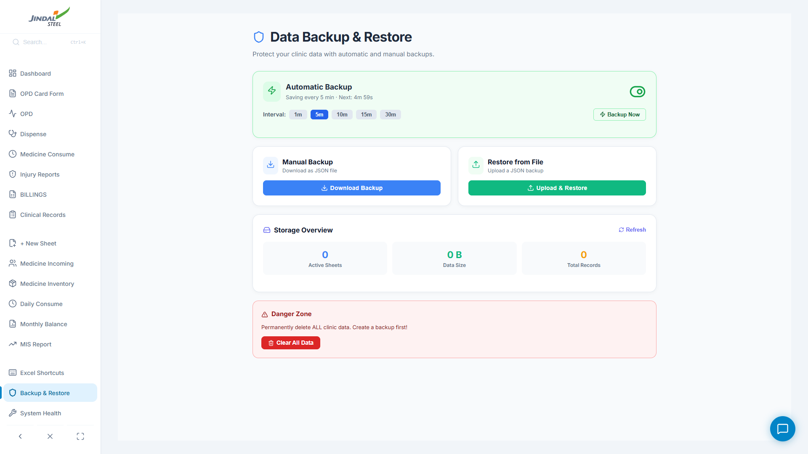

---

### 10. System Health & Diagnostic Suite
Diagnostic suite for verifying IndexedDB integrity, checking storage consumption, auditing schema versions, repairing corrupted keys, and monitoring background sync performance.

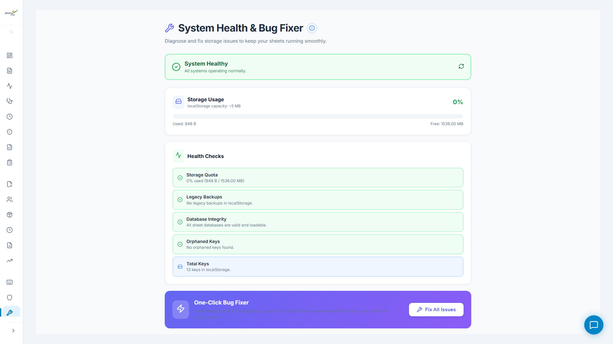

---

### 11. Built-in Keyboard Shortcuts Reference
High-efficiency keyboard shortcut reference enabling rapid navigation, full-screen grid viewing, view switching (`Alt + ←/→`), search indexing (`Ctrl + K`), and print shortcuts (`Ctrl + P`).

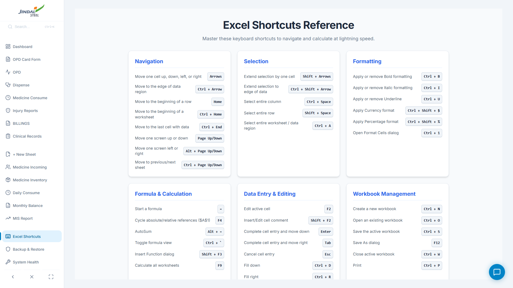

---

## 📂 Project Directory Structure

```
JSPulse-OHMS/
├── .agents/                    # Multi-agent cognitive rules & guidelines
├── build/                      # Build assets, application icons (.ico, .png)
├── electron/                   # Native desktop runtime
│   ├── main.js                 # Electron main process, IPC handlers, single-instance lock
│   └── preload.js              # Context-isolated IPC secure bridge
├── public/                     # Public static assets, SVG icons, plant logos
├── screenshots/                # Comprehensive UI module screenshot suite
├── src/                        # React 19 application source code
│   ├── assets/                 # Brand assets, logos, and illustration vectors
│   ├── components/             # Core UI components
│   │   ├── clinical/           # Clinical & medical management components
│   │   │   ├── AdvancedPatientRecords.jsx
│   │   │   ├── ClinicalRecords.jsx
│   │   │   ├── DailyConsume.jsx        # Shift consumption matrix
│   │   │   ├── DailyOPDTally.jsx       # OPD tally sheets
│   │   │   ├── DataBackupRestore.jsx   # Backup & disaster recovery
│   │   │   ├── ExcelGrid.jsx           # Virtualized spreadsheet engine
│   │   │   ├── FirstAidBoxTracker.jsx  # Plant first aid box audit log
│   │   │   ├── InjuryReportLog.jsx     # Form 21 Industrial Injury Log
│   │   │   ├── MedicineStockRegister.jsx
│   │   │   ├── MonthlyBalance.jsx      # 12-Month stock balance ledger
│   │   │   ├── MonthlyMISReport.jsx    # Monthly health MIS report
│   │   │   ├── OPDCardPrintable.jsx    # A4 printable prescription card
│   │   │   ├── OPDCounter.jsx          # Doctor consultation counter
│   │   │   ├── ShortcutsReference.jsx  # Hotkeys reference modal
│   │   │   └── SystemHealthTool.jsx    # Diagnostics & integrity auditing
│   │   ├── ChatAssistant.jsx   # Hybrid AI clinical assistant
│   │   ├── Dashboard.jsx       # Executive KPI intelligence hub
│   │   ├── DispenseMedicine.jsx# Automated pharmacy queue
│   │   ├── ErrorBoundary.jsx   # Fault-tolerant crash isolation
│   │   ├── GlobalSearch.jsx    # Universal search indexer (Ctrl+K)
│   │   ├── InteractionChecker.jsx # Contraindication safety checker
│   │   └── Navbar.jsx          # Collapsible responsive navigation bar
│   ├── utils/                  # Core logic, storage, & background pipelines
│   │   ├── backgroundSync.js   # Automated OPD-to-pharmacy sync engine
│   │   ├── backupDB.js         # Backup serializer & snapshot generator
│   │   ├── chatBrain.js        # Offline NLP & Gemini routing
│   │   ├── exportUtils.js      # Excel (.xlsx) and PDF exporter
│   │   ├── sheetDB.js          # IndexedDB wrapper (JSPulseOHMS_Sheets)
│   │   └── storage.js          # Synchronous local storage bridge
│   ├── App.jsx                 # View router, global hotkeys, background workers
│   ├── index.css               # Design system & dark theme tokens
│   └── main.jsx                # Storage Proxy quota bypass & root bootstrap
├── package.json                # Project dependencies, build scripts & metadata
└── vite.config.js              # Vite bundling, PWA & React build configuration
```

---

## ⚖️ Statutory Compliance & Standards

JSPulse OHMS satisfies statutory occupational health standards and mandates:

- **The Factories Act, 1948 (Section 88 / 90):** Automated generation of **Form 21 (Report of Accidents / Fatal Accidents)** with body-part mapping, accident causation, and shift logs.
- **Periodic Medical Examination (PME) Mandates:** Digital record-keeping for statutory employee health checks (Audiometry, Pulmonary Function Tests / Spirometry, Vision, Blood Profiles).
- **Audit-Ready Exporting:** Instant generation of Excel and PDF reports for State Pollution Control Boards, Factory Inspectors, and Corporate HSE audits.

---

## 🚀 Getting Started & Installation

### Prerequisites
* **Node.js**: v18.0.0 or higher
* **npm**: v9.0.0 or higher
* **OS**: Windows 10 / 11 (x64)

### 1. Clone the Repository
```bash
git clone https://github.com/ashwini2619a/JSPulse-Occupational-Health-Management-System-Software.git
cd JSPulse-Occupational-Health-Management-System-Software
```

### 2. Install Dependencies
```bash
npm install
```

### 3. Launch in Development Mode
Launches the Vite HMR dev server concurrently with the Electron desktop shell:
```bash
npm run electron:dev
```

---

## 📦 Production Build & Enterprise Deployment

### Compiling Windows Installer (NSIS)
To compile an optimized, standalone Windows installer (`.exe`):
```bash
npm run electron:build
```
The compiled installer will be output to:
```
dist-final/JSPulse OHMS Setup.exe
```

### Unattended Enterprise Distribution (Silent Install)
For plant-wide IT distribution across multiple workstations, silent installation is supported:
```cmd
"JSPulse OHMS Setup.exe" /S /D=C:\Program Files\JSPulseOHMS
```

---

## 👨‍💻 Author & Acknowledgements

* **Lead Architect & Developer:** **Ashwini Kumar** ([@ashwini2619a](https://github.com/ashwini2619a))
* **Deployment Site:** **Occupational Health Centre (OHC)**, Jindal Steel Patratu, Ramgarh, Jharkhand.
* **Institutional Support:** RVS College of Engineering & Technology, Jamshedpur.

---

## 📄 License

This software and its documentation are proprietary and confidential. Developed specifically for the Occupational Health Centre at Jindal Steel Patratu. All rights reserved.
